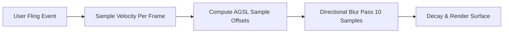

# Shevery UI/UX Design System Specification (`DESIGN.md`)

> **Project**: Shevery (Elevated Android Privileged Automation & Manager)  
> **Target Platforms**: Android 7.0 to Android 17 (API 24–37), Android TV, Modern Web (Next.js 14)  
> **UI Architecture**: 100% Jetpack Compose (Android) + Material 3 Expressive + Next.js / Tailwind CSS (Web)  
> **Reference Codebase**: [`/home/krishna/Downloads/tv/Shizuku implementations/shevery`](file:///home/krishna/Downloads/tv/Shizuku%20implementations/shevery)

---

## 1. Design Philosophy & Vision

Shevery transforms low-level, developer-centric Android ADB and root daemon capabilities into a tactile, elegant, and secure user experience. The interface bridges two contrasting paradigms: **system-level engineering power** and **Material 3 Expressive consumer refinement**.

### Core Tenets
1. **Material 3 Expressive First**: High-curvature surfaces (`24dp` to `28dp` rounded corners), expressive spring-based motion, and adaptive visual weight.
2. **Velocity-Driven Tactility**: Visual feedback that responds to user momentum, incorporating real-time directional AGSL motion blur shaders during scrolls and swipes.
3. **Dual Form-Factor Fluidity**: Seamlessly adapts from touch-first mobile screens and foldable devices to D-Pad driven Android TV leanback environments and responsive web dashboards.
4. **Intelligible Security Topology**: Complex multi-process privilege states (Root UID 0, Shell UID 2000, Device Owner DPM, isolated UserServices) are visualized with clear color tokens, state badges, and contextual warnings.
5. **Human-AI Co-Execution (Comput & Commandium)**: Integrated AI interfaces allow users to generate, inspect, and review privileged shell commands with natural language before execution.

---

## 2. Color Palette & Dynamic Theming Tokens

Shevery utilizes Google's **Material 3 Color Scheme** system with dynamic wallpaper extraction (Monet), while providing curated branded palettes and a true **AMOLED Pitch Black** mode.

### 2.1 Brand Color Palette (Indigo Expressive)

| Token Name | Light Mode Value | Dark Mode Value | Semantic Role |
| :--- | :--- | :--- | :--- |
| `primary` | `#3F51B5` (Indigo) | `#B1B8DF` (Soft Lavender) | Primary interactive actions, active indicators, brand identity |
| `onPrimary` | `#FFFFFF` | `#1A237E` | Text and icons placed on top of `primary` |
| `primaryContainer` | `#E0E3F8` | `#283593` | Tonal button containers, active navigation pill backgrounds |
| `onPrimaryContainer` | `#0D165C` | `#DCE1FF` | Text and icons inside `primaryContainer` |
| `secondary` | `#52669B` | `#B9C7E8` | Secondary controls, badge accents, category chips |
| `tertiary` | `#8C4A62` (Mulberry) | `#E2B8C8` | AI highlights (Comput / Commandium), warning badges |
| `surface` | `#FFFFFF` | `#131318` | Base background color for screens and sheets |
| `surfaceContainer` | `#F2F4FB` | `#1E1F25` | Grouped cards, elevated panels, floating search bars |
| `surfaceContainerHigh` | `#E8EAF3` | `#282A31` | Nested grouped items, elevated dialog surfaces |
| `surfaceContainerHighest`| `#DFE2EC` | `#33353D` | Active selection backgrounds, monospace log containers |
| `outline` | `#74777F` | `#8E9099` | Subtle structural borders (0.5dp to 1dp) |
| `error` | `#BA1A1A` | `#FFB4AB` | Daemon stoppage, root elevation errors, security alerts |

### 2.2 AMOLED Deep Black Theme Mode
For maximum OLED battery efficiency and visual immersion:
- `surface` = `#000000` (Pitch Black)
- `surfaceContainer` = `#0B0B0B`
- `surfaceContainerHigh` = `#161616`
- Card borders utilize an ultra-subtle `outline-variant` tint (`rgba(255, 255, 255, 0.08)`) to maintain component edges without color contamination.

### 2.3 Dynamic Color Support (Monet)
On Android 12+ (API 31+), Shevery automatically queries system wallpaper tonal palettes via [`dynamicLightColorScheme()`](file:///home/krishna/Downloads/tv/Shizuku%20implementations/shevery/manager/src/main/java/moe/shizuku/manager/ui/compose/ShizukuExpressive.kt) and `dynamicDarkColorScheme()`, tinting all containers dynamically.

---

## 3. Typography & Text Hierarchy

Shevery relies on modern geometric sans-serif typefaces (`Roboto Flex` / `Google Sans`) with precise numerical tabulation for system metrics:

| Style Role | Font Weight | Size / Line Height | Tracking | Usage |
| :--- | :--- | :--- | :--- | :--- |
| `displaySmall` | Bold (700) | 36sp / 44sp | 0sp | Hero dashboard metrics, daemon status banners |
| `headlineMedium` | SemiBold (600) | 28sp / 36sp | 0sp | Screen titles (Application Management, Module Catalog) |
| `titleLarge` | SemiBold (600) | 22sp / 28sp | 0sp | Grouped card headers, modal dialog titles |
| `titleMedium` | Medium (500) | 16sp / 24sp | +0.15sp | App names, settings tile primary labels |
| `bodyLarge` | Regular (400) | 16sp / 24sp | +0.5sp | Descriptive paragraphs, permission explanations |
| `bodyMedium` | Regular (400) | 14sp / 20sp | +0.25sp | Settings secondary subtitles, package IDs |
| `labelLarge` | Medium (500) | 14sp / 20sp | +0.1sp | Button action text, tab labels, interactive chips |
| `monospace` | Monospace (500)| 13sp / 18sp | 0sp | Shell command outputs, AIDL method signatures, tokens |

---

## 4. Motion, Physics & Hardware Shader Design

Shevery's motion design emphasizes momentum, organic deceleration, and continuous spatial continuity.

### 4.1 AGSL Directional Scroll Velocity Motion Blur
Implemented in [`MotionBlur.kt`](file:///home/krishna/Downloads/tv/Shizuku%20implementations/shevery/manager/src/main/java/moe/shizuku/manager/ui/compose/MotionBlur.kt):
- **AGSL Runtime Shader**: Available on Android 13+ (API 33+), Shevery injects an inline AGSL shader (`RuntimeShader`) that samples scrolling velocity on every frame via `withFrameNanos`.
- **Directional Adaptation**:
  - Horizontal tab swipe = Horizontal directional blur.
  - Vertical list fling = Vertical directional blur.
- **Kernel Formulation**:
  A 10-sample kernel elongates the pixel buffers along the velocity vector:
  $$\text{blurMagnitude} = \text{clamp}(\text{scrollVelocity} \times 22.0 \times \text{blurScale}, -60.0, 60.0)$$
- **Decay & Clamping**: Velocity decays exponentially on finger release to eliminate abrupt visual snapping.



### 4.2 Navigation Physics
- **Floating Pill Morphing**: The active indicator in [`ExpressiveFloatingNavigationBar`](file:///home/krishna/Downloads/tv/Shizuku%20implementations/shevery/manager/src/main/java/moe/shizuku/manager/ui/compose/ShizukuExpressive.kt) uses `spring(dampingRatio = Spring.DampingRatioMediumBouncy, stiffness = Spring.StiffnessMediumLow)`:
  - As the finger drags between tabs, the pill stretches horizontally (pill morphing) before snapping onto the destination item.
- **Shared Axis Tab Transitions**: Screen transitions slide and crossfade along the horizontal axis, synchronized with the bottom navigation pill.

---

## 5. Component System & Design Hierarchy

All UI components in Shevery are implemented in [`ShizukuExpressive.kt`](file:///home/krishna/Downloads/tv/Shizuku%20implementations/shevery/manager/src/main/java/moe/shizuku/manager/ui/compose/ShizukuExpressive.kt).

### 5.1 Structural Scaffolding
- [`ShizukuScaffold`](file:///home/krishna/Downloads/tv/Shizuku%20implementations/shevery/manager/src/main/java/moe/shizuku/manager/ui/compose/ShizukuExpressive.kt#L387): Root layout handling edge-to-edge system bars (`WindowInsets.navigationBars`), keyboard adjustments (`WindowInsets.ime`), and collapsing top app bars.
- [`ShizukuLazyScaffold`](file:///home/krishna/Downloads/tv/Shizuku%20implementations/shevery/manager/src/main/java/moe/shizuku/manager/ui/compose/ShizukuExpressive.kt#L442): Optimized for high-throughput scrolling lists (Apps, Modules, Logs), binding LazyListState directly to the directional motion blur pipeline.

### 5.2 Card Architecture: `ExpressiveCard`
- Curvature: `RoundedCornerShape(24.dp)` to `28.dp`.
- Padding: Internal `16.dp` padding with `12.dp` inter-card spacing.
- Visual States:
  - **Standard**: Container color `surfaceContainer`, 0dp elevation, subtle `0.5dp` outline border.
  - **Hover / Press**: Scale down to `0.98x` with instant tonal elevation to `surfaceContainerHigh`.
  - **Danger / Alert**: Container tinted to `errorContainer`, borders tinted to `error`, icons colored `onErrorContainer`.

### 5.3 Grouped Settings Architecture (iOS / OneUI Hybrid)
- [`SettingsGroup`](file:///home/krishna/Downloads/tv/Shizuku%20implementations/shevery/manager/src/main/java/moe/shizuku/manager/ui/compose/ShizukuExpressive.kt#L593): Surrounds a collection of settings rows in an outer capsule (`RoundedCornerShape(24.dp)`).
- [`SectionHeader`](file:///home/krishna/Downloads/tv/Shizuku%20implementations/shevery/manager/src/main/java/moe/shizuku/manager/ui/compose/ShizukuExpressive.kt#L620): Small uppercase title (`typography.titleSmall`), accented with `MaterialTheme.colorScheme.primary`.
- [`SettingsRow`](file:///home/krishna/Downloads/tv/Shizuku%20implementations/shevery/manager/src/main/java/moe/shizuku/manager/ui/compose/ShizukuExpressive.kt#L631) & [`SwitchSettingsRow`](file:///home/krishna/Downloads/tv/Shizuku%20implementations/shevery/manager/src/main/java/moe/shizuku/manager/ui/compose/ShizukuExpressive.kt#L697): Consistent 3-part layout:
  1. Leading icon inside circular container (`size = 40.dp`, background `primaryContainer`).
  2. Central text column (Title `titleMedium`, Subtitle `bodyMedium`).
  3. Trailing control (Switch, chevron arrow, or status chip).
- [`GroupDivider`](file:///home/krishna/Downloads/tv/Shizuku%20implementations/shevery/manager/src/main/java/moe/shizuku/manager/ui/compose/ShizukuExpressive.kt#L727): Indented divider separating items inside a group without cutting across the outer border.

### 5.4 Procedural Step Guide: `StepRow`
- Designed for setup wizards (Wireless ADB pairing, root authorization):
  - Left circular numeric badge (`size = 28.dp`, filled with `secondaryContainer`).
  - Right actionable instructional description with inline code highlighting and copy triggers.

### 5.5 Monospace Log Viewer: `MonospaceLog`
- Darkened background (`surfaceContainerHighest`).
- Monospace font rendering with full horizontal scroll and text selection container.
- Tap-to-copy floating action chip.

---

## 6. Information Architecture & Primary Screens

```
                                [ Shevery Main UI ]
                                         |
     +-------------------+---------------+---------------+-------------------+
     |                   |                               |                   |
[ Tab 0: Home ]   [ Tab 1: Apps ]                 [ Tab 2: Modules ]   [ Tab 3: Settings ]
- Daemon Status   - Granted App List              - ADB Module List    - Tasker Automation
- Server Uptime   - Denied App List               - GitHub Catalog     - Device Owner (DPM)
- Quick Triggers  - Granular Permission Editor    - WebUI WebView      - Stealth APK Maker
- Pairing Wizard  - Session-Only Switches         - ZIP Installer      - Comput AI Console
```

### Screen 1: Dashboard (`HomeActivity.kt`)
- **Hero Status Card**:
  - Displays real-time daemon state: `Running` (Green `#4CAF50`), `Stopped` (Red `#F44336`), or `Starting` (Amber `#FF9800`).
  - Technical badges: `UID: 2000 (shell)` or `UID: 0 (root)`, `SELinux: u:r:shell:s0`, and uptime counter (`ServiceUptime.kt`).
- **Activation Cards**:
  - Start via Wireless Debugging (with one-tap pairing dialog).
  - Start via Root (`su`).
  - Start via Computer (displays exact ADB command with copy-to-clipboard button).

### Screen 2: Applications (`ApplicationManagementActivity.kt`)
- **Search & Filter Bar**: Instant search across package names, labels, and permission states.
- **App Detail Drill-in (`AppDetailActivity.kt`)**:
  - Global Shizuku access switch.
  - Session-only authorization switch (revoked when device locks or app process dies).
  - Granular dangerous permission toggles (e.g. `WRITE_SECURE_SETTINGS`, `PACKAGE_USAGE_STATS`).

### Screen 3: Modules & WebUI (`ModulesScreen.kt` & `ModuleWebViewActivity.kt`)
- **Module Tiles**: Displays icon, title, version, author, and enabled/disabled switch.
- **WebUI Launcher**: Launches embedded WebUI running inside an isolated Android WebView.
- **JavaScript Bridge (`ModuleJsBridge.kt`)**: Injects `window.shizuku.exec()` allowing web scripts to run privileged shell commands with a transparent review dialog.

### Screen 4: Comput AI & System Diagnostics (`ComputScreen.kt`)
- **AI Model Selection**: Switch between OpenAI-compatible endpoints, Gemini, Claude, or local on-device models (`AiProvider.kt`).
- **Natural Language Command Review**: Users type natural language intents ("Disable bloatware apps", "Show battery discharge rate"). Comput generates shell commands, explains each flag, and provides an "Execute" button.

---

## 7. Web Application Design System (Next.js & Parametric M3)

Shevery includes a web landing page and interactive simulator built in [`app/page.tsx`](file:///home/krishna/Downloads/tv/Shizuku%20implementations/shevery/app/page.tsx) and [`components/shevery-interactive.tsx`](file:///home/krishna/Downloads/tv/Shizuku%20implementations/shevery/components/shevery-interactive.tsx).

### 7.1 M3 Parametric Polygon Geometry
Rather than relying on raster icons, the web UI uses mathematical parametric SVG polygons inspired by Material 3 expressive shape geometry:
- **`M3_POLYGON_12_LOBE`**: Twelve-lobed parametric floral polygon.
- **`M3_POLYGON_4_PINCH`**: Four-corner pinched hyper-ellipse.
- **`M3_POLYGON_8_COG`**: Eight-point star/cog geometry.
- **`M3_POLYGON_HOURGLASS`**: Symmetrical hourglass parametric curve.
- Used inside [`SectionBadge`](file:///home/krishna/Downloads/tv/Shizuku%20implementations/shevery/components/shevery-interactive.tsx#L55) to display numerical badges with pure SVG vectors without loading external image assets.

### 7.2 Interactive Web Simulator Components
1. **`HeroBinderTopology`**: An SVG-rendered diagram illustrating the Binder handshake between ADB daemon, Shizuku Manager, and Client Apps.
2. **`StealthAndCompatInspector`**: Interactive widget demonstrating random package generation and signature evasion.
3. **`WatchdogBackoffSimulator`**: Real-time simulation demonstrating how NightDog recovers from Android `system_server` crashes using exponential backoff.

---

## 8. TV & Leanback Accessibility Design

Shevery is optimized for Android TV and Google TV devices:
- **Focus Rings**: All interactive cards and buttons define a high-contrast `2dp` primary outline when focused via D-Pad (`focusTarget`).
- **Overscan Margins**: Minimum `24dp` edge margins prevent content clipping on CRT or overscanning TV panels.
- **No Complex Gestures**: All swipe-based navigation flows provide dedicated D-Pad focusable button equivalents.
- **D-Pad Directional Sound**: Standard sound effects for focus change and click confirmation.

---

## 9. Implementation Checklist for UI Engineers

When adding new screens or modifying existing UI in Shevery:
- [ ] Use **100% Jetpack Compose**; do not create legacy XML layout files.
- [ ] Wrap new screen lists in [`ShizukuLazyScaffold`](file:///home/krishna/Downloads/tv/Shizuku%20implementations/shevery/manager/src/main/java/moe/shizuku/manager/ui/compose/ShizukuExpressive.kt#L442) to inherit directional scroll motion blur.
- [ ] Group related settings inside [`SettingsGroup`](file:///home/krishna/Downloads/tv/Shizuku%20implementations/shevery/manager/src/main/java/moe/shizuku/manager/ui/compose/ShizukuExpressive.kt#L593) rather than raw loose cards.
- [ ] Ensure all touch targets measure at least `48dp x 48dp`.
- [ ] Test color contrast against both standard Dark Mode (`surface = #131318`) and AMOLED Black (`surface = #000000`).
- [ ] Provide TalkBack `contentDescription` for all standalone icons and action buttons.
