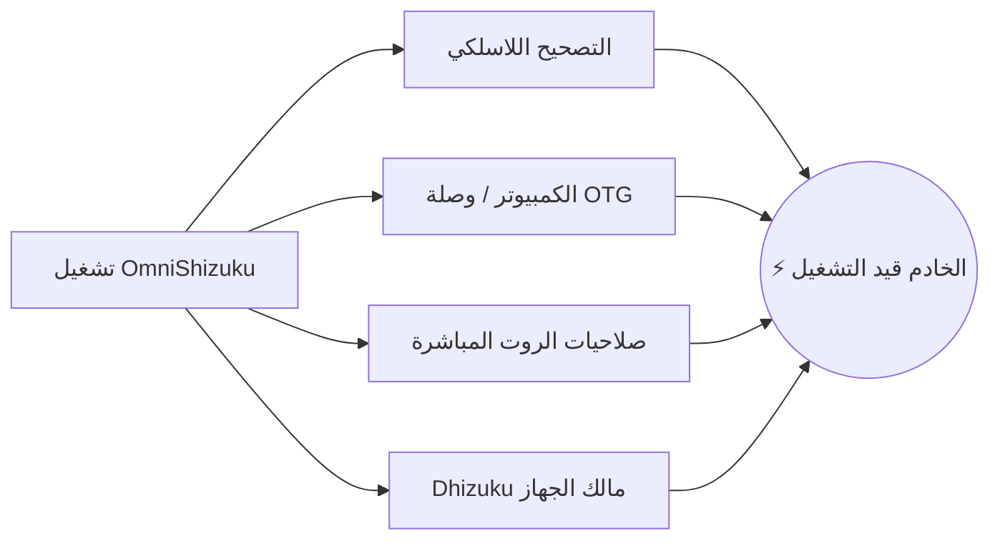

[English](README.md) | [Русский](README.ru.md) | [Қазақша](README.kk.md) | [Qazaqşa (Latın)](README.kk-Latn.md) | [Português](README.pt.md) | [Español](README.es.md) | [العربية](README.ar.md) | [简体中文](README.zh-CN.md) | [日本語](README.ja.md)

# ⚡ OmniShizuku

<div align="center">


# 👑 وضع السيطرة المطلقة لنظام Android
### توقف عن تثبيت 4 تطبيقات مختلفة. استمتع بحرية الصلاحيات الحقيقية — بدون الحاجة إلى روت.

[](https://github.com/krishna3163/OmniShizuku/stargazers)
[](https://github.com/krishna3163/OmniShizuku/network/members)
[](https://github.com/krishna3163/OmniShizuku/actions/workflows/apk-build.yml)
[](https://github.com/krishna3163/OmniShizuku/releases)
[](LICENSE)
[-success?style=for-the-badge&logo=android)](https://developer.android.com)

**حزمة التطبيق:** `com.krishna.omnishizuku`

[⚡ تحميل أحدث ملف APK](#-التحميل-الفوري-والبدء-السريع) • [✨ المميزات الجوهرية](#-ما-الذي-يجعل-omnishizuku-لا-يُقهر) • [⚔️ المقارنة الشاملة](#️-المواجهة-الحاسمة-omnishizuku-مقابل-البقية) • [📚 التوثيق الكامل](docs/)

</div>

---

## 💥 هل سئمت من متاعب Shizuku المعتادة؟

لنكن صريحين:
- ❌ **هل مللت من توقف خادم Shizuku فجأة** في كل مرة يضغط فيها أندرويد على الذاكرة؟
- ❌ **هل سئمت من التنقل بين 4 تطبيقات مختلفة** فقط للتحكم في هاتفك؟ *(Shizuku للواجهات البرمجية + Dhizuku لمالك الجهاز + aShell للطرفية + Shizuku-Keeper لإبقائه قيد التشغيل)*.
- ❌ **هل ترغب في حزم ZIP شبيهة بـ Magisk** لتحسين البطارية والأداء، ولكنك لا تستطيع فتح البوت لودر أو المخاطرة بفقدان Knox وتطبيقات البنوك؟
- ❌ **هل تعبت من أخطاء الطرفية الغامضة** دون أي توجيه أو شرح؟

### 🚀 رحب بـ OmniShizuku.
**OmniShizuku يحل محلها جميعاً.** فهو يجمع بين بروتوكول Binder المميّز لـ Shizuku، ومحرك الإضافات النمطية لـ Shizuku-Next، وأدوات Device Owner من Dhizuku، وذكاء الطرفية الاصطناعي مع Gemini AI، مع خاصية التعافي الذاتي من الانهيار NightDog في **تطبيق فائق واحد مذهل ومؤمّن بالقياسات الحيوية بتصميم Material 3.**

---

## ✨ ما الذي يجعل OmniShizuku لا يُقهر؟

### 1. 📦 "Magisk بدون روت" (محرك وحدات ADB)
قم بتثبيت وحدات ZIP المستقلة مباشرة من هاتفك — بدون فتح البوت لودر، وبدون روت، وبدون المساس بالضمان!
- **تنسيق وحدات متكامل:** دعم `module.prop`، والشعارات التوضيحية، وأدوات التشغيل السريع `action.sh`، والخدمات الخلفية المستمرة (`service.sh`).
- **لوحات تحكم WebUI مدمجة:** يمكن للوحدات عرض لوحات تحكم تفاعلية بتقنيات HTML5/JavaScript مع ربط مباشر عبر `window.Shizuku`!
- **كتالوج GitHub عبر الإنترنت:** تصفح وحدات المجتمع وحمّلها وحدّثها بضغطة زر واحدة.
- **سياسات أمان صارمة:** وضع آمن (Safe Mode)، مهلات زمنية للتنفيذ، حدود للمخرجات، وسجلات تدقيق تفصيلية.

### 2. 🐕 خدمة خلفية لا تموت (NightDog Watchdog v14.5)
- المشكلة الكبرى لمستخدمي ADB هي موت الخوادم في الخلفية.
- يتميز OmniShizuku بخدمة الحراسة الذكية **NightDog Watchdog** التي تراقب استجابة الخادم باستمرار.
- إذا قام النظام بإنهاء الخدمة بسبب ضغط الذاكرة (RAM)، يقوم NightDog **تلقائياً بإعادة تشغيل الخادم عبر التصحيح اللاسلكي** دون الحاجة إلى إعادة التوصيل بالكمبيوتر!

### 3. 🛡️ الجسر الخارق لـ Device Owner و Dhizuku
- إدارة كاملة لمالك الجهاز (DPM) مدمجة بشكل أصيل.
- إمكانية تكوين نطاقات التفويض، وتجميد التطبيقات غير المرغوب فيها، وإدارة قيود النظام وسياساته.
- **توافق 100% مع Dhizuku:** التطبيقات المصممة لـ Dhizuku تعمل بسلاسة فائقة مع OmniShizuku!

### 4. 🤖 وحدة تحكم Comput والمساعد الذكي Gemini AI
- طرفية ADB Shell تفاعلية ومميزة مع أزرار ماكرو سريعة.
- **تشخيص أخطاء عبر Gemini AI:** هل واجهت خطأ غامضاً؟ يقوم الذكاء الاصطناعي تلقائياً بتحليل سجلات الأخطاء وتقديم شروحات واضحة وخطوات عملية لحلها.
- **Commandium AI:** قم بإنشاء أوامر Shell معقدة بمجرد كتابة ما تريده باللغة الطبيعية!

### 5. 🔒 حماية بيومترية بمستوى حصن فورت نوكس
- لا تدع المستخدمين غير المصرح لهم أو التطبيقات الفضولية تعبث ببيئتك المميزة.
- قفل بيومتري رئيسي: حماية منح الأذونات، وتنفيذ الوحدات، والإعدادات الحساسة خلف **بصمة الإصبع، أو التعرف على الوجه، أو رمز PIN / كلمة مرور الجهاز**.

### 6. 🧪 جميع أدوات المختبرات الـ 15 المتقدمة (موروثة من Shizuku-Next)
يحتفظ OmniShizuku بـ **100% من أدوات Shizuku-Next الاحترافية**:
- 🌐 **جدار حماية لكل تطبيق:** قطع اتصال الإنترنت عن أي تطبيق دون الحاجة إلى VPN أو روت (`cmd connectivity set-package-networking-enabled <uid> false`).
- 🕶️ **إخفاء ديناميكي من 6 طبقات:** إخفاء بيئة الصلاحيات وتصحيح الأخطاء عن التطبيقات ذات الحماية العالية.
- 🔑 **عرض كلمات مرور Wi-Fi بنص صريح:** قراءة كلمات مرور الشبكات المحفوظة دون روت.
- 📁 **مستكشف ملفات بصلاحيات النظام:** استعراض وتعديل ملفات نظام Android المحمية.
- 🚀 **مشغل الأنشطة غير المصدرة:** فتح القوائم المخفية وشاشات الاختبار السرية الخاصة بالشركات المصنعة.
- 🌙 **فرض الوضع الليلي:** إجبار التطبيقات العنيدة على تفعيل وضع AMOLED المظلم الحقيقي.
- 🖥️ **تخصيص الشاشة:** تعديل دقة العرض وكثافة DPI وفرض معدل تحديث مرتفع 120Hz.
- ⚡ **قائمة طاقة متقدمة:** إعادة التشغيل المباشر إلى Recovery و Fastboot و Bootloader.
- 🛑 **إيقاف قاتل العمليات الوهمية:** تعطيل حد الـ 32 عملية في Android 12+ لأداء أسرع في Termux وتجميع البرمجيات.
- 📦 **محرك Split-APK InstallerX:** تثبيت حزم APK المجزأة، وتجاوز قيود الرجوع لإصدارات أقدم، وحقن إعدادات التثبيت.

---

## ⚔️ المواجهة الحاسمة: OmniShizuku مقابل البقية

شاهد كيف يتفوق OmniShizuku بوضوح على كل البدائل الأخرى في نظام أندرويد:

| الميزة / الإمكانية | Shizuku الرسمي | Shizuku-Next | ShizukuPlus / Shizako | Dhizuku | Magisk / Root | ⚡ **OmniShizuku** |
| :--- | :---: | :---: | :---: | :---: | :---: | :---: |
| **بدون الحاجة لروت؟** | ✅ نعم | ✅ نعم | ✅ نعم | ✅ نعم | ❌ **لا (يعطل Knox)** | 🌟 **نعم (100% بدون روت)** |
| **واجهة Binder مميزة** | ✅ نعم | ✅ نعم | ✅ نعم | ❌ لا | ❌ لا | 🌟 **نعم (سرعة فائقة)** |
| **تحكم مالك الجهاز (DPM)** | ❌ لا | ❌ لا | ❌ لا | ✅ نعم | ❌ لا | 🌟 **نعم (مدمج كلياً)** |
| **توافق مع تطبيقات Dhizuku**| ❌ لا | ❌ لا | ❌ لا | ✅ نعم | ❌ لا | 🌟 **نعم (بروتوكول مزدوج)** |
| **محرك وحدات ZIP (مثل Magisk)**| ❌ لا | ✅ نعم | ❌ لا | ❌ لا | ✅ نعم (مع الروت فقط)| 🌟 **نعم (ZIP بدون روت!)** |
| **لوحات WebUI وجسر JS** | ❌ لا | ✅ نعم | ❌ لا | ❌ لا | ❌ لا | 🌟 **نعم (لوحات HTML5)** |
| **طرفية ذكية (Gemini / Comput)**| ❌ لا | ❌ لا | ❌ لا | ❌ لا | ❌ لا | 🌟 **نعم (تشخيص بالذكاء)** |
| **تعافي ذاتي (NightDog)** | ❌ لا | ⚠️ أساسي | ❌ لا | ❌ لا | ❌ لا | 🌟 **نعم (إحياء تلقائي)** |
| **حماية بالبصمة / PIN** | ❌ لا | ❌ لا | ❌ لا | ❌ لا | ❌ لا | 🌟 **نعم (قفل بيومتري)** |
| **15 أداة مختبر (جدار حماية/واي فاي)**| ❌ لا | ✅ نعم | ⚠️ جزئي | ❌ لا | ❌ لا | 🌟 **نعم (جميعها مضمنة)** |
| **إخفاء مضاد للاكتشاف (6 طبقات)**| ❌ لا | ✅ نعم | ⚠️ أساسي | ❌ لا | ⚠️ يتطلب Zygisk | 🌟 **نعم (إخفاء تلقائي ديناميكي)**|
| **دعم Android 17 / API 37** | ❌ متوقف | ⚠️ API 36 | ❌ متوقف | ❌ متوقف | ⚠️ يدوي | 🌟 **نعم (compileSdk 37)** |
| **واجهة حديثة Compose Material 3**| ❌ قديمة | ⚠️ جزئية | ❌ قديمة | ❌ قديمة | ❌ قديمة | 🌟 **نعم (تصميم M3 معبّر)** |

> **الخلاصة:** بينما تقدم الفروع الأخرى قطعة واحدة فقط من الأحجية، فإن **OmniShizuku هو الأحجية بأكملها.**

---

## 📸 معرض الواجهات

<div align="center">

| 📱 لوحة التحكم الرئيسية | 🤖 طرفية Comput الذكية | 📦 مدير وحدات ADB | ⚙️ الإعدادات والمختبرات |
| :---: | :---: | :---: | :---: |
|  |  |  |  |
| *حالة الخادم وأزرار التبديل السريعة* | *تحليلات الذكاء الاصطناعي وماكرو* | *وحدات ZIP ولوحات WebUI والكتالوج* | *القياسات الحيوية والجدار الناري و15 أداة* |

</div>

---

## 🚀 التحميل الفوري والبدء السريع

> [!IMPORTANT]
> **يوصى بالتثبيت النظيف:** نظراً لاستخدام معرف حزمة موحد جديد (`com.krishna.omnishizuku`)، يُرجى **إلغاء تثبيت إصدارات Shizuku أو Shevery السابقة أولاً** لتجنب تعارض تواقيع أندرويد.

### الخطوة 1: التحميل
- 📦 **أحدث إصدارات CI التلقائية (مع كل تحديث):** [GitHub Actions](https://github.com/krishna3163/OmniShizuku/actions/workflows/apk-build.yml) &rarr; توجه لأسفل إلى قسم **Artifacts** وحمّل `omnishizuku-release.apk`.
- 🏷️ **إصدارات GitHub المستقرة:** [صفحة الإصدارات Releases](https://github.com/krishna3163/OmniShizuku/releases)

### الخطوة 2: التشغيل بالطريقة التي تفضلها



1. **التصحيح اللاسلكي (Android 11+ / لا يلزم كمبيوتر):**
   - خيارات المطور &rarr; تفعيل **تصحيح الأخطاء اللاسلكي** &rarr; اضغط على **إقران الجهاز باستخدام رمز إقران**.
   - أدخل الرمز المكون من 6 أرقام في OmniShizuku واضغط **بدء**.
2. **عبر الكمبيوتر (ADB USB Shell):**
   ```bash
   adb shell sh /sdcard/Android/data/com.krishna.omnishizuku/starter.sh
   ```
3. **الأجهزة المروّتة (Magisk / KernelSU / APatch):**
   - افتح OmniShizuku &rarr; اضغط على **البدء مع الروت** &rarr; امنح إذن المستخدم الخارق (Superuser).
4. **عبر Dhizuku (Device Owner):**
   - قم بتفويض OmniShizuku داخل تطبيق Dhizuku للإدارة المباشرة في الخلفية.

---

## 📚 التوثيق الفني المعمق

اقرأ أدلتنا التقنية الشاملة داخل مجلد [`docs/`](docs/):

| المستند | الموضوع |
| :--- | :--- |
| 📖 [**دليل وكيل Comput AI**](docs/comput-agent.md) | بيئة الطرفية، ومساعد Gemini AI، وسكريبتات الماكرو. |
| 🛡️ [**دليل Device Owner و DPM**](docs/device-owner.md) | إعداد مالك الملف الشخصي، والقيود، ونطاقات التفويض. |
| 📦 [**دليل استخدام وحدات ADB**](docs/adb-modules-guide.md) | تثبيت وحدات ZIP، والوضع الآمن، واستكشاف الأخطاء وإصلاحها. |
| 🛠️ [**مرجع واجهة برمجة تطبيقات وحدات ADB**](docs/adb-modules-api.md) | كتابة وحداتك الخاصة: الخطافات، والمتغيرات البيئية، وجسر WebUI. |
| 🌐 [**النشر في كتالوج GitHub**](docs/github-catalog.md) | حزم الوحدات ونشرها في الكتالوج العالمي. |
| 🕶️ [**نسخة التخفي والواجهات البديلة (Stubs)**](docs/stealth-and-stubs.md) | إخفاء حالة الصلاحيات عن الفحص المعادي. |
| 🧪 [**المختبرات وإخفاء USB وجدار الحماية**](docs/lab-and-extras.md) | حظر الشبكة، والإخفاء الديناميكي من 6 طبقات، وأدوات إمكانية الوصول. |
| 🔌 [**ملحق Tasker و MacroDroid**](docs/tasker-plugin.md) | مشغلات الأتمتة، والـ Intents، وسكريبتات البدء التلقائي. |
| 🐕 [**التعافي التلقائي عبر NightDog Watchdog**](docs/nightdog.md) | مراقبة صحة الخدمة ومعمارية إعادة الاتصال التلقائي. |
| 🚀 [**التوافق مع Android 17**](docs/android-17-compatibility.md) | التعديلات المعمارية لدعم compileSdk 37 / Android Baklava. |
| 📡 [**مرجع الـ Intents**](docs/intents.md) | توثيق شامل لجميع أوامر البث المدعومة. |

---

## 💻 البناء من المصدر

```bash
# 1. استنساخ المستودع مع الوحدات الفرعية
git clone --recurse-submodules https://github.com/krishna3163/OmniShizuku.git
cd OmniShizuku

# 2. بناء نسخة تصحيح الأخطاء (Debug)
./gradlew :manager:assembleDebug

# 3. بناء نسخة الإصدار النهائي (Release)
./gradlew :manager:assembleRelease
```
*ستجد ملفات الـ APK الناتجة داخل المجلد `manager/build/outputs/apk/{debug,release}/`.*

---

## 🙏 شكر وتقدير لمشاريع المنبع

تم بناء OmniShizuku بفضل جهود مطورين استثنائيين. نتوجه بخالص الاحترام والامتنان إلى:

* **[RikkaApps/Shizuku](https://github.com/RikkaApps/Shizuku)** — معمارية الـ Binder المميزة الأصلية والثورية التي ابتكرتها Rikka.
* **[HmnDev-Tech/shevery](https://github.com/HmnDev-Tech/shevery)** — الميزات الأساسية والواجهة الموسعة ودعم الوحدات المتعددة.
* **[iamr0s/Dhizuku](https://github.com/iamr0s/Dhizuku)** و **[rosan/Dhizuku](https://github.com/rosan/Dhizuku)** — مفاهيم إدارة Device Owner وبروتوكولات الربط.
* **[timschneeb/ShizuStore](https://github.com/timschneeb/ShizuStore)** — أنماط مزامنة كتالوج متاجر التطبيقات.
* **[wxxsfxyzm/InstallerX-Revived](https://github.com/wxxsfxyzm/InstallerX-Revived)** — تقنيات تثبيت حزم Split-APK ومسارات المعالجة.
* **[zacharee/InstallWithOptions](https://github.com/zacharee/InstallWithOptions)** — خيارات التثبيت المتقدمة وتجاوز القيود.
* **[d4rken/porter](https://github.com/d4rken/porter)** — أدوات مساعدة نقية لـ Android IPC ومغلفات Binder.
* **[topjohnwu/libsu](https://github.com/topjohnwu/libsu)** — إدارة خدمات Root shell ومعاملات Binder القوية.
* **[kerneldroid](https://github.com/kerneldroid)** — مكونات Compose UI ووحدات الكتالوج والعمل على توافق Android 17 / API 37.
* **[DP-Hridayan/aShellYou](https://github.com/DP-Hridayan/aShellYou)** — واجهة طرفية أوامر ADB وأدوات الحوسبة.
* **[protonpony/Shizuku-Keeper](https://github.com/protonpony/Shizuku-Keeper)** — معمارية البدء التلقائي لخادم التصحيح اللاسلكي عند إقلاع الجهاز.
* **[Landon Moran](https://github.com/LandonMoran)** — المساهمات في جسر Dhizuku، وإصلاحات شبكات TCP، واستقرار الخدمات.

---

## 📜 مجاني ومفتوح المصدر 100%

OmniShizuku هو برنامج حر مفتوح المصدر تم ترخيصه بموجب **[Apache License 2.0](LICENSE)**.

> [!CAUTION]
> **إشعار التطبيق المجاني:** OmniShizuku هو وسيظل دائماً **مجاني ومفتوح المصدر بنسبة 100%**. لا تدفع أبداً لأي موقع أو بائع خارجي لتحميل هذا التطبيق.

<div align="center">
  <sub>تم تطويره بكل شغف بواسطة <b>Krishna</b> ومجتمع أندرويد مفتوح المصدر.</sub>
</div>
