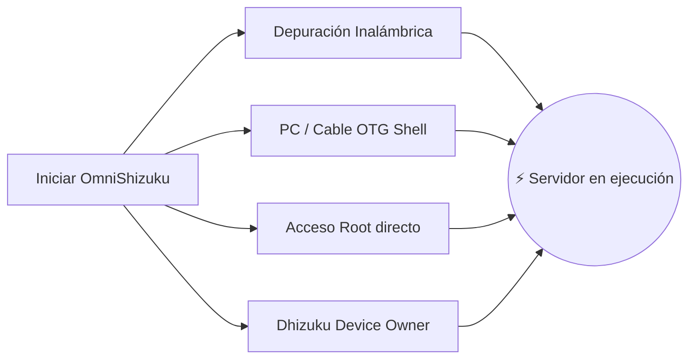

[English](README.md) | [Русский](README.ru.md) | [Қазақша](README.kk.md) | [Qazaqşa (Latın)](README.kk-Latn.md) | [Português](README.pt.md) | [Español](README.es.md) | [العربية](README.ar.md) | [简体中文](README.zh-CN.md) | [日本語](README.ja.md)

# ⚡ OmniShizuku

<div align="center">


# 👑 El Modo Dios para Android
### Deja de instalar 4 aplicaciones diferentes. Experimenta la verdadera libertad de privilegios — Sin necesidad de Root.

[](https://github.com/krishna3163/OmniShizuku/stargazers)
[](https://github.com/krishna3163/OmniShizuku/network/members)
[](https://github.com/krishna3163/OmniShizuku/actions/workflows/apk-build.yml)
[](https://github.com/krishna3163/OmniShizuku/releases)
[](LICENSE)
[-success?style=for-the-badge&logo=android)](https://developer.android.com)

**Nombre del paquete:** `com.krishna.omnishizuku`

[⚡ Descargar APK más reciente](#-descarga-instantánea-y-guía-rápida) • [✨ Características clave](#-qué-hace-a-omnishizuku-imbatible) • [⚔️ Comparativa definitiva](#️-el-duelo-definitivo-omnishizuku-vs-el-resto) • [📚 Documentación completa](docs/)

</div>

---

## 💥 ¿Cansado de los problemas de Shizuku?

Seamos honestos:
- ❌ **¿Cansado de que el servidor Shizuku se cierre aleatoriamente** cuando Android optimiza la memoria RAM?
- ❌ **¿Cansado de alternar entre 4 aplicaciones distintas** solo para administrar tu teléfono? *(Shizuku para APIs + Dhizuku para Device Owner + aShell para la terminal + Shizuku-Keeper para mantenerlo vivo)*.
- ❌ **¿Quieres módulos ZIP estilo Magisk** para ajustes de batería y rendimiento, pero no puedes desbloquear el bootloader ni arriesgarte a activar Knox o perder tus aplicaciones bancarias?
- ❌ **¿Cansado de errores confusos en la terminal** sin ninguna orientación?

### 🚀 Te presentamos OmniShizuku.
**OmniShizuku las reemplaza a todas.** Une el protocolo clásico de binder privilegiado de Shizuku, el motor de extensiones modulares de Shizuku-Next, el control de Device Owner de Dhizuku, la inteligencia de terminal de Gemini AI y la recuperación autorreparable ante caídas de NightDog en **una magnífica superaplicación con Material 3 y seguridad biométrica.**

---

## ✨ ¿Qué hace a OmniShizuku imbatible?

### 1. 📦 "Magisk sin Root" (Motor de módulos ADB)
Flashea módulos ZIP independientes directamente desde tu teléfono — ¡sin desbloquear bootloader, sin root y sin anular tu garantía!
- **Formato completo de módulos:** Soporta `module.prop`, banners de portada, herramientas de ejecución única `action.sh` y servicios demonio en segundo plano (`service.sh`).
- **Paneles WebUI integrados:** ¡Los módulos pueden renderizar paneles interactivos HTML5/JavaScript con puente IPC nativo `window.Shizuku`!
- **Catálogo en línea en GitHub:** Explora, descarga y actualiza módulos de la comunidad con un solo toque.
- **Políticas de seguridad:** Aislamiento en Modo Seguro (Safe Mode), tiempos de espera de ejecución, límites de salida y registros de auditoría.

### 2. 🐕 Demonio indestructible (NightDog Watchdog v14.5)
- La mayor frustración de los usuarios de ADB es que los servidores mueren en segundo plano.
- OmniShizuku incorpora un demonio guardián inteligente **NightDog Watchdog** que monitoriza continuamente el pulso del servidor.
- Si Android cierra el proceso bajo alta presión de memoria, NightDog **revive y reinicia automáticamente el servidor mediante Depuración Inalámbrica** ¡sin necesidad de reconectar el PC!

### 3. 🛡️ Superpuente de Device Owner y Dhizuku
- Control total de Device Owner (DPM) integrado de forma nativa.
- Configura ámbitos de delegación detallados, congela aplicaciones no deseadas (bloatware), conmuta restricciones del sistema y gestiona políticas.
- **100% compatible con Dhizuku:** ¡Las aplicaciones creadas para Dhizuku funcionan sin problemas con OmniShizuku!

### 4. 🤖 Consola Comput y copiloto Gemini AI
- Terminal ADB Shell interactivo y privilegiado integrado con botones de macros instantáneos.
- **Diagnóstico con Gemini AI:** ¿Atascado en un error críptico de la shell? Gemini AI traduce automáticamente los registros de error en explicaciones claras y pasos prácticos.
- **Commandium AI:** ¡Genera comandos shell complejos con solo describir lo que necesitas en lenguaje natural!

### 5. 🔒 Protección biométrica de máxima seguridad
- No permitas que usuarios no autorizados o aplicaciones espías abusen de tu entorno privilegiado.
- Bloqueo biométrico maestro: Protege la concesión de permisos, la ejecución de módulos y las configuraciones sensibles con **huella dactilar, desbloqueo facial o PIN/contraseña del dispositivo**.

### 6. 🧪 Los 15 laboratorios avanzados (Heredados de Shizuku-Next)
OmniShizuku conserva **el 100% de las aclamadas herramientas de Shizuku-Next**:
- 🌐 **Cortafuegos por aplicación:** Corta el acceso a internet de cualquier app sin VPN y sin root (`cmd connectivity set-package-networking-enabled <uid> false`).
- 🕶️ **Ocultación dinámica de 6 capas:** Evita que apps sensibles a la seguridad detecten el estado privilegiado o ADB.
- 🔑 **Visor de contraseñas Wi-Fi:** Lee contraseñas Wi-Fi guardadas en texto plano sin necesidad de root.
- 📁 **Explorador de archivos privilegiado:** Explora y gestiona archivos protegidos del sistema Android.
- 🚀 **Lanzador de actividades no exportadas:** Abre menús ocultos del sistema y pantallas secretas del fabricante.
- 🌙 **Forzar modo oscuro:** Obliga a las aplicaciones incompatibles a mostrar un modo oscuro AMOLED puro.
- 🖥️ **Ajustes de pantalla:** Cambia resolución, densidad DPI y fuerza tasas de refresco altas de 120Hz.
- ⚡ **Menú de energía avanzado:** Reinicio directo a Recovery, Fastboot y Bootloader.
- 🛑 **Detener el asesino de procesos fantasma:** Desactiva el límite de 32 procesos de Android 12+ para Termux y tareas de compilación exigentes.
- 📦 **Motor Split-APK InstallerX:** Instala APKs divididos, elude bloqueos de degradación de versión y personaliza flags de instalación.

---

## ⚔️ El duelo definitivo: OmniShizuku vs el resto

Observa cómo OmniShizuku supera a todas las demás alternativas del ecosistema Android:

| Característica / Poder | Shizuku Oficial | Shizuku-Next | ShizukuPlus / Shizako | Dhizuku | Magisk / Root | ⚡ **OmniShizuku** |
| :--- | :---: | :---: | :---: | :---: | :---: | :---: |
| **¿Sin necesidad de Root?** | ✅ Sí | ✅ Sí | ✅ Sí | ✅ Sí | ❌ **No (Activa Knox)** | 🌟 **Sí (100% Sin Root)** |
| **API Binder Privilegiada** | ✅ Sí | ✅ Sí | ✅ Sí | ❌ No | ❌ No | 🌟 **Sí (Ultra rápida)** |
| **Control Device Owner (DPM)** | ❌ No | ❌ No | ❌ No | ✅ Sí | ❌ No | 🌟 **Sí (Nativo integrado)** |
| **Compatibilidad con Dhizuku** | ❌ No | ❌ No | ❌ No | ✅ Sí | ❌ No | 🌟 **Sí (Protocolo dual)** |
| **Motor de módulos ZIP (estilo Magisk)**| ❌ No | ✅ Sí | ❌ No | ❌ No | ✅ Sí (Solo con Root) | 🌟 **Sí (¡ZIPs sin Root!)** |
| **WebUI de módulos y puente JS**| ❌ No | ✅ Sí | ❌ No | ❌ No | ❌ No | 🌟 **Sí (Paneles HTML5)** |
| **Terminal AI (Gemini / Comput)** | ❌ No | ❌ No | ❌ No | ❌ No | ❌ No | 🌟 **Sí (Diagnósticos AI)** |
| **Autorreparación (NightDog)** | ❌ No | ⚠️ Básico | ❌ No | ❌ No | ❌ No | 🌟 **Sí (Auto-reinicio)** |
| **Bloqueo biométrico / PIN** | ❌ No | ❌ No | ❌ No | ❌ No | ❌ No | 🌟 **Sí (Bloqueo de huella)** |
| **15 Laboratorios (Cortafuegos/Wi-Fi)**| ❌ No | ✅ Sí | ⚠️ Parcial | ❌ No | ❌ No | 🌟 **Sí (Los 15 incluidos)** |
| **Ocultación antidetección (6 capas)**| ❌ No | ✅ Sí | ⚠️ Básico | ❌ No | ⚠️ Requiere Zygisk | 🌟 **Sí (Ocultación dinámica)** |
| **Soporte Android 17 / API 37** | ❌ Obsoleto | ⚠️ API 36 | ❌ Obsoleto | ❌ Obsoleto | ⚠️ Manual | 🌟 **Sí (compileSdk 37)** |
| **Interfaz moderna Compose Material 3**| ❌ Clásica | ⚠️ Parcial | ❌ Clásica | ❌ Clásica | ❌ Clásica | 🌟 **Sí (Expressive M3)** |

> **El veredicto:** Mientras otros proyectos solo ofrecen una pieza del rompecabezas, **OmniShizuku es el rompecabezas completo.**

---

## 📸 Muestra visual

<div align="center">

| 📱 Panel principal | 🤖 Consola Comput AI | 📦 Gestor de módulos ADB | ⚙️ Ajustes y Laboratorios |
| :---: | :---: | :---: | :---: |
|  |  |  |  |
| *Estado del servidor y conmutadores rápidos* | *Explicaciones AI, macros y commandium* | *Módulos ZIP, WebUIs y catálogos* | *Biometría, cortafuegos y 15 laboratorios* |

</div>

---

## 🚀 Descarga instantánea y guía rápida

> [!IMPORTANT]
> **Instalación limpia recomendada:** Debido a nuestro identificador de paquete unificado (`com.krishna.omnishizuku`), por favor **desinstala las versiones antiguas de Shizuku o Shevery** primero para evitar conflictos de firma de Android.

### Paso 1: Descargar
- 📦 **Compilaciones CI más recientes (cada commit):** [GitHub Actions](https://github.com/krishna3163/OmniShizuku/actions/workflows/apk-build.yml) &rarr; Desplázate hacia abajo hasta **Artifacts** para descargar `omnishizuku-release.apk`.
- 🏷️ **Lanzamientos estables de GitHub:** [Página de Releases](https://github.com/krishna3163/OmniShizuku/releases)

### Paso 2: Inicia con tu método preferido



1. **Depuración Inalámbrica (Android 11+ / Sin PC requerido):**
   - Opciones de desarrollador &rarr; Habilita **Depuración Inalámbrica** &rarr; Toca **Vincular dispositivo con código de vinculación**.
   - Introduce el código de 6 dígitos en OmniShizuku y toca **Iniciar**.
2. **Mediante PC (ADB USB Shell):**
   ```bash
   adb shell sh /sdcard/Android/data/com.krishna.omnishizuku/starter.sh
   ```
3. **Dispositivo con Root (Magisk / KernelSU / APatch):**
   - Abre OmniShizuku &rarr; Toca **Iniciar con Root** &rarr; Concede permisos de Superusuario.
4. **Mediante Dhizuku (Device Owner):**
   - Autoriza a OmniShizuku en Dhizuku para gestión en segundo plano.

---

## 📚 Documentación técnica detallada

Consulta nuestras guías completas en el directorio [`docs/`](docs/):

| Documento | Tema |
| :--- | :--- |
| 📖 [**Guía de agente Comput AI**](docs/comput-agent.md) | Entorno de terminal, copiloto Gemini AI y macros. |
| 🛡️ [**Guía de Device Owner y DPM**](docs/device-owner.md) | Configuración de Profile Owner, restricciones y ámbitos de delegación. |
| 📦 [**Guía de usuario de ADB Modules**](docs/adb-modules-guide.md) | Instalación de módulos ZIP, modo seguro y resolución de problemas. |
| 🛠️ [**Referencia de la API de módulos ADB**](docs/adb-modules-api.md) | Creación de módulos propios: ganchos, variables de entorno y puente WebUI. |
| 🌐 [**Publicación en el catálogo de GitHub**](docs/github-catalog.md) | Empaquetado y publicación de módulos para el catálogo global. |
| 🕶️ [**Edición Stealth y Stubs**](docs/stealth-and-stubs.md) | Ocultación del estado privilegiado ante inspecciones hostiles. |
| 🧪 [**Labs, ocultación de USB y cortafuegos**](docs/lab-and-extras.md) | Bloqueo de red, ocultación de 6 capas y accesibilidad. |
| 🔌 [**Plugin para Tasker y MacroDroid**](docs/tasker-plugin.md) | Disparadores de automatización, intents de difusión y scripts de inicio. |
| 🐕 [**Recuperación con NightDog Watchdog**](docs/nightdog.md) | Monitorización del demonio y arquitectura de reconexión automática. |
| 🚀 [**Compatibilidad con Android 17**](docs/android-17-compatibility.md) | Cambios de arquitectura para compileSdk 37 / Android Baklava. |
| 📡 [**Referencia de Intents**](docs/intents.md) | Documentación completa de todos los intents de difusión soportados. |

---

## 💻 Compilación desde el código fuente

```bash
# 1. Clona el repositorio con submódulos
git clone --recurse-submodules https://github.com/krishna3163/OmniShizuku.git
cd OmniShizuku

# 2. Compilar variante Debug
./gradlew :manager:assembleDebug

# 3. Compilar variante Release
./gradlew :manager:assembleRelease
```
*Los APK generados se ubicarán en `manager/build/outputs/apk/{debug,release}/`.*

---

## 🙏 Agradecimientos especiales y Salón de la Fama

OmniShizuku se apoya en hombros de gigantes. Expresamos nuestro mayor respeto y gratitud a:

* **[RikkaApps/Shizuku](https://github.com/RikkaApps/Shizuku)** — La arquitectura original y revolucionaria de binder privilegiado creada por Rikka.
* **[HmnDev-Tech/shevery](https://github.com/HmnDev-Tech/shevery)** — Características de origen, interfaz expandida y base multimodular.
* **[iamr0s/Dhizuku](https://github.com/iamr0s/Dhizuku)** y **[rosan/Dhizuku](https://github.com/rosan/Dhizuku)** — Conceptos de gestión de Device Owner y protocolos de puente.
* **[timschneeb/ShizuStore](https://github.com/timschneeb/ShizuStore)** — Patrones de sincronización de repositorios y catálogo de tiendas de apps.
* **[wxxsfxyzm/InstallerX-Revived](https://github.com/wxxsfxyzm/InstallerX-Revived)** — Técnicas de instalación de Split-APK y flujos de almacenamiento.
* **[zacharee/InstallWithOptions](https://github.com/zacharee/InstallWithOptions)** — Opciones avanzadas de instalación de paquetes y banderas de elusión.
* **[d4rken/porter](https://github.com/d4rken/porter)** — Primitivas limpias de ayuda para IPC de Android y envoltorios de binder.
* **[topjohnwu/libsu](https://github.com/topjohnwu/libsu)** — Gestión de servicios root shell y transacciones binder robustas.
* **[kerneldroid](https://github.com/kerneldroid)** — Componentes de UI en Compose, catálogo de módulos y compatibilidad con Android 17 / API 37.
* **[DP-Hridayan/aShellYou](https://github.com/DP-Hridayan/aShellYou)** — Interfaz gráfica de terminal ADB y herramientas de computación.
* **[protonpony/Shizuku-Keeper](https://github.com/protonpony/Shizuku-Keeper)** — Arquitectura de autoinicio del demonio de depuración inalámbrica al arrancar.
* **[Landon Moran](https://github.com/LandonMoran)** — Contribuciones al puente con Dhizuku, correcciones de red TCP y estabilidad de servicios.

---

## 📜 100% Libre y de código abierto

OmniShizuku es software libre publicado bajo la licencia **[Apache License 2.0](LICENSE)**.

> [!CAUTION]
> **Aviso de aplicación gratuita:** OmniShizuku es y siempre será **100% gratuita y de código abierto**. Nunca pagues a sitios web de terceros, vendedores o alojamientos de archivos por descargar esta aplicación.

<div align="center">
  <sub>Desarrollado con pasión por <b>Krishna</b> y la comunidad de código abierto de Android.</sub>
</div>
