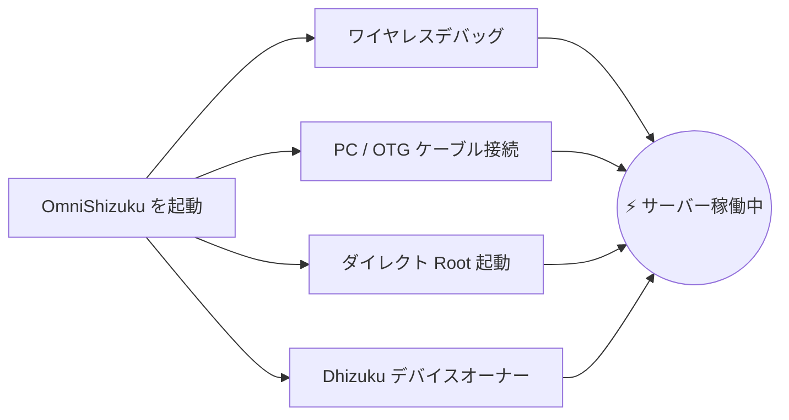

[English](README.md) | [Русский](README.ru.md) | [Қазақша](README.kk.md) | [Qazaqşa (Latın)](README.kk-Latn.md) | [Português](README.pt.md) | [Español](README.es.md) | [العربية](README.ar.md) | [简体中文](README.zh-CN.md) | [日本語](README.ja.md)

# ⚡ OmniShizuku

<div align="center">


# 👑 Android のためのゴッドモード
### 4つの別々のアプリをインストールするのはもうやめましょう。真の特権の自由を体験 — Root権限不要。

**Created & Maintained by [Krishna](https://github.com/krishna3163)**

[](https://github.com/krishna3163/OmniShizuku/releases)
[](https://github.com/krishna3163/OmniShizuku/stargazers)
[](https://github.com/krishna3163/OmniShizuku/network/members)
[](https://github.com/krishna3163/OmniShizuku/actions/workflows/apk-build.yml)
[](https://github.com/krishna3163/OmniShizuku/releases)
[](LICENSE)
[-success?style=for-the-badge&logo=android)](https://developer.android.com)

**パッケージ名:** `com.krishna.omnishizuku`

[⚡ 最新APKをダウンロード](#-今すぐダウンロードとクイックスタート) • [✨ 圧倒的なキラー機能](#-omnishizuku-が選ばれる理由) • [⚔️ 徹底比較](#️-徹底比較omnishizuku-vs-他のソリューション) • [📚 完全ドキュメント](docs/)

</div>

---

## 💥 通常の Shizuku に不満を感じていませんか？

正直に言えば：
- ❌ **Android のメモリ管理によって Shizuku サーバーが勝手に落ちる** ことにうんざりしていませんか？
- ❌ **端末を管理するためだけに 4 つもの別々のアプリを行き来する** のに疲れていませんか？ *(API用のShizuku + デバイス管理用のDhizuku + ターミナル用のaShell + 常駐維持用のShizuku-Keeper)*。
- ❌ **Magisk のような ZIP モジュールでバッテリーやパフォーマンスを最適化したい** のに、ブートローダーのアンロックができなかったり、Knox の破損や銀行アプリの制限が怖くて諦めていませんか？
- ❌ **ターミナルに表示される意味不明なエラー** にガイドが一切なく困り果てていませんか？

### 🚀 OmniShizuku がすべてを解決します。
**OmniShizuku はそれらすべてに取って代わります。** 伝統的な Shizuku 特権 Binder プロトコル、Shizuku-Next のモジュール拡張エンジン、Dhizuku の Device Owner 制御、Gemini AI によるターミナル診断、そして NightDog の自己修復クラッシュリカバリを統合した、**生体認証セキュリティ付きの美しい Material 3 スーパーアプリです。**

---

## ✨ OmniShizuku が選ばれる理由

### 1. 📦 「非Rootユーザーのための Magisk」（ADB モジュールエンジン）
スマートフォンから直接スタンドアロン ZIP モジュールを適用 — ブートローダーのアンロック不要、Root不要、メーカー保証もそのまま！
- **高機能なモジュール規格:** `module.prop`、アートワークバナー、単発実行ツール `action.sh`、常駐バックグラウンドデーモン (`service.sh`) に対応。
- **内蔵 WebUI ダッシュボード:** ネイティブの `window.Shizuku` IPC ブリッジにより、モジュールが完全なインタラクティブ HTML5/JavaScript ダッシュボードを描画可能！
- **オンライン GitHub カタログ:** コミュニティモジュールをワンタップで検索、ダウンロード、更新。
- **安心のセキュリティポリシー:** セーフモードサンドボックス、実行タイムアウト、出力クォータ制限、監査ログ記録。

### 2. 🐕 死なないデーモン（NightDog Watchdog v14.5）
- ADB ユーザーの最大の悩みは、バックグラウンドでサーバーが勝手に停止してしまうことです。
- OmniShizuku には、サーバーのハートビートを常時監視するインテリジェントな **NightDog Watchdog** デーモンが搭載されています。
- RAM 圧迫などでシステムがサービスを強制終了しても、NightDog が **PC との再接続なしに、ワイヤレスデバッグを通じて自動でサーバーを再起動・復元** します！

### 3. 🛡️ Device Owner & Dhizuku スーパーブリッジ
- 完全な Device Owner (DPM) 管理機能を標準搭載。
- 詳細な委任スコープの設定、不要なプリインストールアプリの無効化、システム制限の切り替え、ポリシー管理を実現。
- **100% Dhizuku 互換:** Dhizuku 向けに作成されたアプリがそのまま OmniShizuku と通信可能です！

### 4. 🤖 Comput コンソール & Gemini AI コパイロット
- インスタントマクロボタン付きの特権対話型 ADB シェルを内蔵。
- **Gemini AI 診断:** 複雑なシェルエラーで立ち往生していませんか？Gemini AI が生のログ出力を自動解析し、分かりやすい原因と具体的な解決策を提示します。
- **Commandium AI:** やりたいことを自然言語で入力するだけで、高度なシェルコマンドを自動生成！

### 5. 🔒 フォートノックス級の生体認証保護
- 権限のない第三者や悪意あるアプリに特権環境を悪用される心配はありません。
- マスター生体認証ロック: 権限の許可、モジュールの実行、機微な設定へのアクセスを **指紋認証、顔認証、端末の画面ロックPIN/パスワード** で強固に保護します。

### 6. 🧪 全15種類の先進ラボツール（Shizuku-Next より継承）
OmniShizuku は **Shizuku-Next の高評価ツールを 100% 網羅** しています：
- 🌐 **アプリ別ネットワークファイアウォール:** VPN も Root も使わずに、任意のアプリの通信を直接遮断 (`cmd connectivity set-package-networking-enabled <uid> false`)。
- 🕶️ **動的 6 層アンチディテクション:** ADB や特権ステータスを検知するセキュリティアプリから完全に隠蔽。
- 🔑 **Wi-Fi パスワード表示ツール:** 保存済みの Wi-Fi パスワードを Root なしで平文表示。
- 📁 **特権ファイルエクスプローラー:** Android の保護されたシステムディレクトリを閲覧・管理。
- 🚀 **未エクスポート Activity 起動:** システムの隠しメニューやメーカー独自の設定画面を直接起動。
- 🌙 **強制ダークモード:** ダークテーマ非対応のアプリに対しても AMOLED 漆黒ダークモードを強制適用。
- 🖥️ **画面オーバーライド:** 解像度や DPI 密度の変更、120Hz 高リフレッシュレートの強制固定。
- ⚡ **高度な電源メニュー:** Recovery、Fastboot、Bootloader へのダイレクト再起動。
- 🛑 **ファントムプロセスキル停止:** Android 12+ の「32プロセス上限制限」を解除し、Termux やコードコンパイル作業を快適化。
- 📦 **Split-APK InstallerX エンジン:** 分割 APK のインストール、ダウングレード制限の回避、柔軟なインストールフラグ注入。

---

## ⚔️ 徹底比較：OmniShizuku vs 他のソリューション

OmniShizuku が Android エコシステムの他のツールをいかに圧倒しているかをご覧ください：

| 機能 / 能力 | 公式 Shizuku | Shizuku-Next | ShizukuPlus / Shizako | Dhizuku | Magisk / Root | ⚡ **OmniShizuku** |
| :--- | :---: | :---: | :---: | :---: | :---: | :---: |
| **Root権限不要？** | ✅ 不要 | ✅ 不要 | ✅ 不要 | ✅ 不要 | ❌ **要Root (Knox破損)** | 🌟 **完全不要 (100% Non-Root)** |
| **特権 Binder API** | ✅ 対応 | ✅ 対応 | ✅ 対応 | ❌ 非対応 | ❌ 非対応 | 🌟 **対応 (超高速)** |
| **Device Owner (DPM) 制御** | ❌ 非対応 | ❌ 非対応 | ❌ 非対応 | ✅ 対応 | ❌ 非対応 | 🌟 **対応 (標準内蔵)** |
| **Dhizuku アプリ互換性** | ❌ 非対応 | ❌ 非対応 | ❌ 非対応 | ✅ 対応 | ❌ 非対応 | 🌟 **対応 (デュアルプロトコル)** |
| **ZIP モジュール (Magisk風)** | ❌ 非対応 | ✅ 対応 | ❌ 非対応 | ❌ 非対応 | ✅ 対応 (Root必須) | 🌟 **対応 (Root不要でZIP適用!)** |
| **モジュール WebUI & JSブリッジ** | ❌ 非対応 | ✅ 対応 | ❌ 非対応 | ❌ 非対応 | ❌ 非対応 | 🌟 **対応 (HTML5ダッシュボード)** |
| **AI ターミナル (Gemini / Comput)** | ❌ 非対応 | ❌ 非対応 | ❌ 非対応 | ❌ 非対応 | ❌ 非対応 | 🌟 **対応 (AIエラー診断)** |
| **自己修復機能 (NightDog)** | ❌ 非対応 | ⚠️ 基本的 | ❌ 非対応 | ❌ 非対応 | ❌ 非対応 | 🌟 **対応 (自動復旧・再起動)** |
| **生体認証 / PIN ロック** | ❌ 非対応 | ❌ 非対応 | ❌ 非対応 | ❌ 非対応 | ❌ 非対応 | 🌟 **対応 (指紋・顔認証保護)** |
| **15種類の Labs ツール群** | ❌ 非対応 | ✅ 対応 | ⚠️ 一部のみ | ❌ 非対応 | ❌ 非対応 | 🌟 **対応 (15種すべて収録)** |
| **隠蔽機能 (6層構造)** | ❌ 非対応 | ✅ 対応 | ⚠️ 基本的 | ❌ 非対応 | ⚠️ Zygisk必須 | 🌟 **対応 (自動ダイナミック隠蔽)** |
| **Android 17 / API 37 対応** | ❌ 更新停止 | ⚠️ API 36 | ❌ 更新停止 | ❌ 更新停止 | ⚠️ 手動調整 | 🌟 **対応 (compileSdk 37)** |
| **現代的な Compose Material 3** | ❌ 旧UI | ⚠️ 一部 | ❌ 旧UI | ❌ 旧UI | ❌ 旧UI | 🌟 **対応 (表現力豊かな M3)** |

> **結論:** 他のフォークがパズルの1ピースしか提供していないのに対し、**OmniShizuku はパズル全体そのものです。**

---

## 📸 スクリーンショット

<div align="center">

| 📱 メインダッシュボード | 🤖 Comput AI コンソール | 📦 ADB モジュール管理 | ⚙️ 設定 & Labs ツール |
| :---: | :---: | :---: | :---: |
|  |  |  |  |
| *リアルタイムサーバー状態とトグル* | *AI解説、マクロ、commandium* | *ZIPモジュール、WebUI、カタログ* | *生体認証、ファイアウォール、15のLabs* |

</div>

---

## 🚀 今すぐダウンロードとクイックスタート

> [!IMPORTANT]
> **クリーンインストールの推奨:** 統合パッケージID (`com.krishna.omnishizuku`) を採用しているため、Android の署名競合を防ぐため**古い Shizuku または Shevery マネージャーを事前にアンインストール**してください。

### ステップ 1: ダウンロード
- 📦 **最新 CI ビルド (コミット毎自動生成):** [GitHub Actions](https://github.com/krishna3163/OmniShizuku/actions/workflows/apk-build.yml) &rarr; ページ下部の **Artifacts** から `omnishizuku-release.apk` をダウンロード。
- 🏷️ **GitHub 安定版リリース:** [Releases ページ](https://github.com/krishna3163/OmniShizuku/releases)

### ステップ 2: お好みの方法で起動



1. **ワイヤレスデバッグ（Android 11+ / PC完全不要）:**
   - 開発者向けオプション &rarr; **ワイヤレスデバッグ** を有効化 &rarr; **ペア設定コードでデバイスをペア設定** をタップ。
   - OmniShizuku に表示された 6 桁のコードを入力して **開始** をタップ。
2. **PC 経由（ADB USB シェル）:**
   ```bash
   adb shell sh /sdcard/Android/data/com.krishna.omnishizuku/starter.sh
   ```
3. **Root 済み端末（Magisk / KernelSU / APatch）:**
   - OmniShizuku を開く &rarr; **Root で開始** をタップ &rarr; スーパーユーザー権限を許可。
4. **Dhizuku 経由（Device Owner）:**
   - Dhizuku 内で OmniShizuku を承認し、バックグラウンド管理を開始。

---

## 📚 技術ドキュメント集

[`docs/`](docs/) ディレクトリ内の完全な技術ガイドをご覧ください：

| ドキュメント | 内容 |
| :--- | :--- |
| 📖 [**Comput AI エージェントガイド**](docs/comput-agent.md) | ターミナル環境、Gemini AI コパイロット、マクロ作成。 |
| 🛡️ [**Device Owner & DPM ガイド**](docs/device-owner.md) | Profile Owner 設定、ポリシー制限、委任スコープ。 |
| 📦 [**ADB モジュールユーザーガイド**](docs/adb-modules-guide.md) | ZIP モジュールのインストール、セーフモード、トラブルシューティング。 |
| 🛠️ [**ADB モジュール API リファレンス**](docs/adb-modules-api.md) | 自作モジュールの作成：フック、環境変数、WebUI ブリッジ。 |
| 🌐 [**GitHub カタログ公開ガイド**](docs/github-catalog.md) | モジュールのパッケージングとグローバルカタログへの公開。 |
| 🕶️ [**ステルスエディション & スタブ**](docs/stealth-and-stubs.md) | セキュリティ検知から特権状態を完全に隠蔽。 |
| 🧪 [**Labs、USB 隠蔽 & ファイアウォール**](docs/lab-and-extras.md) | ネットワーク遮断、動的 6 層隠蔽、アクセシビリティ管理。 |
| 🔌 [**Tasker & MacroDroid プラグイン**](docs/tasker-plugin.md) | 自動化トリガー、ブロードキャスト Intent、自動起動スクリプト。 |
| 🐕 [**NightDog Watchdog リカバリ**](docs/nightdog.md) | デーモンの稼働監視と自動再接続アーキテクチャ。 |
| 🚀 [**Android 17 互換性**](docs/android-17-compatibility.md) | compileSdk 37 / Android Baklava に向けたアーキテクチャ刷新。 |
| 📡 [**Intent リファレンス**](docs/intents.md) | サポートされる全ブロードキャスト Intent の技術仕様。 |

---

## 💻 ソースコードからのビルド

```bash
# 1. サブモジュールを含めてリポジトリをクローン
git clone --recurse-submodules https://github.com/krishna3163/OmniShizuku.git
cd OmniShizuku

# 2. デバッグ用 APK のビルド
./gradlew :manager:assembleDebug

# 3. リリース用 APK のビルド
./gradlew :manager:assembleRelease
```
*ビルドされた APK は `manager/build/outputs/apk/{debug,release}/` に出力されます。*

---

## 🙏 謝辞とアップストリームへの敬意

OmniShizuku は偉大な先人たちの礎の上に成り立っています。多大なる敬意と感謝を表します：

* **[RikkaApps/Shizuku](https://github.com/RikkaApps/Shizuku)** — Rikka 氏による革命的かつ独創的な特権 Binder アーキテクチャ。
* **[HmnDev-Tech/shevery](https://github.com/HmnDev-Tech/shevery)** — アップストリーム機能、洗練された UI、マルチモジュールの基盤。
* **[iamr0s/Dhizuku](https://github.com/iamr0s/Dhizuku)** & **[rosan/Dhizuku](https://github.com/rosan/Dhizuku)** — Device Owner 管理コンセプトとブリッジング仕様。
* **[timschneeb/ShizuStore](https://github.com/timschneeb/ShizuStore)** — アプリストアのリポジトリ同期パターン。
* **[wxxsfxyzm/InstallerX-Revived](https://github.com/wxxsfxyzm/InstallerX-Revived)** — Split-APK インストール技術とステージングフロー。
* **[zacharee/InstallWithOptions](https://github.com/zacharee/InstallWithOptions)** — 柔軟なパッケージインストールオプションと回避フラグ。
* **[d4rken/porter](https://github.com/d4rken/porter)** — 堅牢な Android IPC ヘルパープリミティブと Binder ラッパー。
* **[topjohnwu/libsu](https://github.com/topjohnwu/libsu)** — Root シェルサービスの管理と高信頼性 Binder トランザクション。
* **[kerneldroid](https://github.com/kerneldroid)** — Compose UI コンポーネント、カタログモジュール、Android 17 / API 37 適合対応。
* **[DP-Hridayan/aShellYou](https://github.com/DP-Hridayan/aShellYou)** — ADB コマンドターミナル UI とコンピューティングツール。
* **[protonpony/Shizuku-Keeper](https://github.com/protonpony/Shizuku-Keeper)** — ワイヤレスデバッグデーモンの起動時自動実行設計。
* **[Landon Moran](https://github.com/LandonMoran)** — Dhizuku ブリッジング、TCP ネットワーク改善、サービス安定化への貢献。

---

## 📜 100% 無料かつオープンソース

OmniShizuku は **[Apache License 2.0](LICENSE)** に基づいて公開されているフリーソフトウェアです。

> [!CAUTION]
> **無料アプリに関する注意:** OmniShizuku はこれまでも、そしてこれからも **100% 完全無料でオープンソース** です。サードパーティの有料サイトや転売業者に金銭を支払ってダウンロードすることは絶対におやめください。

<div align="center">
  <sub><b>Krishna</b> と Android オープンソースコミュニティの情熱によって開発されています。</sub>
</div>
