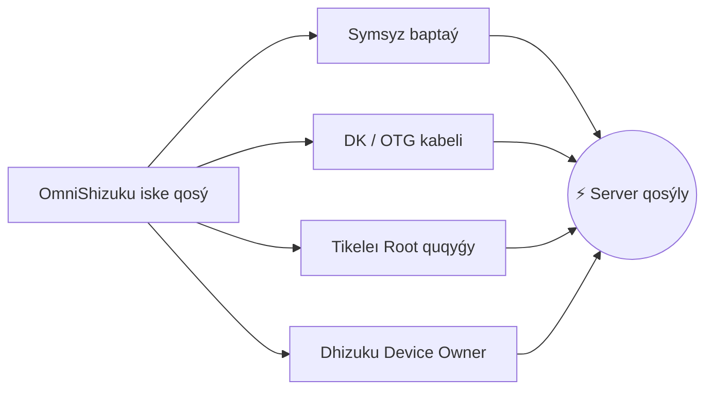

[English](README.md) | [Русский](README.ru.md) | [Қазақша](README.kk.md) | [Qazaqşa (Latın)](README.kk-Latn.md) | [Português](README.pt.md) | [Español](README.es.md) | [العربية](README.ar.md) | [简体中文](README.zh-CN.md) | [日本語](README.ja.md)

# ⚡ OmniShizuku

<div align="center">


# 👑 Android úşin Qudaı rejımi
### 4 túrli qoldanbany ornatýdy doǵaryńyz. Shynaıy artyqshylyq erkindigin sezinińiz — Root qajet emes.

[](https://github.com/krishna3163/OmniShizuku/stargazers)
[](https://github.com/krishna3163/OmniShizuku/network/members)
[](https://github.com/krishna3163/OmniShizuku/actions/workflows/apk-build.yml)
[](https://github.com/krishna3163/OmniShizuku/releases)
[](LICENSE)
[-success?style=for-the-badge&logo=android)](https://developer.android.com)

**Qoldanba paketi:** `com.krishna.omnishizuku`

[⚡ Sońǵy APK-ny júktep alý](#-jdam-júkteý-jáne-bastaý) • [✨ Negizgi artyqshylyqtary](#-omnishizuku-nesimen-erekshe) • [⚔️ Tolyq salystyru](#️-negizgi-salystyru-omnishizuku-basqalarǵa-qarsy) • [📚 Tolyq qujattama](docs/)

</div>

---

## 💥 Shizuku máselelerinen sharshadyńyz ba?

Ashyǵyn aıtaıyq:
- ❌ **Android jedel jadtı bosatqan kezde Shizuku serveriniń kezdeısoq óship qalýynan** sharshadyńyz ba?
- ❌ **Qurylyǵyny basqarý úshin 4 túrli qoldanbany kezektestirýden** jalyqtyńyz ba? *(API úshin Shizuku + Device Owner úshin Dhizuku + termınal úshin aShell + jumysyn ustaý úshin Shizuku-Keeper)*.
- ❌ **Batareıa men ónimdilikti baptaý úshin Magisk sııaqty ZIP-modýlderdi qalaısyz ba**, biraq júkteýishti (bootloader) asha almaısyz nemese Knox pen banktik qoldanbalardan aıyrylǵyńyz kelmeı me?
- ❌ **Termınaldaǵy túsiniksiz qatelerden** sharshadyńyz ba?

### 🚀 OmniShizuku-men tanysyńyz.
**OmniShizuku olardyń barlyǵyn almastyrady.** Ol klassıkalyq Shizuku artyqshylyqty Binder hattamasyn, Shizuku-Next modýldik júıesin, Dhizuku qurylyǵy ıesin basqarýdy, Gemini AI termınaldyq ıntellektin jáne NightDog ózin-ózi qalpyna keltirý júıesin **bıometrııalyq qorǵanysy bar Material 3 sýperqoldanbasyna biriktiredi.**

---

## ✨ OmniShizuku nesimen erekshe?

### 1. 📦 "Root-syz qurylyǵylarǵa arnalǵan Magisk" (ADB modýlder júıesi)
ZIP-modýlderdi tikeleı telefonyńyzdan ornatyńyz — júkteýishti ashýdyń, Root quqyqtarynyń jáne kepildikten aıyrylýdyń qajeti joq!
- **Tolyqqandy modýl pishimi:** `module.prop`, bannerler, `action.sh` jyldam quraldary jáne fondyq qyzmetter (`service.sh`).
- **Kiristirilmegen WebUI panelleri:** Modýlder natıvti `window.Shizuku` IPC kópiri arqyly tolyq ınteraktıvti HTML5/JavaScript panellerin kórsete alady!
- **GitHub onlaın-katalogi:** Qoǵamdastyq modýlderin bir basý arqyly qarap shyǵyńyz, júktep alyńyz jáne jańartyńyz.
- **Qaýipsizdik saıasattary:** Qaýipsiz rejım (Safe Mode), oryndalý ýaqytynyń shekteýleri, shyǵys lımıtteri jáne aýdıt jýrnaldary.

### 2. 🐕 Ólmeıtin qyzmet (NightDog Watchdog v14.5)
- ADB qoldanýshylarynyń basty qıyndyǵy — serverdiń fonda toqtap qalýy.
- OmniShizuku quramynda serverdiń jumysyn úzdiksiz baqylaıtyn aqyldy **NightDog Watchdog** qyzmeti bar.
- Eger júıe jad tapshylyǵynan qyzmetti toqtatsa, NightDog **kompıýterge qosylmaı-aq, symsyz baptaý arqyly serverdi avtomatty túrde qaıta iske qosady**!

### 3. 🛡️ Device Owner jáne Dhizuku sýper-kópiri
- Qurylyǵy ıesin (DPM) tolyq basqarý múmkindigi tikeleı kiristirildi.
- Ókilettikter kólemin baptaý, qajetsiz júıelik qoldanbalardy buǵattaý, júıelik shekteýlerdi basqarý.
- **Dhizuku-men 100% úılesimdi:** Dhizuku úshin jasalǵan qosymshalar OmniShizuku-men birden minsez jumys isteıdi!

### 4. 🤖 Comput konsoli jáne Gemini AI kómekshisi
- Jedel makros túımeleri bar kiristirilmegen artyqshylyqty ınteraktıvti ADB Shell.
- **Gemini AI dıagnostıkasy:** Túsiniksiz shell qatesine tap boldyńyz ba? Gemini AI jýrnaldardy avtomatty túrde taldap, anyq túsindirmeler men naqty áreketterdi usynady.
- **Commandium AI:** Qarapaıym tilmen ne qajet ekenin jazyńyz, al júıe kúrdeli termınal komandalaryn avtomatty túrde qurastyryp beredi!

### 5. 🔒 Fort-Noks deńgeıindegi bıometrııalyq qorǵanys
- Ruqsat etilmegen tulǵalarǵa nemese bógde qoldanbalarǵa júıeńizdi basqarýǵa jol bermeńiz.
- Negizgi bıometrııalyq qulypshy: Ruqsattar berýdi, modýlderdi oryndaýdy jáne mańyzdy parametrlerdi **saýsaq izi, betpen ashý nemese qurylyǵynyń PIN-kody/qupııa sózimen** senimdi qorǵańyz.

### 6. 🧪 Barlyq 15 zerthanalyq qural (Shizuku-Next-ten muralanǵan)
OmniShizuku **Shizuku-Next quraldarynyń 100% tolyqtyǵyn** saqtaıdy:
- 🌐 **Ár qoldanbaǵa arnalǵan faırvol:** VPN jáne Root-syz kez kelgen qoldanbanyń ınternetke qosylýyn buǵattaý (`cmd connectivity set-package-networking-enabled <uid> false`).
- 🕶️ **Dınamıkalyq 6 deńgeıli jasyryný:** Qatań tekserisi bar baǵdarlamalardan artyqshylyqty orta men ADB kúıin tolyq jasyrý.
- 🔑 **Wi-Fi qupııa sózderin kórý:** Saqtalǵan Wi-Fi qupııa sózderin Root-syz ashyq mátin túrinde oqý.
- 📁 **Artyqshylyqty faıldar menedjeri:** Android júıesiniń qorǵalǵan faıldary men qaltalaryn basqarý.
- 🚀 **Eksporttalmaǵan Activity iske qosý:** Óndirýshilerdiń jasyryn ınjenerlik máziri men synaq ekrandaryn ashý.
- 🌙 **Májbúrli qarańǵy rejım:** Qarańǵy rejimdi qoldamaıtyn qoldanbalarǵa AMOLED taza qara reńkin májbúrlep qoldaný.
- 🖥️ **Ekran parametrlerin ózgertý:** Ekran ruqsatyn, DPI tyǵyzdyǵyn baptaý jáne 120 Gts jıiligin májbúrli túrde bekitý.
- ⚡ **Keńeıtilgen qýat máziri:** Recovery, Fastboot jáne Bootloader rejımderine tikeleı qaıta júkteý.
- 🛑 **Phantom Process Killer toqtatý:** Termux jáne kúrdeli qurastyrylymdar úshin Android 12+ nusqasyndaǵy 32 process shekteýin alyp tastaý.
- 📦 **Split-APK InstallerX júıesi:** Bólengen APK-lardy ornatý, eski nusqaǵa oralý shekteýlerin aınalyp ótý jáne ornatý parametrlerin engizý.

---

## ⚔️ Negizgi salystyru: OmniShizuku basqalarǵa qarsy

OmniShizuku-nyń Android ékojúıesindegi barlyq balamalardan qalaı ústem ekenin kórińiz:

| Múmkindik | Resmı Shizuku | Shizuku-Next | ShizukuPlus / Shizako | Dhizuku | Magisk / Root | ⚡ **OmniShizuku** |
| :--- | :---: | :---: | :---: | :---: | :---: | :---: |
| **Root qajet emes pe?** | ✅ Iá | ✅ Iá | ✅ Iá | ✅ Iá | ❌ **Joq (Knox buzylady)**| 🌟 **Iá (100% Root-syz)** |
| **Artyqshylyqty Binder API** | ✅ Iá | ✅ Iá | ✅ Iá | ❌ Joq | ❌ Joq | 🌟 **Iá (Óte jyldam)** |
| **Device Owner (DPM) baqylaýy** | ❌ Joq | ❌ Joq | ❌ Joq | ✅ Iá | ❌ Joq | 🌟 **Iá (Kiristirilmegen)** |
| **Dhizuku baǵdarlamalarymen úılesimdilik**| ❌ Joq | ❌ Joq | ❌ Joq | ✅ Iá | ❌ Joq | 🌟 **Iá (Qos hattama)** |
| **ZIP modýlderi (Magisk stıli)**| ❌ Joq | ✅ Iá | ❌ Joq | ❌ Joq | ✅ Iá (Tek Root-pen) | 🌟 **Iá (Root-syz ZIP!)** |
| **Modýlder WebUI jáne JS kópiri**| ❌ Joq | ✅ Iá | ❌ Joq | ❌ Joq | ❌ Joq | 🌟 **Iá (HTML5 paneller)** |
| **AI Termınaly (Gemini / Comput)** | ❌ Joq | ❌ Joq | ❌ Joq | ❌ Joq | ❌ Joq | 🌟 **Iá (AI dıagnostıkasy)** |
| **Ózin-ózi qalpyna keltirý (NightDog)**| ❌ Joq | ⚠️ Negizgi | ❌ Joq | ❌ Joq | ❌ Joq | 🌟 **Iá (Avto-jandandyrý)** |
| **Bıometrııa / PIN qorǵanysy** | ❌ Joq | ❌ Joq | ❌ Joq | ❌ Joq | ❌ Joq | 🌟 **Iá (Saýsaq izi qulpy)** |
| **15 zerthana quraly (Faırvol/Wi-Fi)**| ❌ Joq | ✅ Iá | ⚠️ Jartylaı | ❌ Joq | ❌ Joq | 🌟 **Iá (Barlyq 15 qosylǵan)** |
| **Jasyryný (6 deńgeıli qorǵanys)**| ❌ Joq | ✅ Iá | ⚠️ Negizgi | ❌ Joq | ⚠️ Zygisk qajet | 🌟 **Iá (Dınamıkalyq jasyrý)**|
| **Android 17 / API 37 qoldaýy** | ❌ Eskirgen | ⚠️ API 36 | ❌ Eskirgen | ❌ Eskirgen | ⚠️ Qolmen baptaý | 🌟 **Iá (compileSdk 37)** |
| **Zamanaýı Compose Material 3** | ❌ Eski UI | ⚠️ Jartylaı | ❌ Eski UI | ❌ Eski UI | ❌ Eski UI | 🌟 **Iá (Kórkem M3)** |

> **Qorytyndy:** Basqa nusqalar basqatyrǵyshtyń bir ǵana bóligin usynsa, **OmniShizuku — tolyq qurastyrylǵan kartına.**

---

## 📸 Interfeıs kórinisi

<div align="center">

| 📱 Negizgi panel | 🤖 Comput AI konsoli | 📦 ADB modýlder menedjeri | ⚙️ Baptaýlar jáne Labs |
| :---: | :---: | :---: | :---: |
|  |  |  |  |
| *Server kúıi men jyldam qosqyshtar* | *AI túsindirmeleri, makrostar* | *ZIP modýlder, WebUI jáne katalog* | *Bıometrııa, faırvol jáne 15 qural* |

</div>

---

## 🚀 Jyldam júkteý jáne bastaý

> [!IMPORTANT]
> **Taza ornatý usynylady:** Biryńǵaı paket ıkentıfıkatoryna (`com.krishna.omnishizuku`) kóshýge baılanysty qoltańba qaqtyǵystaryn boldyrmaý úshin **burynǵy Shizuku nemese Shevery qoldanbalaryn aldyn ala joıyńyz**.

### 1-qadam: Júktep alý
- 📦 **Eń sońǵy avtomatty CI qurastyrylymdary:** [GitHub Actions](https://github.com/krishna3163/OmniShizuku/actions/workflows/apk-build.yml) &rarr; Tómengi **Artifacts** bóliminen `omnishizuku-release.apk` faılyn júkteńiz.
- 🏷️ **Turaqty resmı shyǵarylymdar:** [Shyǵarylymdar beti](https://github.com/krishna3163/OmniShizuku/releases)

### 2-qadam: Qolaıly ádispen iske qosý



1. **Symsyz baptaý (Android 11+ / DK qajet emes):**
   - Ázirleýshi baptaýlary &rarr; **Symsyz baptaýdy** qosyńyz &rarr; **Qurylyǵyny juptastyrý kodymen baılanystyru** túımesin basyńyz.
   - OmniShizuku-ǵa 6 tańbaly kodty engizip, **Bastaý** túımesin basyńyz.
2. **Kompıýter arqyly (ADB USB Shell):**
   ```bash
   adb shell sh /sdcard/Android/data/com.krishna.omnishizuku/starter.sh
   ```
3. **Root quqyǵy bar qurylyǵylar (Magisk / KernelSU / APatch):**
   - OmniShizuku-ny ashyńyz &rarr; **Root arqyly bastaý** túımesin basyńyz &rarr; Sýperpaıdalanýshy ruqs наз berińiz.
4. **Dhizuku arqyly (Device Owner):**
   - Fondyq basqarý úshin Dhizuku qoldanbasynda OmniShizuku-ǵa ruqsat berińiz.

---

## 📚 Tolyq qujattama

Barlyq tolyq tehnıkalyq nusqaýlyqtardy [`docs/`](docs/) qaltasynan oqyńyz:

| Qujat | Taqyryp |
| :--- | :--- |
| 📖 [**Comput AI agentiniń nusqaýlyǵy**](docs/comput-agent.md) | Termınal ortasy, Gemini AI kómekshisi jáne makrostar. |
| 🛡️ [**Device Owner jáne DPM nusqaýlyǵy**](docs/device-owner.md) | Profile Owner baptaýy, shekteýler men ókilettikter. |
| 📦 [**ADB modýlderin paıdalaný nusqaýlyǵy**](docs/adb-modules-guide.md) | ZIP-modýlderdi ornatý, qaýipsiz rejım jáne aqaýlardy joıý. |
| 🛠️ [**ADB modýlderi API anyqtamalyǵy**](docs/adb-modules-api.md) | Óz modýlderińizdi jazý: hýktar, orta aınymalylary jáne WebUI. |
| 🌐 [**GitHub kataloginde jarııalaý**](docs/github-catalog.md) | Modýlderdi jınaqtaý jáne jahandyq katalogke shyǵarý. |
| 🕶️ [**Stels-nusqa jáne zaglýshkalar (Stubs)**](docs/stealth-and-stubs.md) | Artyqshylyqty kúıdi tekseristerden jasyrý. |
| 🧪 [**Labs, USB jasyrý jáne faırvol**](docs/lab-and-extras.md) | Jelini buǵattaý, dınamıkalyq 6 deńgeıli jasyrý. |
| 🔌 [**Tasker jáne MacroDroid plagıni**](docs/tasker-plugin.md) | Avtomattandyrý trıggerleri, Intent habarlary jáne iske qosý. |
| 🐕 [**NightDog Watchdog qalpyna keltirý**](docs/nightdog.md) | Qyzmettiń densaýlyǵyn baqylaý jáne avtomatty qosylý. |
| 🚀 [**Android 17 úılesimdiligi**](docs/android-17-compatibility.md) | compileSdk 37 / Android Baklava úshin arhıtektýralyq beıimdelý. |
| 📡 [**Intent anyqtamalyǵy**](docs/intents.md) | Qoldaý kórsetiletin barlyq broadcast Intent-ter týraly tolyq málimet. |

---

## 💻 Bastapqy kodtan qurastyru

```bash
# 1. Repozıtorııdi qosalqy modýldermen birge kóshirip alyńyz
git clone --recurse-submodules https://github.com/krishna3163/OmniShizuku.git
cd OmniShizuku

# 2. Synaq nusqasyn qurastyru (Debug)
./gradlew :manager:assembleDebug

# 3. Shyǵarylym nusqasyn qurastyru (Release)
./gradlew :manager:assembleRelease
```
*Daıyn APK faıldary `manager/build/outputs/apk/{debug,release}/` qaltasynda bolady.*

---

## 🙏 Alǵys pen qurmet taqtasy

OmniShizuku kórnekti jobalardyń negizinde jasaldy. Biz kelesi jobalarǵa tereń alǵysymyzdy bildiremiz:

* **[RikkaApps/Shizuku](https://github.com/RikkaApps/Shizuku)** — Rikka jasaǵan revolıýtsııalyq artyqshylyqty Binder arhıtektýrasy.
* **[HmnDev-Tech/shevery](https://github.com/HmnDev-Tech/shevery)** — Bastapqy múmkindikter, keńeıtilgen ınterfeıs jáne modýldik negiz.
* **[iamr0s/Dhizuku](https://github.com/iamr0s/Dhizuku)** jáne **[rosan/Dhizuku](https://github.com/rosan/Dhizuku)** — Device Owner basqarý tujyrymdamasy men hattamalary.
* **[timschneeb/ShizuStore](https://github.com/timschneeb/ShizuStore)** — Qoldanbalar dúkeniniń repozıtorıılerin sínhrondar úlgileri.
* **[wxxsfxyzm/InstallerX-Revived](https://github.com/wxxsfxyzm/InstallerX-Revived)** — Split-APK ornatý ádisteri men óńdeý aǵyndary.
* **[zacharee/InstallWithOptions](https://github.com/zacharee/InstallWithOptions)** — Paketterdi ornatýdyń ıkemdi baptaýlary men jalaýshalary.
* **[d4rken/porter](https://github.com/d4rken/porter)** — Taza Android IPC quraldary men Binder oramalary.
* **[topjohnwu/libsu](https://github.com/topjohnwu/libsu)** — Root Shell basqarý qyzmetteri men senimdi Binder tranzaktsııalary.
* **[kerneldroid](https://github.com/kerneldroid)** — Compose UI komponentteri, katalog modýlderi jáne Android 17 / API 37 úılesimdiligi.
* **[DP-Hridayan/aShellYou](https://github.com/DP-Hridayan/aShellYou)** — ADB pármenderiniń termınaldyq ınterfeısi men quraldary.
* **[protonpony/Shizuku-Keeper](https://github.com/protonpony/Shizuku-Keeper)** — Symsyz baptaý qyzmetiniń júıe qosylǵanda avto-iske qosylý arhıtektýrasy.
* **[Landon Moran](https://github.com/LandonMoran)** — Dhizuku kópipine qosqan úlesi, TCP jelisin túzetýler jáne qyzmet turaqtylyǵy.

---

## 📜 100% Tegin jáne ashyq bastapqy kod

OmniShizuku — **[Apache License 2.0](LICENSE)** lıtsenzııasy boıynsha taratylatyn tegin baǵdarlamalyq qural.

> [!CAUTION]
> **Tegin qoldanba týraly eskertu:** OmniShizuku árqashan **100% tegin jáne ashyq bastapqy kodty** bolyp qala beredi. Bul qoldanbany júktep alý úshin eshqashan úshinshi tarap saıttaryna nemese satýshylarǵa aqsha tólemeńiz.

<div align="center">
  <sub><b>Krishna</b> jáne Android Open Source qaýymdastyǵynyń mahabbatymen jasalǵan.</sub>
</div>
