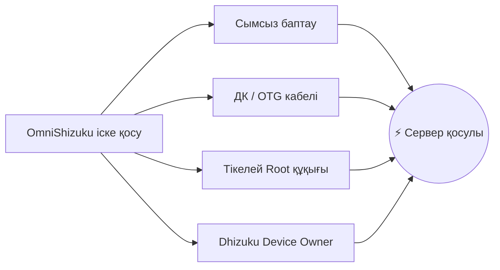

[English](README.md) | [Русский](README.ru.md) | [Қазақша](README.kk.md) | [Qazaqşa (Latın)](README.kk-Latn.md) | [Português](README.pt.md) | [Español](README.es.md) | [العربية](README.ar.md) | [简体中文](README.zh-CN.md) | [日本語](README.ja.md)

# ⚡ OmniShizuku

<div align="center">


# 👑 Android үшін Құдай режимі
### 4 түрлі қолданбаны орнатуды доғарыңыз. Шынайы артықшылық еркіндігін сезініңіз — Root қажет емес.

[](https://github.com/krishna3163/OmniShizuku/stargazers)
[](https://github.com/krishna3163/OmniShizuku/network/members)
[](https://github.com/krishna3163/OmniShizuku/actions/workflows/apk-build.yml)
[](https://github.com/krishna3163/OmniShizuku/releases)
[](LICENSE)
[-success?style=for-the-badge&logo=android)](https://developer.android.com)

**Қолданба пакеті:** `com.krishna.omnishizuku`

[⚡ Соңғы APK-ны жүктеп алу](#-жылдам-жүктеу-және-бастау) • [✨ Негізгі артықшылықтары](#-omnishizuku-несімен-ерекше) • [⚔️ Толық салыстыру](#️-негізгі-салыстыру-omnishizuku-басқаларға-қарсы) • [📚 Толық құжаттама](docs/)

</div>

---

## 💥 Shizuku мәселелерінен шаршадыңыз ба?

Ашығын айтайық:
- ❌ **Android жедел жадты босатқан кезде Shizuku серверінің кездейсоқ өшіп қалуынан** шаршадыңыз ба?
- ❌ **Құрылғыны басқару үшін 4 түрлі қолданбаны кезектестіруден** жалықтыңыз ба? *(API үшін Shizuku + Device Owner үшін Dhizuku + терминал үшін aShell + жұмысын ұстап тұру үшін Shizuku-Keeper)*.
- ❌ **Батарея мен өнімділікті баптау үшін Magisk сияқты ZIP-модульдерді қалайсыз ба**, бірақ жүктеуішті (bootloader) аша алмайсыз немесе Knox пен банктік қолданбалардан айырылғыңыз келмей ме?
- ❌ **Терминалдағы түсініксіз қателерден** шаршадыңыз ба?

### 🚀 OmniShizuku-мен танысыңыз.
**OmniShizuku олардың барлығын алмастырады.** Ол классикалық Shizuku артықшылықты Binder хаттамасын, Shizuku-Next модульдік жүйесін, Dhizuku құрылғы иесін басқаруды, Gemini AI терминалдық интеллектін және NightDog өзін-өзі қалпына келтіру жүйесін **биометриялық қорғанысы бар Material 3 суперқолданбасына біріктіреді.**

---

## ✨ OmniShizuku несімен ерекше?

### 1. 📦 "Root-сыз құрылғыларға арналған Magisk" (ADB модульдер жүйесі)
ZIP-модульдерді тікелей телефоныңыздан орнатыңыз — жүктеуішті ашудың, Root құқықтарының және кепілдіктен айырылудың қажеті жоқ!
- **Толыққанды модуль пішімі:** `module.prop`, баннерлер, `action.sh` жылдам құралдары және фондық қызметтер (`service.sh`).
- **Кірістірілген WebUI панельдері:** Модульдер нативті `window.Shizuku` IPC көпірі арқылы толық интерактивті HTML5/JavaScript панельдерін көрсете алады!
- **GitHub онлайн-каталогы:** Қоғамдастық модульдерін бір басу арқылы қарап шығыңыз, жүктеп алыңыз және жаңартыңыз.
- **Қауіпсіздік саясаттары:** Қауіпсіз режим (Safe Mode), орындалу уақытының шектеулері, шығыс лимиттері және аудит журналдары.

### 2. 🐕 Өлмейтін қызмет (NightDog Watchdog v14.5)
- ADB қолданушыларының басты қиындығы — сервердің фонда тоқтап қалуы.
- OmniShizuku құрамында сервердің жұмысын үздіксіз бақылайтын ақылды **NightDog Watchdog** қызметі бар.
- Егер жүйе жад тапшылығынан қызметті тоқтатса, NightDog **компьютерге қосылмай-ақ, сымсыз баптау арқылы серверді автоматты түрде қайта іске қосады**!

### 3. 🛡️ Device Owner және Dhizuku супер-көпірі
- Құрылғы иесін (DPM) толық басқару мүмкіндігі тікелей кірістірілген.
- Өкілеттіктер көлемін баптау, қажетсіз жүйелік қолданбаларды бұғаттау, жүйелік шектеулерді басқару.
- **Dhizuku-мен 100% үйлесімді:** Dhizuku үшін жасалған қосымшалар OmniShizuku-мен бірден мінсіз жұмыс істейді!

### 4. 🤖 Comput консолі және Gemini AI көмекшісі
- Жедел макрос түймелері бар кірістірілген артықшылықты интерактивті ADB Shell.
- **Gemini AI диагностикасы:** Түсініксіз шелл қатесіне тап болдыңыз ба? Gemini AI журналдарды автоматты түрде талдап, анық түсініктемелер мен нақты әрекеттерді ұсынады.
- **Commandium AI:** Қарапайым тілмен не қажет екенін жазыңыз, ал жүйе күрделі терминал командаларын автоматты түрде құрастырып береді!

### 5. 🔒 Форт-Нокс деңгейіндегі биометриялық қорғаныс
- Рұқсат етілмеген тұлғаларға немесе бөгде қолданбаларға жүйеңізді басқаруға жол бермеңіз.
- Негізгі биометриялық құлып: Рұқсаттар беруді, модульдерді орындауды және маңызды параметрлерді **саусақ ізі, бетпен ашу немесе құрылғының PIN-коды/құпия сөзімен** сенімді қорғаңыз.

### 6. 🧪 Барлық 15 зертханалық құрал (Shizuku-Next-тен мұраланған)
OmniShizuku **Shizuku-Next құралдарының 100% толықтығын** сақтайды:
- 🌐 **Әр қолданбаға арналған файрвол:** VPN және Root-сыз кез келген қолданбаның интернетке қосылуын бұғаттау (`cmd connectivity set-package-networking-enabled <uid> false`).
- 🕶️ **Динамикалық 6 деңгейлі жасыру:** Қатаң тексерісі бар бағдарламалардан артықшылықты орта мен ADB күйін толық жасыру.
- 🔑 **Wi-Fi құпия сөздерін көру:** Сақталған Wi-Fi құпия сөздерін Root-сыз ашық мәтін түрінде оқу.
- 📁 **Артықшылықты файлдар менеджері:** Android жүйесінің қорғалған файлдары мен қалталарын басқару.
- 🚀 **Экспортталмаған Activity іске қосу:** Өндірушілердің жасырын инженерлік мәзірлері мен сынақ экрандарын ашу.
- 🌙 **Мәжбүрлі қараңғы режим:** Қараңғы режимді қолдамайтын қолданбаларға AMOLED таза қара реңкін мәжбүрлеп қолдану.
- 🖥️ **Экран параметрлерін өзгерту:** Экран рұқсатын, DPI тығыздығын баптау және 120 Гц жиілігін мәжбүрлі түрде бекіту.
- ⚡ **Кеңейтілген қуат мәзірі:** Recovery, Fastboot және Bootloader режимдеріне тікелей қайта жүктеу.
- 🛑 **Phantom Process Killer тоқтату:** Termux және күрделі құрастырулар үшін Android 12+ нұсқасындағы 32 процесс шектеуін алып тастау.
- 📦 **Split-APK InstallerX жүйесі:** Бөлінген APK-ларды орнату, ескі нұсқаға оралу шектеулерін айналып өту және орнату параметрлерін енгізу.

---

## ⚔️ Негізгі салыстыру: OmniShizuku басқаларға қарсы

OmniShizuku-ның Android экожүйесіндегі барлық баламалардан қалай үстем екенін көріңіз:

| Мүмкіндік | Ресми Shizuku | Shizuku-Next | ShizukuPlus / Shizako | Dhizuku | Magisk / Root | ⚡ **OmniShizuku** |
| :--- | :---: | :---: | :---: | :---: | :---: | :---: |
| **Root қажет емес пе?** | ✅ Иә | ✅ Иә | ✅ Иә | ✅ Иә | ❌ **Жоқ (Knox бұзылады)**| 🌟 **Иә (100% Root-сыз)** |
| **Артықшылықты Binder API** | ✅ Иә | ✅ Иә | ✅ Иә | ❌ Жоқ | ❌ Жоқ | 🌟 **Иә (Өте жылдам)** |
| **Device Owner (DPM) бақылауы** | ❌ Жоқ | ❌ Жоқ | ❌ Жоқ | ✅ Иә | ❌ Жоқ | 🌟 **Иә (Кірістірілген)** |
| **Dhizuku бағдарламаларымен үйлесімділік**| ❌ Жоқ | ❌ Жоқ | ❌ Жоқ | ✅ Иә | ❌ Жоқ | 🌟 **Иә (Қос хаттама)** |
| **ZIP модульдері (Magisk стилі)**| ❌ Жоқ | ✅ Иә | ❌ Жоқ | ❌ Жоқ | ✅ Иә (Тек Root-пен) | 🌟 **Иә (Root-сыз ZIP!)** |
| **Модульдер WebUI және JS көпірі**| ❌ Жоқ | ✅ Иә | ❌ Жоқ | ❌ Жоқ | ❌ Жоқ | 🌟 **Иә (HTML5 панельдер)** |
| **AI Терминалы (Gemini / Comput)** | ❌ Жоқ | ❌ Жоқ | ❌ Жоқ | ❌ Жоқ | ❌ Жоқ | 🌟 **Иә (AI диагностикасы)** |
| **Өзін-өзі қалпына келтіру (NightDog)**| ❌ Жоқ | ⚠️ Негізгі | ❌ Жоқ | ❌ Жоқ | ❌ Жоқ | 🌟 **Иә (Авто-жандандыру)** |
| **Биометрия / PIN қорғанысы** | ❌ Жоқ | ❌ Жоқ | ❌ Жоқ | ❌ Жоқ | ❌ Жоқ | 🌟 **Иә (Саусақ ізі құлпы)** |
| **15 зертхана құралы (Файрвол/Wi-Fi)**| ❌ Жоқ | ✅ Иә | ⚠️ Жартылай | ❌ Жоқ | ❌ Жоқ | 🌟 **Иә (Барлық 15 қосылған)** |
| **Жасырыну (6 деңгейлі қорғаныс)**| ❌ Жоқ | ✅ Иә | ⚠️ Негізгі | ❌ Жоқ | ⚠️ Zygisk қажет | 🌟 **Иә (Динамикалық жасыру)**|
| **Android 17 / API 37 қолдауы** | ❌ Ескірген | ⚠️ API 36 | ❌ Ескірген | ❌ Ескірген | ⚠️ Қолмен баптау | 🌟 **Иә (compileSdk 37)** |
| **Заманауи Compose Material 3** | ❌ Ескі UI | ⚠️ Жартылай | ❌ Ескі UI | ❌ Ескі UI | ❌ Ескі UI | 🌟 **Иә (Көркем M3)** |

> **Қорытынды:** Басқа нұсқалар басқатырғыштың бір ғана бөлігін ұсынса, **OmniShizuku — толық құрастырылған картина.**

---

## 📸 Интерфейс көрінісі

<div align="center">

| 📱 Негізгі панель | 🤖 Comput AI консолі | 📦 ADB модульдер менеджері | ⚙️ Баптаулар және Labs |
| :---: | :---: | :---: | :---: |
|  |  |  |  |
| *Сервер күйі мен жылдам қосқыштар* | *AI түсіндірмелері, макростар* | *ZIP модульдер, WebUI және каталог* | *Биометрия, файрвол және 15 құрал* |

</div>

---

## 🚀 Жылдам жүктеу және бастау

> [!IMPORTANT]
> **Таза орнату ұсынылады:** Бірыңғай пакет идентификаторына (`com.krishna.omnishizuku`) көшуге байланысты қолтаңба қақтығыстарын болдырмау үшін **бұрынғы Shizuku немесе Shevery қолданбаларын алдын ала жойыңыз**.

### 1-қадам: Жүктеп алу
- 📦 **Ең соңғы автоматты CI құрастырылымдары:** [GitHub Actions](https://github.com/krishna3163/OmniShizuku/actions/workflows/apk-build.yml) &rarr; Төменгі **Artifacts** бөлімінен `omnishizuku-release.apk` файлын жүктеңіз.
- 🏷️ **Тұрақты ресми шығарылымдар:** [Шығарылымдар беті](https://github.com/krishna3163/OmniShizuku/releases)

### 2-қадам: Қолайлы әдіспен іске қосу



1. **Сымсыз баптау (Android 11+ / ДК қажет емес):**
   - Әзірлеуші баптаулары &rarr; **Сымсыз баптауды** қосыңыз &rarr; **Құрылғыны жұптастыру кодымен байланыстыру** түймесін басыңыз.
   - OmniShizuku-ға 6 таңбалы кодты енгізіп, **Бастау** түймесін басыңыз.
2. **Компьютер арқылы (ADB USB Shell):**
   ```bash
   adb shell sh /sdcard/Android/data/com.krishna.omnishizuku/starter.sh
   ```
3. **Root құқығы бар құрылғылар (Magisk / KernelSU / APatch):**
   - OmniShizuku-ны ашыңыз &rarr; **Root арқылы бастау** түймесін басыңыз &rarr; Суперпайдаланушы рұқсатын беріңіз.
4. **Dhizuku арқылы (Device Owner):**
   - Фондық басқару үшін Dhizuku қолданбасында OmniShizuku-ға рұқсат беріңіз.

---

## 📚 Толық құжаттама

Барлық толық техникалық нұсқаулықтарды [`docs/`](docs/) қалтасынан оқыңыз:

| Құжат | Тақырып |
| :--- | :--- |
| 📖 [**Comput AI агентінің нұсқаулығы**](docs/comput-agent.md) | Терминал ортасы, Gemini AI көмекшісі және макростар. |
| 🛡️ [**Device Owner және DPM нұсқаулығы**](docs/device-owner.md) | Profile Owner баптауы, шектеулер мен өкілеттіктер. |
| 📦 [**ADB модульдерін пайдалану нұсқаулығы**](docs/adb-modules-guide.md) | ZIP-модульдерді орнату, қауіпсіз режим және ақауларды жою. |
| 🛠️ [**ADB модульдері API анықтамалығы**](docs/adb-modules-api.md) | Өз модульдеріңізді жазу: хуктар, орта айнымалылары және WebUI. |
| 🌐 [**GitHub каталогында жариялау**](docs/github-catalog.md) | Модульдерді жинақтау және жаһандық каталогқа шығару. |
| 🕶️ [**Стелс-нұсқа және заглушкалар (Stubs)**](docs/stealth-and-stubs.md) | Артықшылықты күйді тексерулерден жасыру. |
| 🧪 [**Labs, USB жасыру және файрвол**](docs/lab-and-extras.md) | Желіні бұғаттау, динамикалық 6 деңгейлі жасыру. |
| 🔌 [**Tasker және MacroDroid плагині**](docs/tasker-plugin.md) | Автоматтандыру триггерлері, Intent хабарлары және іске қосу. |
| 🐕 [**NightDog Watchdog қалпына келтіру**](docs/nightdog.md) | Қызметтің денсаулығын бақылау және автоматты қосылу. |
| 🚀 [**Android 17 үйлесімділігі**](docs/android-17-compatibility.md) | compileSdk 37 / Android Baklava үшін архитектуралық бейімделу. |
| 📡 [**Intent анықтамалығы**](docs/intents.md) | Қолдау көрсетілетін барлық broadcast Intent-тер туралы толық мәлімет. |

---

## 💻 Бастапқы кодтан құрастыру

```bash
# 1. Репозиторийді қосалқы модульдермен бірге көшіріп алыңыз
git clone --recurse-submodules https://github.com/krishna3163/OmniShizuku.git
cd OmniShizuku

# 2. Сынақ нұсқасын құрастыру (Debug)
./gradlew :manager:assembleDebug

# 3. Шығарылым нұсқасын құрастыру (Release)
./gradlew :manager:assembleRelease
```
*Дайын APK файлдары `manager/build/outputs/apk/{debug,release}/` қалтасында болады.*

---

## 🙏 Алғыс пен құрмет тақтасы

OmniShizuku көрнекті жобалардың негізінде жасалды. Біз келесі жобаларға терең алғысымызды білдіреміз:

* **[RikkaApps/Shizuku](https://github.com/RikkaApps/Shizuku)** — Rikka жасаған революциялық артықшылықты Binder архитектурасы.
* **[HmnDev-Tech/shevery](https://github.com/HmnDev-Tech/shevery)** — Бастапқы мүмкіндіктер, кеңейтілген интерфейс және модульдік негіз.
* **[iamr0s/Dhizuku](https://github.com/iamr0s/Dhizuku)** және **[rosan/Dhizuku](https://github.com/rosan/Dhizuku)** — Device Owner басқару тұжырымдамасы мен хаттамалары.
* **[timschneeb/ShizuStore](https://github.com/timschneeb/ShizuStore)** — Қолданбалар дүкенінің репозиторийлерін синхрондау үлгілері.
* **[wxxsfxyzm/InstallerX-Revived](https://github.com/wxxsfxyzm/InstallerX-Revived)** — Split-APK орнату әдістері мен өңдеу ағындары.
* **[zacharee/InstallWithOptions](https://github.com/zacharee/InstallWithOptions)** — Пакеттерді орнатудың икемді баптаулары мен жалаушалары.
* **[d4rken/porter](https://github.com/d4rken/porter)** — Таза Android IPC құралдары мен Binder орамалары.
* **[topjohnwu/libsu](https://github.com/topjohnwu/libsu)** — Root Shell басқару қызметтері мен сенімді Binder транзакциялары.
* **[kerneldroid](https://github.com/kerneldroid)** — Compose UI компоненттері, каталог модульдері және Android 17 / API 37 үйлесімділігі.
* **[DP-Hridayan/aShellYou](https://github.com/DP-Hridayan/aShellYou)** — ADB пәрмендерінің терминалдық интерфейсі мен құралдары.
* **[protonpony/Shizuku-Keeper](https://github.com/protonpony/Shizuku-Keeper)** — Сымсыз баптау қызметінің жүйе қосылғанда авто-іске қосылу архитектурасы.
* **[Landon Moran](https://github.com/LandonMoran)** — Dhizuku көпіріне қосқан үлесі, TCP желісін түзетулер және қызмет тұрақтылығы.

---

## 📜 100% Тегін және ашық бастапқы код

OmniShizuku — **[Apache License 2.0](LICENSE)** лицензиясы бойынша таратылатын тегін бағдарламалық құрал.

> [!CAUTION]
> **Тегін қолданба туралы ескерту:** OmniShizuku әрқашан **100% тегін және ашық бастапқы кодты** болып қала береді. Бұл қолданбаны жүктеп алу үшін ешқашан үшінші тарап сайттарына немесе сатушыларға ақша төлемеңіз.

<div align="center">
  <sub><b>Krishna</b> және Android Open Source қауымдастығының махаббатымен жасалған.</sub>
</div>
