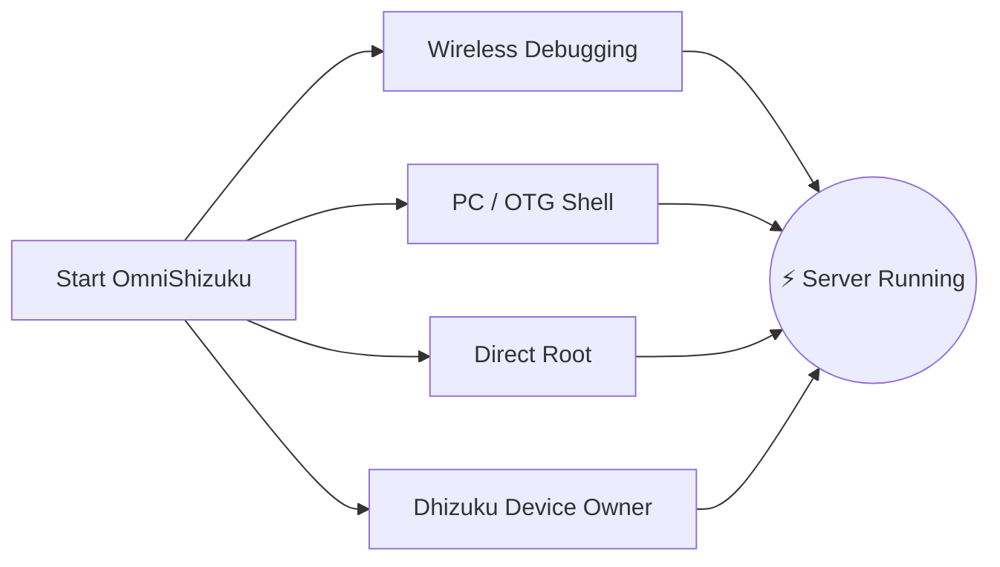

[English](README.md) | [Русский](README.ru.md) | [Қазақша](README.kk.md) | [Qazaqşa (Latın)](README.kk-Latn.md) | [Português](README.pt.md) | [Español](README.es.md) | [العربية](README.ar.md) | [简体中文](README.zh-CN.md) | [日本語](README.ja.md)

# ⚡ OmniShizuku

<div align="center">


# Android customization with Shizuku privileged access

**Created & Maintained by [Krishna](https://github.com/krishna3163)**

[](https://github.com/krishna3163/OmniShizuku/releases)
[](https://github.com/krishna3163/OmniShizuku/stargazers)
[](https://github.com/krishna3163/OmniShizuku/network/members)
[](https://github.com/krishna3163/OmniShizuku/actions/workflows/apk-build.yml)
[](https://github.com/krishna3163/OmniShizuku/releases)
[](LICENSE)
[](https://developer.android.com)

**Application Package:** `com.krishna.omnishizuku`

[Current implementation](#current-implementation) • [Build instructions](#building-from-source) • [Technical docs](docs/)

</div>

---

## Current implementation

OmniShizuku is an Android application built around the Shizuku Binder service. The repository currently contains these code areas:

| Area | Present in source | Verification |
|---|---|---|
| Shizuku server, ADB/root starters, Binder API and shell | Yes | Build and device behavior not verified in this audit |
| ZIP modules, action/service scripts, module WebUI and command review | Yes | Static checks are present; no device run |
| App management, package inspection and UAD debloater | Yes | Android/OEM behavior not verified |
| APK/APKS/APKM/XAPK install flow and install options | Yes | Shell commands are source-reviewed; Android build/device run pending |
| Private DNS, per-app network controls and system labs | Yes | DNS-over-TLS presets include Cloudflare, AdGuard, Quad9, OpenDNS, DNSforge, HaGeZi, Google and CleanBrowsing; Android/OEM behavior is unverified |
| Device Owner/Dhizuku, watchdog, biometric gate, Tasker and AI UI | Code is present | End-to-end compatibility is not verified |

**These entries describe code in the repository, not a claim that every feature works on every device.** The repository-wide source audit and Android build are still in progress. See [`docs/integration-progress.md`](docs/integration-progress.md), [`docs/feature-source-mapping.md`](docs/feature-source-mapping.md), and [`docs/build-and-test-results.md`](docs/build-and-test-results.md) for evidence and limits. The manager declares a minimum Android SDK of 25; support on a given Android release is not established by that setting alone.

Privileged operations require a running Shizuku server or another supported backend. Some controls require root, Device Owner, specific Android APIs, or manufacturer support. Review each operation before using it; the app cannot bypass Android or OEM restrictions.

### Modules and WebUI

The source includes ZIP module install/enable/remove operations, bounded extraction, `module.prop`, action and service scripts, a local WebUI, an optional shell bridge, and per-command approval. ADB module scripts execute with shell privileges; install and WebUI behavior has not been device-verified.

### App and system tools

The source includes package browsing and operations, a UAD-backed debloater, APK inspection and install options, Private DNS controls, network restrictions, display/system settings, logs, and power actions. Battery Center uses Essentials' battery/thermal utilities and exposes the upstream Pixel charging-mode setting on Google devices. These use privileged Android APIs or shell commands, so availability and results depend on the device build and granted backend; the Android app build and device behavior are still unverified in this audit.

### AI and automation

AI provider configuration, assistant screens, shell history and automation/plugin code are present. Provider connectivity, model behavior, and every automation trigger/action have not been verified end to end. Review commands before running them with elevated access.

---

## 📸 Visual Showcase

<div align="center">

| 📱 Main Dashboard | 🤖 Comput AI Console | 📦 ADB Modules Manager | ⚙️ Settings & Labs |
| :---: | :---: | :---: | :---: |
|  |  |  |  |
| *Dashboard UI* | *AI and shell UI* | *Modules UI* | *Settings and labs UI* |

</div>

---

## 🚀 Instant Download & Quick Start

Install a build from a trusted project release or build it locally. Package signing and upgrade compatibility depend on the build source and signing key; do not uninstall an existing Shizuku app unless you understand the impact on apps that depend on its service.

### Step 1: Obtain a build
- [GitHub Actions](https://github.com/krishna3163/OmniShizuku/actions/workflows/apk-build.yml) and [Releases](https://github.com/krishna3163/OmniShizuku/releases) are project links. Availability and build status are determined by the linked pages.

### Step 2: Launch with Your Favorite Method



1. **Wireless Debugging (Android 11+):**
   - Developer Options &rarr; Enable **Wireless Debugging** &rarr; Tap **Pair device with pairing code**.
   - Enter the 6-digit code in OmniShizuku & tap **Start**.
2. **Via PC or root:** Use the start flow shown in the installed app and follow its prompts. Exact options depend on the installed build and device.

---

## 📚 Deep Dive Documentation

Read our comprehensive technical guides in the [`docs/`](docs/) directory:

| Document | Topic |
| :--- | :--- |
| 📖 [**Comput AI Agent Guide**](docs/comput-agent.md) | Terminal environment, Gemini AI copilot, and macro scripting. |
| 🛡️ [**Device Owner & DPM Guide**](docs/device-owner.md) | Profile owner setup, policy restrictions, and delegation scopes. |
| 📦 [**ADB Modules User Guide**](docs/adb-modules-guide.md) | Installing ZIP modules, Safe Mode policies, and troubleshooting. |
| 🛠️ [**ADB Modules API Reference**](docs/adb-modules-api.md) | Writing your own modules: hooks, environment variables, and WebUI bridge. |
| 🌐 [**GitHub Catalog Publishing**](docs/github-catalog.md) | Packaging and publishing custom modules for the global catalog. |
| 🕶️ [**Stealth Edition & Stubs**](docs/stealth-and-stubs.md) | Hiding privileged status from hostile inspection. |
| 🧪 [**Labs, USB Hiding & Firewall**](docs/lab-and-extras.md) | Network blocking, dynamic 6-layer hiding, and accessibility controls. |
| 🔌 [**Tasker & MacroDroid Plugin**](docs/tasker-plugin.md) | Automation triggers, broadcast intents, and auto-start scripts. |
| 🐕 [**NightDog Watchdog Recovery**](docs/nightdog.md) | Daemon health monitoring and auto-reconnection architecture. |
| 🚀 [**Android 17 Compatibility**](docs/android-17-compatibility.md) | Architectural changes for compileSdk 37 / Android Baklava. |
| 📡 [**Intents Reference**](docs/intents.md) | Complete documentation of all supported broadcast intents. |

---

## 💻 Building from Source

```bash
# Clone the repository
git clone https://github.com/krishna3163/OmniShizuku.git
cd OmniShizuku

# 2. Build Debug Variant
./gradlew :manager:assembleDebug

# 3. Build Release Variant
./gradlew :manager:assembleRelease
```
*Generated APKs will be in `manager/build/outputs/apk/{debug,release}/`.*

The Android build requires JDK 21, Android SDK platform 37.1, and the NDK version declared by the project. Gradle build and test tasks have not completed in the current audit environment; see [`docs/build-and-test-results.md`](docs/build-and-test-results.md).

---

## Upstream references reviewed

The repository inventory and feature mapping track source projects and integration evidence. In this audit, the target's Shizuku engine was compared at a high level with upstream Shizuku, and two small input-validation helpers were adapted with attribution: the package-name rule from [ShizukuPlus](https://github.com/thejaustin/ShizukuPlus) and the DNS hostname parser from [ADNS](https://github.com/eyalm2000/adns). Other project relationships remain under audit; see [`docs/source-repository-inventory.md`](docs/source-repository-inventory.md).

---

## License

OmniShizuku's project license is the **[Apache License 2.0](LICENSE)**. Bundled dependencies and adapted upstream code may carry separate license and attribution terms; see [`NOTICE`](NOTICE), [`licenses/`](licenses/), and the inventory. The audit has not yet verified licensing for every file in the repository.

> [!CAUTION]
> **Free App Notice:** OmniShizuku is and always will be **100% free and open-source**. Never pay any third-party website, seller, or file host to download this app.

<div align="center">
  <sub>Crafted with passion by <b>Krishna</b> & the Open-Source Android Community.</sub>
</div>
