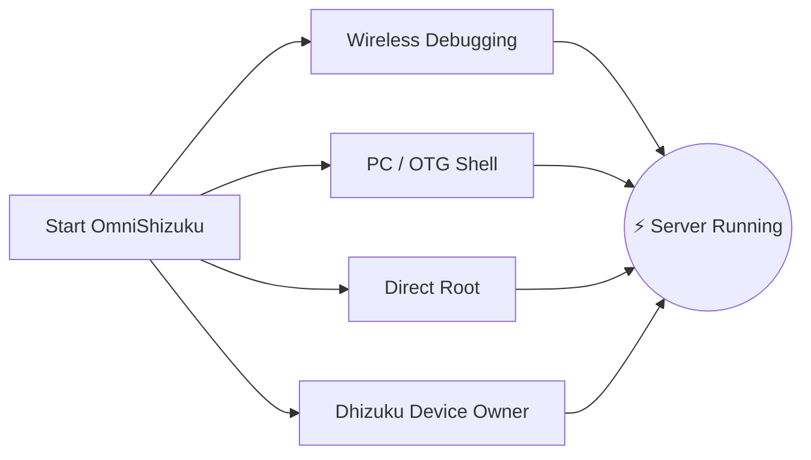

# ⚡ OmniShizuku

<div align="center">


# 👑 The God Mode for Android
### Stop Installing 4 Different Apps. Experience True Privileged Freedom — No Root Required.

[](https://github.com/krishna3163/OmniShizuku/stargazers)
[](https://github.com/krishna3163/OmniShizuku/network/members)
[](https://github.com/krishna3163/OmniShizuku/actions/workflows/apk-build.yml)
[](https://github.com/krishna3163/OmniShizuku/releases)
[](LICENSE)
[-success?style=for-the-badge&logo=android)](https://developer.android.com)

**Application Package:** `com.krishna.omnishizuku`

[⚡ Download Latest APK](#-instant-download--quick-start) • [✨ Killer Features](#-what-makes-omnishizuku-unbeatable) • [⚔️ Comparison Showdown](#️-the-ultimate-showdown-omnishizuku-vs-the-rest) • [📚 Full Docs](docs/)

</div>

---

## 💥 Tired of the Shizuku Hassle?

Let’s be honest:
- ❌ **Tired of your Shizuku server dying randomly** whenever Android gets aggressive with memory?
- ❌ **Tired of juggling 4 different apps** just to manage your phone? *(Shizuku for APIs + Dhizuku for Device Owner + aShell for terminal + Shizuku-Keeper to keep it alive)*.
- ❌ **Want Magisk-like ZIP modules** for battery & performance tweaks, but can't unlock your bootloader or afford to trip Knox & Banking apps?
- ❌ **Tired of confusing terminal errors** with zero guidance?

### 🚀 Say Hello to OmniShizuku.
**OmniShizuku replaces them all.** It unites the classic Shizuku privileged binder protocol, the entire Shizuku-Next modular extension engine, Dhizuku Device Owner controls, Gemini AI terminal intelligence, and NightDog self-healing crash recovery into **one stunning, biometric-secured Material 3 super-app.**

---

## ✨ What Makes OmniShizuku Unbeatable?

### 1. 📦 "Magisk for Non-Root" (ADB Modules Engine)
Flash standalone ZIP modules directly from your phone — no unlocked bootloader, no root, no voided warranty!
- **Rich Module Format:** Supports `module.prop`, artwork banners, `action.sh` one-shot tools, and background daemons (`service.sh`).
- **Embedded WebUI Dashboards:** Modules can render full interactive HTML5/JavaScript dashboards with native `window.Shizuku` IPC bridging!
- **Online GitHub Catalog:** Browse, download, and update community modules with a single tap.
- **Safety Policies:** Safe Mode sandboxing, execution timeouts, output quotas, and audit logs.

### 2. 🐕 Unkillable Daemon (NightDog Watchdog v14.5)
- The #1 frustration of ADB users is servers dying in the background.
- OmniShizuku features an intelligent **NightDog Watchdog** daemon that continuously monitors server heartbeats.
- If Android kills the service under heavy RAM pressure, NightDog **automatically revives and restarts the server via Wireless Debugging** without needing a PC reconnect!

### 3. 🛡️ Device Owner & Dhizuku Super-Bridge
- Full Device Owner (DPM) management built right in.
- Configure granular delegation scopes, block bloatware, toggle system restrictions, and manage policies.
- **100% Dhizuku Compatible:** Apps built for Dhizuku talk seamlessly to OmniShizuku!

### 4. 🤖 Comput Console & Gemini AI Copilot
- Built-in interactive privileged ADB shell with instant macro buttons.
- **Gemini AI Diagnostics:** Stuck on a cryptic Android shell error? Gemini AI automatically translates raw error logs into clear, actionable explanations.
- **Commandium AI:** Generate complex shell commands simply by typing what you want in plain English or Hinglish!

### 5. 🔒 Fort Knox Biometric Protection
- Don't let unauthorized users or sneaky apps exploit your privileged environment.
- Master Biometric Lock: Protect permission grants, module execution, and sensitive settings behind **Fingerprint, Face Unlock, or Device Lock PIN/Password**.

### 6. 🧪 All 15 Power-User Labs (Inherited from Shizuku-Next)
OmniShizuku retains **100% of Shizuku-Next’s acclaimed power tools**:
- 🌐 **Per-App Network Firewall:** Cut off internet access for any app without a VPN and without root (`cmd connectivity set-package-networking-enabled`).
- 🚫 **Autostart Blocker:** Stop greedy background apps from launching themselves on boot (`RUN_ANY_IN_BACKGROUND`).
- 🕶️ **6-Layer Stealth Anti-Detection:** Dynamically hide Developer Options, USB Debugging, Wireless Debugging, Accessibility, Private DNS, and VPN flags from banking/corporate apps.
- 🔑 **Cleartext Wi-Fi Password Viewer:** Read stored Wi-Fi passwords with zero root access.
- 📁 **Privileged File Explorer:** Browse and manage protected Android system files.
- 🚀 **Unexported Activity Launcher:** Launch hidden system menus and OEM secret screens.
- 🌙 **Force Dark Mode:** Force AMOLED dark mode on stubborn, uncooperative apps.
- 🖥️ **Display Overrides:** Change resolution, DPI density, and force 120Hz/high refresh rates.
- ⚡ **Advanced Power Menu:** Direct reboot to Recovery, Fastboot, and Bootloader.
- 🛑 **Phantom Process Killer Stopper:** Disable Android 12+'s 32-process limit for heavy Termux / compilation workloads.
- 📦 **Split-APK InstallerX Engine:** Install multi-APKs, bypass downgrade restrictions, and customize installation flags.

---

## ⚔️ The Ultimate Showdown: OmniShizuku vs The Rest

See how OmniShizuku dominates every other fork and solution in the Android ecosystem:

| Feature / Power | Official Shizuku | Shizuku-Next | ShizukuPlus / Shizako | Dhizuku | Magisk / Root | ⚡ **OmniShizuku** |
| :--- | :---: | :---: | :---: | :---: | :---: | :---: |
| **No Root Required?** | ✅ Yes | ✅ Yes | ✅ Yes | ✅ Yes | ❌ **No (Trips Knox)** | 🌟 **Yes (100% Non-Root)** |
| **Privileged Binder API** | ✅ Yes | ✅ Yes | ✅ Yes | ❌ No | ❌ No | 🌟 **Yes (Blazing Fast)** |
| **Device Owner (DPM) Controls** | ❌ No | ❌ No | ❌ No | ✅ Yes | ❌ No | 🌟 **Yes (Built-in)** |
| **Dhizuku App Compatibility** | ❌ No | ❌ No | ❌ No | ✅ Yes | ❌ No | 🌟 **Yes (Dual Protocol)** |
| **ZIP Modules Engine (Magisk-style)** | ❌ No | ✅ Yes | ❌ No | ❌ No | ✅ Yes (Root only) | 🌟 **Yes (Rootless ZIPs!)** |
| **Module WebUI & JS Bridge** | ❌ No | ✅ Yes | ❌ No | ❌ No | ❌ No | 🌟 **Yes (HTML5 Dashboards)** |
| **AI Terminal (Gemini / Comput)** | ❌ No | ❌ No | ❌ No | ❌ No | ❌ No | 🌟 **Yes (AI Diagnosed)** |
| **Self-Healing Watchdog (NightDog)** | ❌ No | ⚠️ Basic | ❌ No | ❌ No | ❌ No | 🌟 **Yes (Auto-Revive)** |
| **Biometric / PIN Security Gate** | ❌ No | ❌ No | ❌ No | ❌ No | ❌ No | 🌟 **Yes (Fingerprint Lock)** |
| **15 Labs Power Tools (Firewall/Wi-Fi)**| ❌ No | ✅ Yes | ⚠️ Partial | ❌ No | ❌ No | 🌟 **Yes (All 15 Included)** |
| **Anti-Detection Hiding (6 Layers)** | ❌ No | ✅ Yes | ⚠️ Basic | ❌ No | ⚠️ Requires Zygisk | 🌟 **Yes (Dynamic Auto-Hide)** |
| **Android 17 / API 37 Support** | ❌ Stale | ⚠️ API 36 | ❌ Stale | ❌ Stale | ⚠️ Manual | 🌟 **Yes (compileSdk 37)** |
| **Modern Compose Material 3 UI** | ❌ Legacy | ⚠️ Partial | ❌ Legacy | ❌ Legacy | ❌ Legacy | 🌟 **Yes (Expressive M3)** |

> **The Verdict:** While other forks only offer one piece of the puzzle, **OmniShizuku is the complete puzzle.**

---

## 📸 Visual Showcase

<div align="center">

| 📱 Main Dashboard | 🤖 Comput AI Console | 📦 ADB Modules Manager | ⚙️ Settings & Labs |
| :---: | :---: | :---: | :---: |
|  |  |  |  |
| *Real-time server state & quick toggles* | *AI explanations, macros & commandium* | *ZIP modules, WebUIs & catalogs* | *Biometrics, firewall & 15 labs* |

</div>

---

## 🚀 Instant Download & Quick Start

> [!IMPORTANT]
> **Fresh Install Recommended:** Due to our unified package ID (`com.krishna.omnishizuku`), please **uninstall older Shizuku or Shevery manager builds** first to avoid Android signature conflicts.

### Step 1: Download
- 📦 **Latest CI Builds (Every Commit):** [GitHub Actions](https://github.com/krishna3163/OmniShizuku/actions/workflows/apk-build.yml) &rarr; Scroll down to **Artifacts** to download `omnishizuku-release.apk`.
- 🏷️ **Stable GitHub Releases:** [Releases Page](https://github.com/krishna3163/OmniShizuku/releases)

### Step 2: Launch with Your Favorite Method



1. **Wireless Debugging (Android 11+ / No PC required):**
   - Developer Options &rarr; Enable **Wireless Debugging** &rarr; Tap **Pair device with pairing code**.
   - Enter the 6-digit code in OmniShizuku & tap **Start**.
2. **Via PC (ADB USB Shell):**
   ```bash
   adb shell sh /sdcard/Android/data/com.krishna.omnishizuku/starter.sh
   ```
3. **Rooted Device (Magisk / KernelSU / APatch):**
   - Open OmniShizuku &rarr; Tap **Start under Root** &rarr; Grant Superuser access.
4. **Via Dhizuku (Device Owner):**
   - Authorize OmniShizuku in Dhizuku for background management.

---

## 📚 Deep Dive Documentation

Read our comprehensive technical guides in the [`docs/`](docs/) directory:

| Document | Topic |
| :--- | :--- |
| 📖 [**Comput AI Agent Guide**](docs/comput-agent.md) | Terminal environment, Gemini AI copilot, and macro scripting. |
| 🛡️ [**Device Owner & DPM Guide**](docs/device-owner.md) | Profile owner setup, policy restrictions, and delegation scopes. |
| 📦 [**ADB Modules User Guide**](docs/adb-modules-guide.md) | Installing ZIP modules, Safe Mode policies, and troubleshooting. |
| 🛠️ [**ADB Modules API Reference**](docs/adb-modules-api.md) | Writing your own modules: hooks, environment variables, and WebUI bridge. |
| 🌐 [**GitHub Catalog Publishing**](docs/github-catalog.md) | Packaging and publishing custom modules for the global catalog. |
| 🕶️ [**Stealth Edition & Stubs**](docs/stealth-and-stubs.md) | Hiding privileged status from hostile inspection. |
| 🧪 [**Labs, USB Hiding & Firewall**](docs/lab-and-extras.md) | Network blocking, dynamic 6-layer hiding, and accessibility controls. |
| 🔌 [**Tasker & MacroDroid Plugin**](docs/tasker-plugin.md) | Automation triggers, broadcast intents, and auto-start scripts. |
| 🐕 [**NightDog Watchdog Recovery**](docs/nightdog.md) | Daemon health monitoring and auto-reconnection architecture. |
| 🚀 [**Android 17 Compatibility**](docs/android-17-compatibility.md) | Architectural changes for compileSdk 37 / Android Baklava. |
| 📡 [**Intents Reference**](docs/intents.md) | Complete documentation of all supported broadcast intents. |

---

## 💻 Building from Source

```bash
# 1. Clone the repository with submodules
git clone --recurse-submodules https://github.com/krishna3163/OmniShizuku.git
cd OmniShizuku

# 2. Build Debug Variant
./gradlew :manager:assembleDebug

# 3. Build Release Variant
./gradlew :manager:assembleRelease
```
*Generated APKs will be in `manager/build/outputs/apk/{debug,release}/`.*

---

## 🙏 Special Thanks & Upstream Hall of Fame

OmniShizuku is built on the shoulders of giants. We express our utmost respect and heartfelt gratitude to:

* **[RikkaApps/Shizuku](https://github.com/RikkaApps/Shizuku)** — The original, revolutionary privileged binder architecture created by Rikka.
* **[HmnDev-Tech/shevery](https://github.com/HmnDev-Tech/shevery)** — Upstream features, expanded UI, and multi-module foundation.
* **[iamr0s/Dhizuku](https://github.com/iamr0s/Dhizuku)** & **[rosan/Dhizuku](https://github.com/rosan/Dhizuku)** — Device Owner management concepts and bridging protocols.
* **[timschneeb/ShizuStore](https://github.com/timschneeb/ShizuStore)** — App Store catalog repository synchronization patterns.
* **[wxxsfxyzm/InstallerX-Revived](https://github.com/wxxsfxyzm/InstallerX-Revived)** — Split-APK installation techniques and staging flows.
* **[zacharee/InstallWithOptions](https://github.com/zacharee/InstallWithOptions)** — Granular package installation options and bypass flags.
* **[d4rken/porter](https://github.com/d4rken/porter)** — Clean Android IPC helper primitives and binder wrappers.
* **[topjohnwu/libsu](https://github.com/topjohnwu/libsu)** — Root shell service management and robust binder transaction wrappers.
* **[kerneldroid](https://github.com/kerneldroid)** — Compose UI components, catalog modules, and Android 17 / API 37 compatibility work.
* **[DP-Hridayan/aShellYou](https://github.com/DP-Hridayan/aShellYou)** — ADB command terminal UI and computing tools.
* **[protonpony/Shizuku-Keeper](https://github.com/protonpony/Shizuku-Keeper)** — Wireless Debugging daemon boot autostart architecture.
* **[Landon Moran](https://github.com/LandonMoran)** — Contributions to Dhizuku bridging, TCP networking fixes, and service stability.

---

## 📜 100% Free & Open Source

OmniShizuku is free software licensed under the **[Apache License 2.0](LICENSE)**.

> [!CAUTION]
> **Free App Notice:** OmniShizuku is and always will be **100% free and open-source**. Never pay any third-party website, seller, or file host to download this app.

<div align="center">
  <sub>Crafted with passion by <b>Krishna</b> & the Open-Source Android Community.</sub>
</div>
