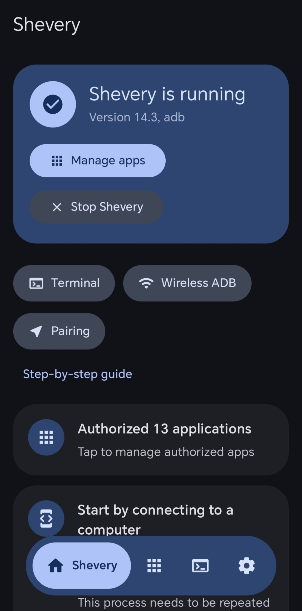
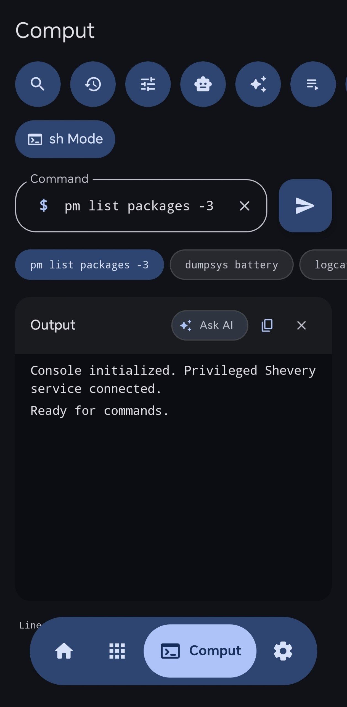
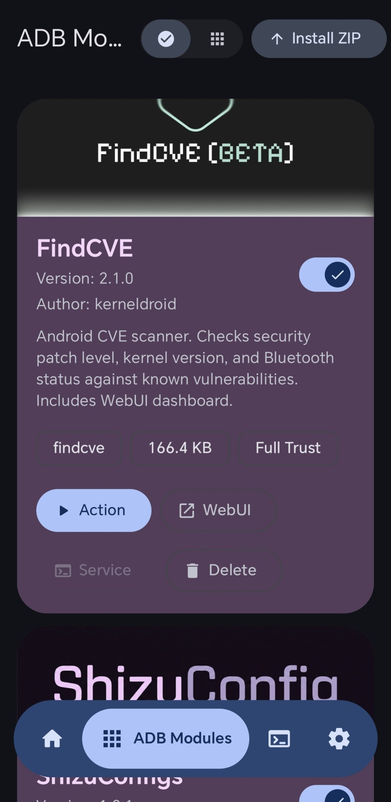
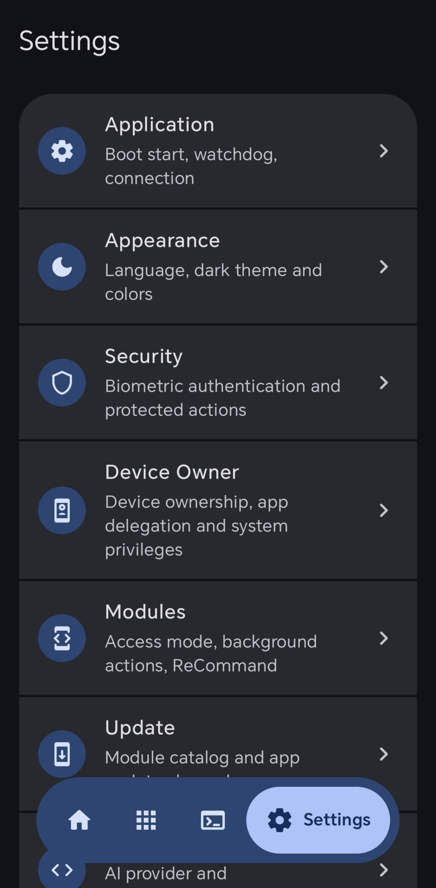

[English](README.md) | [Русский](README.ru.md) | [Қазақша](README.kk.md) | [Qazaqşa (Latın)](README.kk-Latn.md) | [Português](README.pt.md) | [Español](README.es.md) | [العربية](README.ar.md) | [简体中文](README.zh-CN.md) | [日本語](README.ja.md)

# ⚡ OmniShizuku

<div align="center">


# Android customization with Shizuku privileged access

**Created & Maintained by [Krishna](https://github.com/krishna3163)**

[](https://github.com/krishna3163/OmniShizuku/releases)
[](https://github.com/krishna3163/OmniShizuku/stargazers)
[](https://github.com/krishna3163/OmniShizuku/network/members)
[](https://github.com/krishna3163/OmniShizuku/actions/workflows/apk-build.yml)
[](https://github.com/krishna3163/OmniShizuku/releases)
[](LICENSE)
[](https://developer.android.com)

**Application Package:** `com.krishna.omnishizuku`

[⬇️ Download APK](https://github.com/krishna3163/OmniShizuku/releases/latest/download/omnishizuku.apk) • [Install guide](#install-and-get-started) • [Features](#what-you-can-do) • [Build](#building-from-source) • [Docs](docs/)

</div>

---

## 👋 Install and get started

1. **Download:** [Get the latest APK](https://github.com/krishna3163/OmniShizuku/releases/latest/download/omnishizuku.apk). You can also [browse releases](https://github.com/krishna3163/OmniShizuku/releases). If the direct link has no file yet, check the [Actions build status](https://github.com/krishna3163/OmniShizuku/actions/workflows/apk-build.yml).
2. **Install:** Open the APK. If Android asks, allow **Install unknown apps** for the browser or file manager you used, then return to the installer and tap **Install**. Turn that source permission off again when you are done.
3. **Start Shizuku access:** Open OmniShizuku and follow its setup screen. Wireless debugging generally requires Android 11 or newer and Developer options. Root and Device Owner options only work when configured on your device.
4. **Review actions:** Some tools can change system settings or run privileged commands. Read each confirmation and only run commands you understand.

**If Android blocks the APK install, you can try temporarily disabling the Google Play Store app:** open **Settings → Apps → Google Play Store → Disable**, install the APK, then return to the same screen and tap **Enable**. The menu names vary by device, and this workaround may not clear every install block. On Android 8 and newer, also allow **Install unknown apps** for the browser or file manager opening the APK. This does not turn off Play Protect; if Play Protect warns that the APK may be harmful, check that the file came from this project's official release before deciding what to do. ([Android APK installation guide](https://support.google.com/pixelphone/answer/7391672?hl=en), [Play Protect guidance](https://support.google.com/android/answer/2812853?hl=en))

### If installation fails

- Download again from the official GitHub Release and make sure the download completed.
- Grant **Install unknown apps** to the app opening the APK (for example, Chrome or Files). If the device allows disabling the Play Store app, re-enable it immediately after the install attempt.
- Check that the device meets the app's declared minimum of Android 8.0 / API 26. Device and OEM compatibility have not been verified across the Android range.
- If Android reports a package/signature conflict while updating, the installed copy may have been signed with a different key. Do not uninstall it until you understand that removing an app can erase its local data.
- If Play Protect reports the APK as harmful or blocks it, do not bypass the warning on the basis of this README. Review the release source and wait for a verified build or report a suspected false positive.

## ✨ What you can do

OmniShizuku is an Android application built around the Shizuku Binder service. The repository currently contains these code areas:

| Area | Present in source | Verification |
|---|---|---|
| Shizuku server, ADB/root starters, Binder API and shell | Yes | Build and device behavior not verified in this audit |
| ZIP modules, action/service scripts, module WebUI and command review | Yes | Static checks are present; no device run |
| App management, package inspection and UAD debloater | Yes | Android/OEM behavior not verified |
| APK/APKS/APKM/XAPK install flow and install options | Yes | Shell commands are source-reviewed; Android build/device run pending |
| Private DNS, per-app network controls and system labs | Yes | DNS-over-TLS presets include Cloudflare, AdGuard, Quad9, OpenDNS, DNSforge, HaGeZi, Google and CleanBrowsing; Android/OEM behavior is unverified |
| Device Owner/Dhizuku, watchdog, biometric gate, Tasker and AI UI | Code is present | End-to-end compatibility is not verified |

> **Project status:** These entries describe code in the repository; they do not mean every feature works on every device. The full source audit and Android build verification are still in progress. The manager declares a minimum Android SDK of 26 (Android 8.0), but device/OEM compatibility is not established by that setting alone. See [integration progress](docs/integration-progress.md), [feature mapping](docs/feature-source-mapping.md), and [build results](docs/build-and-test-results.md).

Privileged operations require a running Shizuku server or another supported backend. Some controls require root, Device Owner, specific Android APIs, or manufacturer support. Review each operation before using it; the app cannot bypass Android or OEM restrictions.

### Modules and WebUI

The source includes ZIP module install/enable/remove operations, bounded extraction, `module.prop`, action and service scripts, a local WebUI, an optional shell bridge, and per-command approval. ADB module scripts execute with shell privileges; install and WebUI behavior has not been device-verified.

### App and system tools

The source includes package browsing and operations, a UAD-backed debloater, APK inspection and install options, Private DNS controls, network restrictions, display/system settings, logs, and power actions. Battery Center uses Essentials' battery/thermal utilities and exposes the upstream Pixel charging-mode setting on Google devices. These use privileged Android APIs or shell commands, so availability and results depend on the device build and granted backend; the Android app build and device behavior are still unverified in this audit.

### AI and automation

AI provider configuration, assistant screens, shell history and automation/plugin code are present. Provider connectivity, model behavior, and every automation trigger/action have not been verified end to end. Review commands before running them with elevated access.

---

## 📸 Visual Showcase

<div align="center">

| 📱 Main Dashboard | 🤖 Comput AI Console | 📦 ADB Modules Manager | ⚙️ Settings & Labs |
| :---: | :---: | :---: | :---: |
|  |  |  |  |
| *Dashboard UI* | *AI and shell UI* | *Modules UI* | *Settings and labs UI* |

</div>

---

## 📚 Deep Dive Documentation

Read our comprehensive technical guides in the [`docs/`](docs/) directory:

| Document | Topic |
| :--- | :--- |
| 📖 [**Comput AI Agent Guide**](docs/comput-agent.md) | Terminal environment, Gemini AI copilot, and macro scripting. |
| 🛡️ [**Device Owner & DPM Guide**](docs/device-owner.md) | Profile owner setup, policy restrictions, and delegation scopes. |
| 📦 [**ADB Modules User Guide**](docs/adb-modules-guide.md) | Installing ZIP modules, Safe Mode policies, and troubleshooting. |
| 🛠️ [**ADB Modules API Reference**](docs/adb-modules-api.md) | Writing your own modules: hooks, environment variables, and WebUI bridge. |
| 🌐 [**GitHub Catalog Publishing**](docs/github-catalog.md) | Packaging and publishing custom modules for the global catalog. |
| 🕶️ [**Stealth Edition & Stubs**](docs/stealth-and-stubs.md) | Hiding privileged status from hostile inspection. |
| 🧪 [**Labs, USB Hiding & Firewall**](docs/lab-and-extras.md) | Network blocking, dynamic 6-layer hiding, and accessibility controls. |
| 🔌 [**Tasker & MacroDroid Plugin**](docs/tasker-plugin.md) | Automation triggers, broadcast intents, and auto-start scripts. |
| 🐕 [**NightDog Watchdog Recovery**](docs/nightdog.md) | Daemon health monitoring and auto-reconnection architecture. |
| 🚀 [**Android 17 Compatibility**](docs/android-17-compatibility.md) | Architectural changes for compileSdk 37 / Android Baklava. |
| 📡 [**Intents Reference**](docs/intents.md) | Complete documentation of all supported broadcast intents. |

---

## 💻 Building from Source

```bash
# Clone the repository
git clone https://github.com/krishna3163/OmniShizuku.git
cd OmniShizuku

# Build a debug APK
./gradlew :manager:assembleDebug

# Build a release APK
./gradlew :manager:assembleRelease
```
*Generated APKs will be in `manager/build/outputs/apk/{debug,release}/`.*

The Android build requires JDK 21, Android SDK platform 37.1, and the NDK version declared by the project. Gradle build and test tasks have not completed in the current audit environment; see [`docs/build-and-test-results.md`](docs/build-and-test-results.md).

---

## 🔐 Security and downloads

Download builds only from this repository's [GitHub Releases](https://github.com/krishna3163/OmniShizuku/releases). The direct APK link works when a successful public release contains the APK asset. Release signing and whether one build can update another depend on the signing key; GitHub build artifacts may not share a persistent signing key unless the maintainer configures one.

OmniShizuku is open source, but **that alone is not a security certification**. This project's security review is preliminary, and the Android build and device behavior have not yet been fully verified. The app includes privileged operations, so inspect permissions and review commands before approving them. See [`docs/security-review.md`](docs/security-review.md) for current findings and gaps. Google Play Protect scans apps installed from outside Play as well as Play apps; keep it enabled and treat its warnings seriously. ([Google Play Protect](https://support.google.com/android/answer/2812853?hl=en))

## 🙏 Upstream projects and thanks

Thank you to the maintainers and contributors of these projects. We use them as implementation references and, where recorded, reuse or adapt compatible code. **Not every project below is integrated into OmniShizuku.** Each reuse has to respect that project's license and attribution requirements; see [`NOTICE`](NOTICE), [`licenses/`](licenses/), and the [source inventory](docs/source-repository-inventory.md).

<details>
<summary>Show all upstream projects (27)</summary>

- [Shizuku](https://github.com/thedjchi/Shizuku)
- [Shizuku-Next](https://github.com/rushiranpise/Shizuku-Next)
- [ShizukuPlus](https://github.com/thejaustin/ShizukuPlus)
- [Shizako](https://github.com/cr1437/Shizako)
- [Xhizuku](https://github.com/xeonleonreal/Xhizuku)
- [Stellar](https://github.com/roro2239/Stellar)
- [Shevery](https://github.com/HmnDev-Tech/shevery)
- [Porter](https://github.com/d4rken-org/porter)
- [InstallerX-Revived](https://github.com/wxxsfxyzm/InstallerX-Revived)
- [InstallWithOptions](https://github.com/zacharee/InstallWithOptions)
- [ShizuStore](https://github.com/timschneeb/ShizuStore)
- [Morphe Manager](https://github.com/MorpheApp/morphe-manager)
- [Root-My-Galaxy](https://github.com/BuSung-dev/Root-My-Galaxy)
- [Root-My-Pixel](https://github.com/alex193a/Root-My-Pixel)
- [ShizuCallRecorder](https://github.com/kitsumed/ShizuCallRecorder)
- [ShizuTools](https://github.com/legendsayantan/ShizuTools)
- [SystemUI-Tuner](https://github.com/zacharee/Tweaker)
- [ADNS](https://github.com/eyalm2000/adns)
- [AutoDND](https://github.com/im030/android_AutoDND)
- [ShizuWall](https://github.com/AhmetCanArslan/ShizuWall)
- [shizzi](https://github.com/carlelieser/shizzi)
- [sing-box-for-android](https://github.com/SagerNet/sing-box-for-android)
- [EnforceDoze](https://github.com/Akylas/EnforceDoze)
- [Quick-Tile-Settings](https://github.com/RBN-Apps/Quick-Tile-Settings)
- [essentials](https://github.com/sameerasw/essentials)
- [Canta](https://github.com/samolego/Canta)
- [AxManager](https://github.com/fahrez182/AxManager)

</details>

Current examples of attributed reuse include the Essentials battery utilities, the ShizukuPlus package-name validation rule, and the ADNS DNS hostname parser/provider data. More details are in the [feature-to-source map](docs/feature-source-mapping.md); the audit is ongoing.

---

## License

OmniShizuku's project license is the **[Apache License 2.0](LICENSE)**. Bundled dependencies and adapted upstream code may carry separate license and attribution terms; see [`NOTICE`](NOTICE), [`licenses/`](licenses/), and the inventory. The audit has not yet verified licensing for every file in the repository.

> [!CAUTION]
> **Free app:** Download OmniShizuku from this repository's releases. Never pay a third-party seller or file host for the APK.

<div align="center">
  <sub>Crafted with passion by <b>Krishna</b> & the Open-Source Android Community.</sub>
</div>
