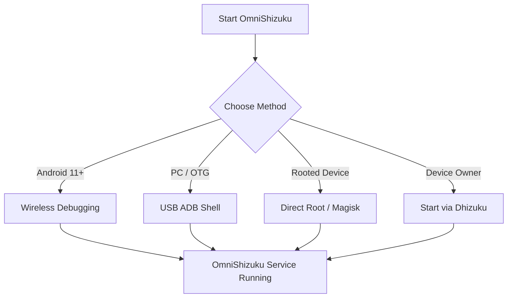
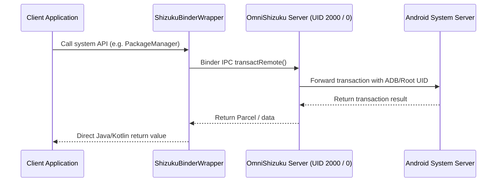

# ⚡ OmniShizuku

<div align="center">


### Next-Generation Elevated Privileged Framework, Device Owner Manager & Modular ADB Toolkit for Android

[](https://github.com/krishna3163/OmniShizuku/stargazers)
[](https://github.com/krishna3163/OmniShizuku/network/members)
[](https://github.com/krishna3163/OmniShizuku/actions/workflows/apk-build.yml)
[](https://github.com/krishna3163/OmniShizuku/releases)
[](LICENSE)
[-green?style=for-the-badge&logo=android)](https://developer.android.com)

**Package Identifier:** `com.krishna.omnishizuku`

</div>

---

## 📑 Table of Contents

- [Project Overview](#-project-overview)
- [Key Features](#-key-features)
- [Screenshots](#-screenshots)
- [Installation & Quick Start](#-installation--quick-start)
- [How to Start OmniShizuku](#-how-to-start-omnishizuku)
- [Architecture & How It Works](#-architecture--how-it-works)
- [ADB Modules System](#-adb-modules-system)
- [Documentation Index](#-documentation-index)
- [Building from Source](#-building-from-source)
- [CI/CD Automated Builds](#-cicd-automated-builds)
- [Special Thanks & Upstream Acknowledgements](#-special-thanks--upstream-acknowledgements)
- [License & Free App Notice](#-license--free-app-notice)

---

## 🌟 Project Overview

**OmniShizuku** is an all-in-one, modernized privileged Android service framework and ADB extension suite. Built on the foundation of Rikka's groundbreaking Shizuku privileged binder architecture and enhanced with modern system capabilities, OmniShizuku bridges the gap between elevated system APIs, Device Owner controls, and Magisk-like modular extensibility—**without requiring root privileges**.

Whether you want to run privileged apps, manage Device Owner delegation scopes, install custom ADB ZIP modules with WebUI dashboards, execute AI-assisted terminal scripts, or safeguard your environment with biometric authentication, **OmniShizuku provides a complete, unified solution.**

> [!IMPORTANT]
> **Migration Action Required:** Due to the customized application package identifier (`com.krishna.omnishizuku`), you **MUST UNINSTALL** any older official Shizuku Manager app or previous builds from your device before installing OmniShizuku. Otherwise, signature conflicts will occur.

---

## ✨ Key Features

### ⚡ Privileged Binder IPC (Core Engine)
- Direct Inter-Process Communication (IPC) via Android Binder with elevated ADB or Root privileges.
- Eliminates the severe overhead, slow process creation, and brittle text parsing of repetitive `su` / `sh` command execution.
- System server APIs (`PackageManager`, `ActivityManager`, `IUserManager`, etc.) are exposed directly to authorized client applications at native speeds.

### 🛡️ Device Owner Management & Dhizuku Bridging
- Full Device Owner (DPM) management capabilities: package delegation scopes, user restriction toggling, and ownership management.
- Built-in Dhizuku bridging and compatibility stubs, allowing applications designed for Dhizuku to function seamlessly with OmniShizuku.

### 📦 Modular ADB Engine (Magisk for ADB)
- Install, toggle, and manage standalone ZIP modules directly through the manager UI.
- Rich module support: `module.prop` metadata, custom banner artwork, `action.sh` one-shot scripts, policy-gated background `service.sh` daemons, and embedded local HTML/JS WebUI dashboards.
- Module execution policy modes: **Safe Mode**, **Full Access**, output limits, execution timeouts, and audit logging.
- Integrated Module Catalog for browsing and installing modules directly from GitHub repositories.

### 🤖 Comput Console & AI Command Terminal
- Advanced interactive terminal console with built-in command macro execution.
- Integrated Gemini AI explanation engine to analyze terminal output, diagnose errors, and demystify complex ADB commands.
- Commandium AI command generator for crafting precise shell commands using natural language.

### 🔒 Biometric Security & Stealth Stubs
- Master biometric authentication switch: protect manager access, permission grants, module execution, and configuration changes using Fingerprint, Face Unlock, or Device Lock PIN/Password.
- Configurable authentication timeouts and granular action triggers.
- Stealth compatibility stubs to protect elevated processes from hostile application inspection.

### 🐕 NightDog Watchdog & Auto-Recovery
- Dedicated background watchdog daemon that monitors the health of the OmniShizuku server process.
- Automatic crash detection with intelligent auto-restart capabilities via Wireless Debugging (pairing port discovery and auto-reconnection).

### 🎨 Modern Material 3 Expressive UI
- Written from the ground up in modern **Jetpack Compose**.
- Full Material 3 Expressive styling with dynamic color theming, fluid motion animations, customizable navigation layouts, and system dark/light theme support.

### 🚀 Android 14 to Android 17 (Baklava / API 37) Ready
- Modernized build architecture using Gradle 9, Kotlin 2.2+, and Android Gradle Plugin 8.9+.
- Built and tested against `compileSdk = 37` (Android 17 / Baklava) with full backward compatibility down to Android 7.0 (API 24).

---

## 📸 Screenshots

<details open>
  <summary><b>Click to collapse/expand screenshots</b></summary>
  <br/>
  <table>
    <tr>
      <td align="center" width="25%"><br/><b>Dashboard</b></td>
      <td align="center" width="25%"><br/><b>Comput Terminal</b></td>
      <td align="center" width="25%"><br/><b>ADB Modules</b></td>
      <td align="center" width="25%"><br/><b>Settings & Security</b></td>
    </tr>
  </table>
</details>

---

## 🚀 Installation & Quick Start

### 1. Download OmniShizuku
Download the latest APK directly from the official repositories:
- **Latest CI Builds (Every Commit):** [GitHub Actions Summary](https://github.com/krishna3163/OmniShizuku/actions/workflows/apk-build.yml) &rarr; Scroll down to the **Artifacts** section to download `omnishizuku-release.apk` or `omnishizuku-debug.apk`.
- **Tagged Releases:** [GitHub Releases](https://github.com/krishna3163/OmniShizuku/releases)

### 2. Install on Device
```bash
adb install -r omnishizuku-release.apk
```
*(Or install directly through your device file manager).*

---

## 🛠️ How to Start OmniShizuku

OmniShizuku supports multiple flexible start mechanisms:



### Method 1: Wireless Debugging (Recommended for Android 11+)
*No PC required after initial pairing!*
1. Enable **Developer Options** and **Wireless Debugging** in your Android device settings.
2. In OmniShizuku, tap **Pairing** under Wireless Debugging.
3. Split-screen or open Developer Options in floating window, tap **Pair device with pairing code**.
4. Enter the 6-digit Wi-Fi pairing code and port in OmniShizuku.
5. Tap **Start** in OmniShizuku to launch the privileged service.

### Method 2: Via PC / USB OTG (ADB Shell)
Connect your device to a computer with ADB installed and run:
```bash
adb shell sh /sdcard/Android/data/com.krishna.omnishizuku/starter.sh
```

### Method 3: Direct Root (Magisk / KernelSU / APatch)
If your device is rooted, simply open OmniShizuku and tap **Start** under the **Root** section. Grant Superuser permission when prompted.

### Method 4: Via Dhizuku (Device Owner)
1. Ensure OmniShizuku is started initially via Wireless Debugging or PC.
2. Open **Dhizuku** and authorize the connection.
3. OmniShizuku will leverage Device Owner privileges for background operations. *(Do not start OmniShizuku via Dhizuku first).*

---

## 🏗️ Architecture & How It Works

### The Traditional Root / Shell Problem
Traditional root or ADB apps execute terminal commands repeatedly via shell wrappers:
```
[Client App] --> ProcessBuilder("su" / "sh") --> fork() --> exec("pm grant ...") --> parse stdout
```
- **Slow Performance:** Spawning a new Linux process for every action causes significant lag.
- **Unreliable Parsing:** Output strings change across Android versions and OEM skins (OneUI, MIUI, ColorOS), breaking apps.
- **Limited Scope:** Can only execute pre-existing binary commands on disk.

### The OmniShizuku Solution
OmniShizuku executes commands through high-speed Android Binder IPC:



Client apps interact with standard Android APIs directly, while OmniShizuku handles privileged transaction relaying under elevated UID 2000 (`shell`) or UID 0 (`root`).

---

## 📦 ADB Modules System

OmniShizuku features an extensible modular system for ADB scripts and binaries.

### Creating a Module Archive
An OmniShizuku module is a standard `.zip` file containing:

```text
my-module.zip
├── module.prop          # Required: Module metadata
├── banner.png           # Optional: Artwork (ratio 16:9 or 2:1)
├── action.sh            # Optional: Script triggered by user 'Action' button
├── service.sh           # Optional: Background service script (gated by policy)
└── webroot/             # Optional: Embedded WebUI dashboard
    ├── index.html
    └── style.css
```

#### Sample `module.prop`
```ini
id=battery_optimizer
name=Battery & Thermal Optimizer
version=v1.2.0
versionCode=120
author=Krishna
description=Applies optimized CPU governors and aggressive background app hibernation via ADB.
minApi=26
```

Publish your module on GitHub with the topic tag **`omnishizuku-modules`** to make it discoverable in the Module Catalog!

---

## 📚 Documentation Index

Explore in-depth documentation in the [`docs/`](docs/) directory:

| Document | Description |
| --- | --- |
| [**Comput AI Agent Guide**](docs/comput-agent.md) | Terminal console features, Gemini AI diagnostics, and macro automation. |
| [**Device Owner & Profile Owner Guide**](docs/device-owner.md) | Setting up DPM scopes, policy restrictions, and delegation. |
| [**Stealth Edition & Compatibility Stubs**](docs/stealth-and-stubs.md) | Obfuscation stubs and avoiding detection by restrictive apps. |
| [**Laboratory Features & Firewall**](docs/lab-and-extras.md) | Accessibility manager, USB debugging hiding, and TCP firewall. |
| [**Tasker & MacroDroid Plugin**](docs/tasker-plugin.md) | Automated service starting, command execution, and broadcast actions. |
| [**Intents Reference**](docs/intents.md) | Complete list of supported Intents and Broadcast Actions. |
| [**ADB Modules User Guide**](docs/adb-modules-guide.md) | How to install, configure policies, and manage ZIP modules. |
| [**ADB Modules API Reference**](docs/adb-modules-api.md) | Environment variables, hooks, paths, and WebUI bridge specifications. |
| [**GitHub Catalog Publishing Guide**](docs/github-catalog.md) | Packaging and publishing custom modules for the global catalog. |
| [**Shizuku Connectors API**](docs/shizuku-connectors.md) | Inter-app IPC and custom connector integrations. |
| [**Android 17 Compatibility Guide**](docs/android-17-compatibility.md) | Changes and optimizations for compileSdk 37 / Android 17. |
| [**NightDog Watchdog & Auto-Recovery**](docs/nightdog.md) | Background crash monitoring and wireless recovery daemon. |

---

## 💻 Building from Source

### Prerequisites
- **JDK 21** (Eclipse Temurin or OpenJDK recommended)
- **Android SDK** with:
  - `platforms;android-37.0` (Android 17 / compileSdk 37)
  - `build-tools;37.0.0`
  - `ndk;29.0.14206865`

### Build Steps
1. **Clone the repository with submodules:**
   ```bash
   git clone --recurse-submodules https://github.com/krishna3163/OmniShizuku.git
   cd OmniShizuku
   ```

2. **Build Debug APK:**
   ```bash
   ./gradlew :manager:assembleDebug
   ```
   *Output located at: `manager/build/outputs/apk/debug/manager-debug.apk`*

3. **Build Release APK:**
   ```bash
   ./gradlew :manager:assembleRelease
   ```
   *Output located at: `manager/build/outputs/apk/release/manager-release.apk`*

---

## 🔄 CI/CD Automated Builds

OmniShizuku utilizes an automated [GitHub Actions CI/CD Pipeline](https://github.com/krishna3163/OmniShizuku/actions/workflows/apk-build.yml):

- **Every Commit to `main`:** Automatically compiles both debug and release variants. Artifacts are published to the run summary page as:
  - `omnishizuku-debug`
  - `omnishizuku-release`
- **Signature Verification:** Each release artifact is verified with `apksigner` during CI.
- **Tagged Releases:** Pushing any version tag (e.g. `git tag v1.0.0 && git push origin v1.0.0`) automatically generates a GitHub Release with both signed APKs attached.

---

## 🙏 Special Thanks & Upstream Acknowledgements

OmniShizuku stands on the shoulders of giants. We express our deepest appreciation and gratitude to all upstream authors and projects whose open-source contributions made this work possible:

* **[RikkaApps/Shizuku](https://github.com/RikkaApps/Shizuku)** — The foundational privileged service framework, IPC binder architecture, and core protocols conceived and built by Rikka.
* **[HmnDev-Tech/shevery](https://github.com/HmnDev-Tech/shevery)** — Upstream work on integration modules, expanded UI, and multi-feature toolkits.
* **[iamr0s/Dhizuku](https://github.com/iamr0s/Dhizuku)** & **[rosan/Dhizuku](https://github.com/rosan/Dhizuku)** — Device Owner management concepts, bridging protocols, and permission delegation framework.
* **[timschneeb/ShizuStore](https://github.com/timschneeb/ShizuStore)** — App Store catalog models and repository synchronization architecture.
* **[wxxsfxyzm/InstallerX-Revived](https://github.com/wxxsfxyzm/InstallerX-Revived)** — Modern package installation techniques, split-APK staging, and installer options.
* **[zacharee/InstallWithOptions](https://github.com/zacharee/InstallWithOptions)** — Granular package installation flags and package bypass logic.
* **[d4rken/porter](https://github.com/d4rken/porter)** — Clean Android IPC helper primitives and binder wrappers.
* **[topjohnwu/libsu](https://github.com/topjohnwu/libsu)** — Root shell service management and robust binder transaction wrappers.
* **[kerneldroid](https://github.com/kerneldroid)** — Modern Compose UI components, catalog module system, and Android 17 / API 37 compatibility work.
* **[DP-Hridayan/aShellYou](https://github.com/DP-Hridayan/aShellYou)** — ADB command terminal UI patterns and system computing tools.
* **[protonpony/Shizuku-Keeper](https://github.com/protonpony/Shizuku-Keeper)** — Wireless Debugging daemon boot autostart architecture.
* **[Landon Moran](https://github.com/LandonMoran)** — Contributions to Dhizuku bridging, TCP networking fixes, and service stability.

---

## 📜 License & Free App Notice

OmniShizuku is open-source software licensed under the **[Apache License 2.0](LICENSE)**.

> [!CAUTION]
> **Free App Notice**
> 
> OmniShizuku is **100% free and open-source software**. Do not pay any third-party app store, file host, or cloud service to download or use this application. Always obtain authentic builds directly from the official [GitHub repository](https://github.com/krishna3163/OmniShizuku).

<div align="center">
  <sub>Maintained with ❤️ by Krishna & the Open Source Community</sub>
</div>
