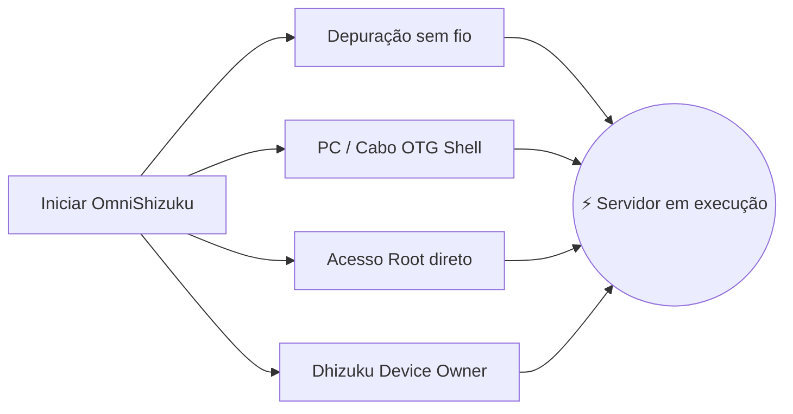

[English](README.md) | [Русский](README.ru.md) | [Қазақша](README.kk.md) | [Qazaqşa (Latın)](README.kk-Latn.md) | [Português](README.pt.md) | [Español](README.es.md) | [العربية](README.ar.md) | [简体中文](README.zh-CN.md) | [日本語](README.ja.md)

# ⚡ OmniShizuku

<div align="center">


# 👑 O Modo Deus para Android
### Chega de instalar 4 aplicativos diferentes. Experimente a verdadeira liberdade de privilégios — Sem necessidade de Root.

**Created & Maintained by [Krishna](https://github.com/krishna3163)**

[](https://github.com/krishna3163/OmniShizuku/releases)
[](https://github.com/krishna3163/OmniShizuku/stargazers)
[](https://github.com/krishna3163/OmniShizuku/network/members)
[](https://github.com/krishna3163/OmniShizuku/actions/workflows/apk-build.yml)
[](https://github.com/krishna3163/OmniShizuku/releases)
[](LICENSE)
[-success?style=for-the-badge&logo=android)](https://developer.android.com)

**Nome do Pacote:** `com.krishna.omnishizuku`

[⚡ Baixar APK mais recente](#-download-instantâneo-e-início-rápido) • [✨ Recursos matadores](#-o-que-torna-o-omnishizuku-imbatível) • [⚔️ Comparativo definitivo](#️-o-confronto-definitivo-omnishizuku-vs-os-outros) • [📚 Documentação completa](docs/)

</div>

---

## 💥 Cansado das complicações do Shizuku?

Sejamos sinceros:
- ❌ **Cansado de ver seu servidor Shizuku encerrando sozinho** quando o Android gerencia a memória de forma agressiva?
- ❌ **Cansado de alternar entre 4 aplicativos diferentes** apenas para gerenciar seu celular? *(Shizuku para APIs + Dhizuku para Device Owner + aShell para terminal + Shizuku-Keeper para manter ativo)*.
- ❌ **Quer módulos ZIP estilo Magisk** para ajustes de bateria e desempenho, mas não pode desbloquear o bootloader ou perder o Knox e o acesso a apps de bancos?
- ❌ **Cansado de erros incompreensíveis no terminal** sem nenhuma orientação?

### 🚀 Conheça o OmniShizuku.
**O OmniShizuku substitui todos eles.** Ele reúne o clássico protocolo binder privilegiado do Shizuku, o motor modular de extensões do Shizuku-Next, os controles de Device Owner do Dhizuku, a inteligência de terminal do Gemini AI e a recuperação autorreparadora do NightDog em **um superaplicativo espetacular em Material 3 com proteção biométrica.**

---

## ✨ O que torna o OmniShizuku imbatível?

### 1. 📦 "Magisk para quem não tem Root" (Motor de Módulos ADB)
Instale módulos ZIP autônomos diretamente do seu celular — sem bootloader desbloqueado, sem root e sem anular a garantia!
- **Formato Completo de Módulo:** Suporte a `module.prop`, banners visuais, ferramentas de execução rápida `action.sh` e serviços contínuos em segundo plano (`service.sh`).
- **Painéis WebUI Integrados:** Os módulos podem renderizar painéis interativos HTML5/JavaScript com integração IPC nativa via `window.Shizuku`!
- **Catálogo Online no GitHub:** Navegue, baixe e atualize módulos da comunidade com apenas um toque.
- **Políticas de Segurança:** Modo Seguro (Safe Mode) com sandbox, tempo limite de execução, cotas de saída e logs de auditoria.

### 2. 🐕 Daemon Indestrutível (NightDog Watchdog v14.5)
- A frustração nº 1 dos usuários de ADB é o servidor fechando em segundo plano.
- O OmniShizuku conta com o daemon sentinela **NightDog Watchdog**, que monitora constantemente o sinal do servidor.
- Se o Android encerrar o processo por falta de RAM, o NightDog **revive e reinicia automaticamente o servidor via Depuração sem fio** sem precisar reconectar ao PC!

### 3. 🛡️ Superponte de Device Owner e Dhizuku
- Gerenciamento completo de Device Owner (DPM) integrado nativamente.
- Configure escopos de delegação granulares, congele bloatware indesejado, alterne restrições do sistema e gerencie políticas.
- **100% Compatível com Dhizuku:** Aplicativos desenvolvidos para o Dhizuku se comunicam perfeitamente com o OmniShizuku!

### 4. 🤖 Console Comput e Copiloto Gemini AI
- Shell ADB interativo e privilegiado integrado com botões de atalho para macros.
- **Diagnóstico com Gemini AI:** Travou em um erro enigmático no terminal? O Gemini AI traduz automaticamente logs complexos em explicações claras e passos práticos.
- **Commandium AI:** Gere comandos shell avançados apenas descrevendo o que deseja em linguagem natural!

### 5. 🔒 Proteção Biométrica Nível Fort Knox
- Impeça que pessoas não autorizadas ou aplicativos maliciosos explorem seu ambiente privilegiado.
- Bloqueio Biométrico Mestre: Proteja concessões de permissões, execução de módulos e configurações sensíveis com **impressão digital, desbloqueio facial ou PIN/senha do aparelho**.

### 6. 🧪 Todas as 15 Ferramentas de Laboratório (Herdadas do Shizuku-Next)
O OmniShizuku mantém **100% das consagradas ferramentas do Shizuku-Next**:
- 🌐 **Firewall por Aplicativo:** Bloqueie o acesso à internet de qualquer app sem VPN e sem root (`cmd connectivity set-package-networking-enabled <uid> false`).
- 🕶️ **Ocultação Dinâmica de 6 Camadas:** Esconda o status privilegiado e ADB de apps com detecções rigorosas.
- 🔑 **Visualizador de Senhas Wi-Fi:** Leia senhas de redes Wi-Fi salvas em texto simples sem root.
- 📁 **Gerenciador de Arquivos Privilegiado:** Navegue e modifique diretórios protegidos do sistema Android.
- 🚀 **Inicializador de Activities Ocultas:** Abra menus de teste e telas secretas do fabricante.
- 🌙 **Modo Escuro Forçado:** Imponha o modo escuro AMOLED mesmo em aplicativos sem suporte nativo.
- 🖥️ **Ajustes de Exibição:** Altere resolução, densidade de DPI e force taxas de atualização altas de 120Hz.
- ⚡ **Menu Avançado de Energia:** Reinicie diretamente em Modo Recovery, Fastboot e Bootloader.
- 🛑 **Parar o Exterminador de Processos Fantasma:** Desative o limite de 32 processos do Android 12+ para cargas pesadas no Termux ou compilações.
- 📦 **Motor Split-APK InstallerX:** Instale pacotes divididos, contorne restrições de downgrade e injete parâmetros avançados de instalação.

---

## ⚔️ O confronto definitivo: OmniShizuku vs os outros

Veja como o OmniShizuku se destaca em relação a qualquer outra solução no ecossistema Android:

| Recurso / Capacidade | Shizuku Oficial | Shizuku-Next | ShizukuPlus / Shizako | Dhizuku | Magisk / Root | ⚡ **OmniShizuku** |
| :--- | :---: | :---: | :---: | :---: | :---: | :---: |
| **Sem necessidade de Root?** | ✅ Sim | ✅ Sim | ✅ Sim | ✅ Sim | ❌ **Não (Aciona Knox)** | 🌟 **Sim (100% Sem Root)** |
| **API Binder Privilegiada** | ✅ Sim | ✅ Sim | ✅ Sim | ❌ Não | ❌ Não | 🌟 **Sim (Altíssima velocidade)**|
| **Controle Device Owner (DPM)** | ❌ Não | ❌ Não | ❌ Não | ✅ Sim | ❌ Não | 🌟 **Sim (Integrado)** |
| **Compatibilidade com Dhizuku** | ❌ Não | ❌ Não | ❌ Não | ✅ Sim | ❌ Não | 🌟 **Sim (Protocolo Duplo)** |
| **Motor de Módulos ZIP (tipo Magisk)**| ❌ Não | ✅ Sim | ❌ Não | ❌ Não | ✅ Sim (Apenas Root) | 🌟 **Sim (ZIPs sem Root!)** |
| **WebUI de Módulos e Ponte JS** | ❌ Não | ✅ Sim | ❌ Não | ❌ Não | ❌ Não | 🌟 **Sim (Painéis HTML5)** |
| **Terminal com AI (Gemini / Comput)** | ❌ Não | ❌ Não | ❌ Não | ❌ Não | ❌ Não | 🌟 **Sim (Diagnósticos por AI)**|
| **Auto-recuperação (NightDog)** | ❌ Não | ⚠️ Básico | ❌ Não | ❌ Não | ❌ Não | 🌟 **Sim (Auto-reinício)** |
| **Bloqueio Biométrico / PIN** | ❌ Não | ❌ Não | ❌ Não | ❌ Não | ❌ Não | 🌟 **Sim (Proteção por biometria)**|
| **15 Ferramentas Labs (Firewall/Wi-Fi)**| ❌ Não | ✅ Sim | ⚠️ Parcial | ❌ Não | ❌ Não | 🌟 **Sim (Todas as 15)** |
| **Ocultação Anti-detecção (6 Camadas)**| ❌ Não | ✅ Sim | ⚠️ Básico | ❌ Não | ⚠️ Exige Zygisk | 🌟 **Sim (Auto-ocultação)** |
| **Suporte a Android 17 / API 37** | ❌ Obsoleto | ⚠️ API 36 | ❌ Obsoleto | ❌ Obsoleto | ⚠️ Manual | 🌟 **Sim (compileSdk 37)** |
| **Interface Moderna Compose Material 3**| ❌ Antiga | ⚠️ Parcial | ❌ Antiga | ❌ Antiga | ❌ Antiga | 🌟 **Sim (Expressive M3)** |

> **O Veredito:** Enquanto outros forks oferecem apenas uma peça isolada, **o OmniShizuku é a solução completa.**

---

## 📸 Demonstração visual

<div align="center">

| 📱 Painel Principal | 🤖 Console Comput AI | 📦 Gerenciador de Módulos ADB | ⚙️ Configurações e Labs |
| :---: | :---: | :---: | :---: |
|  |  |  |  |
| *Status do servidor e atalhos rápidos* | *Explicações de AI, macros e commandium* | *Módulos ZIP, WebUIs e catálogos* | *Biometria, firewall e 15 ferramentas* |

</div>

---

## 🚀 Download instantâneo e início rápido

> [!IMPORTANT]
> **Instalação limpa recomendada:** Devido à mudança para nosso pacote exclusivo (`com.krishna.omnishizuku`), por favor **desinstale versões antigas do Shizuku ou Shevery** antes de instalar para evitar conflitos de assinatura do Android.

### Passo 1: Baixar o aplicativo
- 📦 **Compilações CI Recentes (a cada commit):** [GitHub Actions](https://github.com/krishna3163/OmniShizuku/actions/workflows/apk-build.yml) &rarr; Role até **Artifacts** e baixe `omnishizuku-release.apk`.
- 🏷️ **Versões Estáveis no GitHub:** [Página de Releases](https://github.com/krishna3163/OmniShizuku/releases)

### Passo 2: Inicie com seu método preferido



1. **Depuração sem fio (Android 11+ / Não requer PC):**
   - Opções do desenvolvedor &rarr; Ative **Depuração sem fio** &rarr; Toque em **Parear dispositivo com código de pareamento**.
   - Digite o código de 6 dígitos no OmniShizuku e toque em **Iniciar**.
2. **Via Computador (ADB USB Shell):**
   ```bash
   adb shell sh /sdcard/Android/data/com.krishna.omnishizuku/starter.sh
   ```
3. **Dispositivo com Root (Magisk / KernelSU / APatch):**
   - Abra o OmniShizuku &rarr; Toque em **Iniciar via Root** &rarr; Conceda permissão de Superusuário.
4. **Via Dhizuku (Device Owner):**
   - Autorize o OmniShizuku no aplicativo Dhizuku para gerenciamento em segundo plano.

---

## 📚 Documentação detalhada

Consulte nossos manuais técnicos completos na pasta [`docs/`](docs/):

| Documento | Assunto |
| :--- | :--- |
| 📖 [**Guia do Agente Comput AI**](docs/comput-agent.md) | Ambiente do terminal, copiloto Gemini AI e macros. |
| 🛡️ [**Guia de Device Owner e DPM**](docs/device-owner.md) | Configuração de Profile Owner, restrições e escopos de delegação. |
| 📦 [**Guia do Usuário de Módulos ADB**](docs/adb-modules-guide.md) | Instalação de módulos ZIP, Modo Seguro e solução de problemas. |
| 🛠️ [**Referência de API de Módulos ADB**](docs/adb-modules-api.md) | Desenvolvimento de módulos: hooks, variáveis de ambiente e ponte WebUI. |
| 🌐 [**Publicação no Catálogo do GitHub**](docs/github-catalog.md) | Empacotamento e publicação de módulos para o catálogo global. |
| 🕶️ [**Edição Stealth e Stubs**](docs/stealth-and-stubs.md) | Ocultação de privilégios contra inspeções de segurança. |
| 🧪 [**Labs, Ocultação de USB e Firewall**](docs/lab-and-extras.md) | Bloqueio de rede, ocultação em 6 camadas e acessibilidade. |
| 🔌 [**Plugin para Tasker e MacroDroid**](docs/tasker-plugin.md) | Gatilhos de automação, intents de broadcast e scripts de início. |
| 🐕 [**Recuperação com NightDog Watchdog**](docs/nightdog.md) | Monitoramento de integridade do daemon e arquitetura de reconexão. |
| 🚀 [**Compatibilidade com Android 17**](docs/android-17-compatibility.md) | Modificações arquiteturais para compileSdk 37 / Android Baklava. |
| 📡 [**Referência de Intents**](docs/intents.md) | Documentação de todos os intents de broadcast suportados. |

---

## 💻 Compilação a partir do código-fonte

```bash
# 1. Clone o repositório com submódulos
git clone --recurse-submodules https://github.com/krishna3163/OmniShizuku.git
cd OmniShizuku

# 2. Compilar variante de depuração (Debug)
./gradlew :manager:assembleDebug

# 3. Compilar variante de lançamento (Release)
./gradlew :manager:assembleRelease
```
*Os APKs gerados estarão localizados em `manager/build/outputs/apk/{debug,release}/`.*

---

## 🙏 Agradecimentos especiais e Galeria de Honra

O OmniShizuku foi construído com base em projetos revolucionários. Expressamos nosso profundo respeito e gratidão a:

* **[RikkaApps/Shizuku](https://github.com/RikkaApps/Shizuku)** — A genial arquitetura de binder privilegiado concebida por Rikka.
* **[HmnDev-Tech/shevery](https://github.com/HmnDev-Tech/shevery)** — Recursos de base, interface expandida e suporte a múltiplos módulos.
* **[iamr0s/Dhizuku](https://github.com/iamr0s/Dhizuku)** e **[rosan/Dhizuku](https://github.com/rosan/Dhizuku)** — Conceitos de gerenciamento de Device Owner e protocolos de comunicação.
* **[timschneeb/ShizuStore](https://github.com/timschneeb/ShizuStore)** — Padrões de sincronização com repositórios de lojas de apps.
* **[wxxsfxyzm/InstallerX-Revived](https://github.com/wxxsfxyzm/InstallerX-Revived)** — Métodos de instalação de Split-APKs e fluxos de armazenamento temporário.
* **[zacharee/InstallWithOptions](https://github.com/zacharee/InstallWithOptions)** — Parâmetros minuciosos de instalação e flags de bypass.
* **[d4rken/porter](https://github.com/d4rken/porter)** — Classes utilitárias limpas para IPC do Android e wrappers de binder.
* **[topjohnwu/libsu](https://github.com/topjohnwu/libsu)** — Gestão de serviços em root shell e transações confiáveis de binder.
* **[kerneldroid](https://github.com/kerneldroid)** — Componentes de UI em Compose, catálogo de módulos e trabalho de compatibilidade com Android 17 / API 37.
* **[DP-Hridayan/aShellYou](https://github.com/DP-Hridayan/aShellYou)** — Interface de terminal para comandos ADB e ferramentas de computação.
* **[protonpony/Shizuku-Keeper](https://github.com/protonpony/Shizuku-Keeper)** — Arquitetura de inicialização automática do daemon de depuração sem fio no boot.
* **[Landon Moran](https://github.com/LandonMoran)** — Contribuições na ponte com Dhizuku, correções na pilha de rede TCP e estabilidade geral.

---

## 📜 100% Gratuito e Código Aberto

O OmniShizuku é um software livre distribuído sob a licença **[Apache License 2.0](LICENSE)**.

> [!CAUTION]
> **Aviso de Aplicativo Gratuito:** O OmniShizuku é e sempre será **100% gratuito e de código aberto**. Nunca pague a nenhum site terceiro, vendedor ou serviço de hospedagem para fazer o download deste aplicativo.

<div align="center">
  <sub>Desenvolvido com carinho por <b>Krishna</b> e pela comunidade de código aberto do Android.</sub>
</div>
