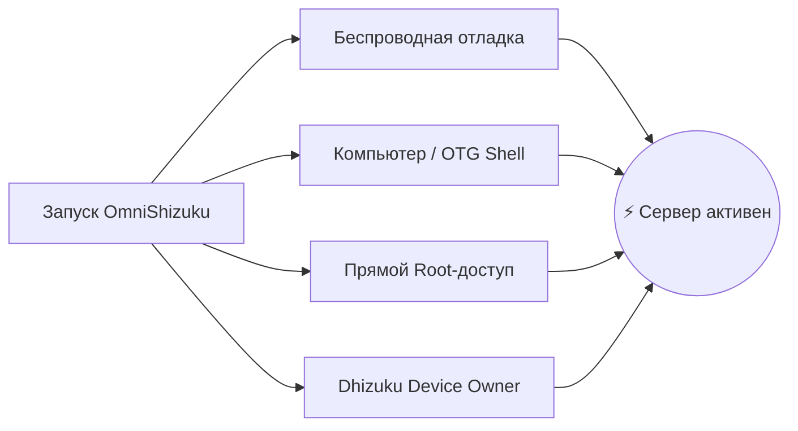

[English](README.md) | [Русский](README.ru.md) | [Қазақша](README.kk.md) | [Qazaqşa (Latın)](README.kk-Latn.md) | [Português](README.pt.md) | [Español](README.es.md) | [العربية](README.ar.md) | [简体中文](README.zh-CN.md) | [日本語](README.ja.md)

# ⚡ OmniShizuku

<div align="center">


# 👑 Режим Бога для Android
### Хватит ставить 4 разных приложения. Ощутите настоящую свободу привилегий — без Root-прав.

[](https://github.com/krishna3163/OmniShizuku/stargazers)
[](https://github.com/krishna3163/OmniShizuku/network/members)
[](https://github.com/krishna3163/OmniShizuku/actions/workflows/apk-build.yml)
[](https://github.com/krishna3163/OmniShizuku/releases)
[](LICENSE)
[-success?style=for-the-badge&logo=android)](https://developer.android.com)

**Имя пакета приложения:** `com.krishna.omnishizuku`

[⚡ Скачать свежий APK](#-быстрое-скачивание-и-запуск) • [✨ Ключевые возможности](#-что-делает-omnishizuku-непревзойденным) • [⚔️ Сравнение](#️-великая-битва-omnishizuku-против-остальных) • [📚 Документация](docs/)

</div>

---

## 💥 Устали от проблем с обычным Shizuku?

Будем честны:
- ❌ **Устали от того, что сервер Shizuku случайно отключается**, когда Android выгружает память?
- ❌ **Устали жонглировать 4 разными приложениями** ради контроля над системой? *(Shizuku для API + Dhizuku для Device Owner + aShell для терминала + Shizuku-Keeper для поддержки работы)*.
- ❌ **Хотите ZIP-модули как в Magisk** для настройки батареи и быстродействия, но не можете разблокировать загрузчик или сломать Knox и банковские клиенты?
- ❌ **Устали от невнятных ошибок в консоли** без подсказок и расшифровки?

### 🚀 Встречайте OmniShizuku.
**OmniShizuku заменяет их все.** Оно объединяет классический привилегированный протокол Shizuku Binder, полноценный модульный движок Shizuku-Next, управление Device Owner от Dhizuku, терминальный интеллект Gemini AI и механизм самовосстановления NightDog в **одном невероятном супер-приложении с Material 3 и биометрической защитой.**

---

## ✨ Что делает OmniShizuku непревзойденным?

### 1. 📦 «Magisk для устройств без Root» (Движок ADB-модулей)
Устанавливайте автономные ZIP-модули прямо со смартфона — без разблокировки загрузчика, без Root и без потери гарантии!
- **Богатый формат модулей:** Поддержка `module.prop`, баннеров, одноразовых утилит `action.sh` и фоновых служб (`service.sh`).
- **Встроенные панели WebUI:** Модули могут отображать интерактивные HTML5/JavaScript интерфейсы с нативным IPC-мостом `window.Shizuku`!
- **Онлайн-каталог GitHub:** Находите, загружайте и обновляйте модули сообщества в один клик.
- **Политики безопасности:** Изоляция Safe Mode, таймауты выполнения, лимиты вывода и логи аудита.

### 2. 🐕 Неубиваемый демон (NightDog Watchdog v14.5)
- Главная проблема пользователей ADB — постоянная выгрузка сервера из памяти.
- В OmniShizuku интегрирован умный демон-сторож **NightDog Watchdog**, непрерывно проверяющий пульс сервера.
- Если система убьет процесс из-за нехватки RAM, NightDog **автоматически поднимет и перезапустит сервер через Беспроводную отладку** без подключения к ПК!

### 3. 🛡️ Супер-мост Device Owner и Dhizuku
- Встроенное полноценное управление Device Owner (DPM).
- Настройка областей делегирования, удаление предустановленного мусора, управление ограничениями и политиками.
- **100% совместимость с Dhizuku:** Приложения для Dhizuku работают с OmniShizuku «из коробки»!

### 4. 🤖 Консоль Comput и Gemini AI Ассистент
- Встроенный интерактивный привилегированный ADB Shell с быстрыми макросами.
- **Диагностика Gemini AI:** Запутались в загадочной ошибке шелла? Gemini AI мгновенно переведет сырой лог в простое и понятное руководство к действию.
- **Commandium AI:** Генерируйте сложные терминальные команды, просто описав задачу человеческим языком!

### 5. 🔒 Биометрическая защита уровня Fort Knox
- Никакие посторонние лица или скрытные приложения не получат доступ к вашей привилегированной среде.
- Главный биометрический замок: Защита выдачи разрешений, запуска модулей и скрытых настроек с помощью **отпечатка пальца, Face Unlock или PIN-кода/пароля**.

### 6. 🧪 Все 15 лабораторий Labs (унаследовано от Shizuku-Next)
OmniShizuku сохраняет **все 100% инструментов Shizuku-Next**:
- 🌐 **Брандмауэр по приложениям:** Отключение доступа в сеть для любого приложения без VPN и Root (`cmd connectivity set-package-networking-enabled <uid> false`).
- 🕶️ **Динамическая 6-уровневая маскировка:** Скрытие привилегированного статуса от приложений с детекцией ADB/Root.
- 🔑 **Просмотр паролей Wi-Fi:** Считывание сохраненных паролей Wi-Fi в открытом виде без Root.
- 📁 **Привилегированный проводник:** Доступ к защищенным системным директориям Android.
- 🚀 **Запуск скрытых Activity:** Вызов скрытых инженерных меню и системных экранов производителей.
- 🌙 **Принудительная темная тема:** Включение темного AMOLED-режима даже в упрямых приложениях.
- 🖥️ **Настройки экрана:** Изменение разрешения, плотности DPI и принудительный режим 120 Гц.
- ⚡ **Расширенное меню питания:** Прямая перезагрузка в Recovery, Fastboot и Bootloader.
- 🛑 **Отключение Phantom Process Killer:** Снятие лимита в 32 дочерних процесса на Android 12+ для Termux и тяжелой сборки кода.
- 📦 **Движок Split-APK InstallerX:** Установка сплит-пакетов, обход запрета на даунгрейд и инъекция скрытых флагов установки.

---

## ⚔️ Великая битва: OmniShizuku против остальных

Посмотрите, как OmniShizuku превосходит любые альтернативы в экосистеме Android:

| Возможность | Официальный Shizuku | Shizuku-Next | ShizukuPlus / Shizako | Dhizuku | Magisk / Root | ⚡ **OmniShizuku** |
| :--- | :---: | :---: | :---: | :---: | :---: | :---: |
| **Без Root-прав?** | ✅ Да | ✅ Да | ✅ Да | ✅ Да | ❌ **Нет (срабатывает Knox)** | 🌟 **Да (100% Non-Root)** |
| **Привилегированный Binder API** | ✅ Да | ✅ Да | ✅ Да | ❌ Нет | ❌ Нет | 🌟 **Да (Макс. скорость)** |
| **Управление Device Owner (DPM)** | ❌ Нет | ❌ Нет | ❌ Нет | ✅ Да | ❌ Нет | 🌟 **Да (Встроено)** |
| **Совместимость с софтом Dhizuku** | ❌ Нет | ❌ Нет | ❌ Нет | ✅ Да | ❌ Нет | 🌟 **Да (Двойной протокол)** |
| **ZIP-модули (в стиле Magisk)** | ❌ Нет | ✅ Да | ❌ Нет | ❌ Нет | ✅ Да (Только Root) | 🌟 **Да (ZIP без Root!)** |
| **WebUI модулей и JS-мост** | ❌ Нет | ✅ Да | ❌ Нет | ❌ Нет | ❌ Нет | 🌟 **Да (HTML5 панели)** |
| **AI Терминал (Gemini / Comput)** | ❌ Нет | ❌ Нет | ❌ Нет | ❌ Нет | ❌ Нет | 🌟 **Да (AI Диагностика)** |
| **Самовосстановление (NightDog)** | ❌ Нет | ⚠️ Базовое | ❌ Нет | ❌ Нет | ❌ Нет | 🌟 **Да (Авто-подъем)** |
| **Биометрия / PIN-код** | ❌ Нет | ❌ Нет | ❌ Нет | ❌ Нет | ❌ Нет | 🌟 **Да (Защита сканером)** |
| **15 лабораторий (Фаервол/Wi-Fi)**| ❌ Нет | ✅ Да | ⚠️ Частично | ❌ Нет | ❌ Нет | 🌟 **Да (Все 15 включены)** |
| **Маскировка (6 уровней)** | ❌ Нет | ✅ Да | ⚠️ Базовая | ❌ Нет | ⚠️ Нужен Zygisk | 🌟 **Да (Авто-скрытие)** |
| **Поддержка Android 17 / API 37** | ❌ Устарел | ⚠️ API 36 | ❌ Устарел | ❌ Устарел | ⚠️ Ручная | 🌟 **Да (compileSdk 37)** |
| **Интерфейс Compose Material 3** | ❌ Старый | ⚠️ Частичный | ❌ Старый | ❌ Старый | ❌ Старый | 🌟 **Да (Expressive M3)** |

> **Вердикт:** Пока другие ветки предлагают лишь отдельные кусочки пазла, **OmniShizuku — это весь собранный пазл.**

---

## 📸 Галерея интерфейса

<div align="center">

| 📱 Главная панель | 🤖 Comput AI Консоль | 📦 Менеджер ADB-модулей | ⚙️ Настройки и Labs |
| :---: | :---: | :---: | :---: |
|  |  |  |  |
| *Статус сервера и быстрые тумблеры* | *AI-объяснения, макросы и commandium* | *ZIP-модули, WebUI и каталоги* | *Биометрия, фаервол и 15 утилит* |

</div>

---

## 🚀 Быстрое скачивание и запуск

> [!IMPORTANT]
> **Рекомендуется чистая установка:** Из-за перехода на единый идентификатор пакета (`com.krishna.omnishizuku`), пожалуйста, **удалите старые сборки Shizuku или Shevery**, чтобы избежать конфликта подписей Android.

### Шаг 1: Скачивание
- 📦 **Свежие CI-сборки (с каждого коммита):** [GitHub Actions](https://github.com/krishna3163/OmniShizuku/actions/workflows/apk-build.yml) &rarr; Спуститесь в раздел **Artifacts** и загрузите `omnishizuku-release.apk`.
- 🏷️ **Стабильные релизы GitHub:** [Страница релизов](https://github.com/krishna3163/OmniShizuku/releases)

### Шаг 2: Запуск удобным для вас способом



1. **Беспроводная отладка (Android 11+ / ПК не требуется):**
   - Параметры разработчика &rarr; Включите **Беспроводная отладка** &rarr; Нажмите **Подключить устройство с помощью кода сопряжения**.
   - Введите 6-значный код в OmniShizuku и нажмите **Запуск**.
2. **Через компьютер (ADB USB Shell):**
   ```bash
   adb shell sh /sdcard/Android/data/com.krishna.omnishizuku/starter.sh
   ```
3. **На устройстве с Root (Magisk / KernelSU / APatch):**
   - Откройте OmniShizuku &rarr; Нажмите **Запустить через Root** &rarr; Предоставьте права суперпользователя.
4. **Через Dhizuku (Device Owner):**
   - Авторизуйте OmniShizuku в приложении Dhizuku для фонового управления.

---

## 📚 Подробная документация

Читайте полные технические руководства в директории [`docs/`](docs/):

| Документ | Тема |
| :--- | :--- |
| 📖 [**Руководство Comput AI Agent**](docs/comput-agent.md) | Окружение терминала, ассистент Gemini AI и макросы. |
| 🛡️ [**Руководство Device Owner и DPM**](docs/device-owner.md) | Настройка Profile Owner, ограничения и области делегирования. |
| 📦 [**Руководство по ADB Modules**](docs/adb-modules-guide.md) | Установка ZIP-модулей, безопасный режим и решение проблем. |
| 🛠️ [**Справочник API модулей**](docs/adb-modules-api.md) | Создание собственных модулей: хуки, переменные среды и мост WebUI. |
| 🌐 [**Публикация в каталоге GitHub**](docs/github-catalog.md) | Упаковка и публикация модулей в глобальном репозитории. |
| 🕶️ [**Стелс-режим и заглушки (Stubs)**](docs/stealth-and-stubs.md) | Защита от обнаружения привилегий враждебным софтом. |
| 🧪 [**Labs, маскировка USB и фаервол**](docs/lab-and-extras.md) | Блокировка сети, 6-уровневое скрытие и спецвозможности. |
| 🔌 [**Плагин Tasker и MacroDroid**](docs/tasker-plugin.md) | Триггеры автоматизации, широковещательные Intent и скрипты запуска. |
| 🐕 [**Восстановление NightDog Watchdog**](docs/nightdog.md) | Мониторинг здоровья демона и архитектура авто-переподключения. |
| 🚀 [**Совместимость с Android 17**](docs/android-17-compatibility.md) | Архитектурные адаптации под compileSdk 37 / Android Baklava. |
| 📡 [**Справочник Intent-ов**](docs/intents.md) | Исчерпывающий справочник всех поддерживаемых широковещательных действий. |

---

## 💻 Сборка из исходного кода

```bash
# 1. Клонируйте репозиторий с субмодулями
git clone --recurse-submodules https://github.com/krishna3163/OmniShizuku.git
cd OmniShizuku

# 2. Сборка отладочного APK (Debug)
./gradlew :manager:assembleDebug

# 3. Сборка релизного APK (Release)
./gradlew :manager:assembleRelease
```
*Собранные файлы APK появятся в каталоге `manager/build/outputs/apk/{debug,release}/`.*

---

## 🙏 Благодарности и зал славы апстрима

OmniShizuku создано благодаря труду выдающихся разработчиков. Мы выражаем глубочайшее уважение и признательность:

* **[RikkaApps/Shizuku](https://github.com/RikkaApps/Shizuku)** — Оригинальная революционная архитектура привилегированного Binder, созданная Rikka.
* **[HmnDev-Tech/shevery](https://github.com/HmnDev-Tech/shevery)** — Апстрим-функции, расширенный интерфейс и основа многомодульности.
* **[iamr0s/Dhizuku](https://github.com/iamr0s/Dhizuku)** и **[rosan/Dhizuku](https://github.com/rosan/Dhizuku)** — Концепции управления Device Owner и протоколы сопряжения.
* **[timschneeb/ShizuStore](https://github.com/timschneeb/ShizuStore)** — Архитектура каталога и синхронизации репозиториев приложений.
* **[wxxsfxyzm/InstallerX-Revived](https://github.com/wxxsfxyzm/InstallerX-Revived)** — Механизмы установки Split-APK и staging-потоки.
* **[zacharee/InstallWithOptions](https://github.com/zacharee/InstallWithOptions)** — Тонкие опции установки пакетов и флаги обхода ограничений.
* **[d4rken/porter](https://github.com/d4rken/porter)** — Чистые примитивы Android IPC и обертки Binder.
* **[topjohnwu/libsu](https://github.com/topjohnwu/libsu)** — Управление сервисами Root Shell и надежные транзакции Binder.
* **[kerneldroid](https://github.com/kerneldroid)** — Компоненты Compose UI, модули каталога и адаптация под Android 17 / API 37.
* **[DP-Hridayan/aShellYou](https://github.com/DP-Hridayan/aShellYou)** — Терминальный интерфейс команд ADB и вычислительные утилиты.
* **[protonpony/Shizuku-Keeper](https://github.com/protonpony/Shizuku-Keeper)** — Архитектура автозапуска демона беспроводной отладки при старте.
* **[Landon Moran](https://github.com/LandonMoran)** — Вклад в мост с Dhizuku, исправления сетевого стека TCP и стабильность служб.

---

## 📜 100% Свободное и открытое ПО

OmniShizuku — бесплатное программное обеспечение, распространяемое по лицензии **[Apache License 2.0](LICENSE)**.

> [!CAUTION]
> **Уведомление о бесплатности:** OmniShizuku всегда было и останется **на 100% бесплатным и открытым**. Никогда не платите сторонним сайтам, продавцам или файлообменникам за скачивание этой программы.

<div align="center">
  <sub>Создано с любовью разработчиком <b>Krishna</b> и сообществом Android Open Source.</sub>
</div>
