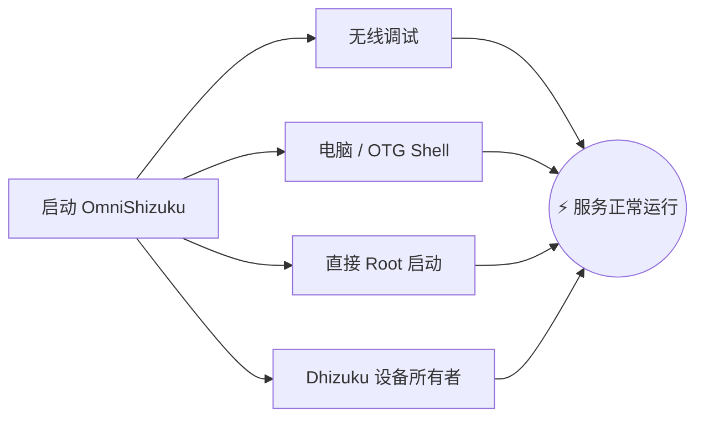

[English](README.md) | [Русский](README.ru.md) | [Қазақша](README.kk.md) | [Qazaqşa (Latın)](README.kk-Latn.md) | [Português](README.pt.md) | [Español](README.es.md) | [العربية](README.ar.md) | [简体中文](README.zh-CN.md) | [日本語](README.ja.md)

# ⚡ OmniShizuku

<div align="center">


# 👑 Android 的上帝模式
### 不再需要安装 4 个不同的应用。体验真正的特权自由 —— 无需 Root。

[](https://github.com/krishna3163/OmniShizuku/stargazers)
[](https://github.com/krishna3163/OmniShizuku/network/members)
[](https://github.com/krishna3163/OmniShizuku/actions/workflows/apk-build.yml)
[](https://github.com/krishna3163/OmniShizuku/releases)
[](LICENSE)
[-success?style=for-the-badge&logo=android)](https://developer.android.com)

**应用包名：** `com.krishna.omnishizuku`

[⚡ 下载最新 APK](#-即刻下载与快速入门) • [✨ 核心杀手级特性](#-是什么让-omnishizuku-无与伦比) • [⚔️ 终极对比](#️-终极对决omnishizuku-vs-其他方案) • [📚 完整文档](docs/)

</div>

---

## 💥 厌倦了普通 Shizuku 的各种麻烦？

扪心自问：
- ❌ **厌倦了 Shizuku 服务在后台被系统随意杀死？**
- ❌ **厌倦了同时折腾 4 个不同的应用？** *(Shizuku 用于 API + Dhizuku 用于设备管理员 + aShell 用于终端 + Shizuku-Keeper 用于保活)*。
- ❌ **想要类似 Magisk 的 ZIP 模块来调优性能与电池**，但无法解锁 Bootloader，或无法承受熔断 Knox 和无法使用银行应用的代价？
- ❌ **厌倦了终端报出一堆晦涩难懂的报错而没有任何指引？**

### 🚀 欢迎体验 OmniShizuku。
**OmniShizuku 彻底取代它们。** 它将经典 Shizuku 特权 Binder 协议、Shizuku-Next 模块化扩展引擎、Dhizuku 设备所有者控制、Gemini AI 终端智能以及 NightDog 自愈崩溃恢复机制，融为一体，打造为**一款绝美、生物识别加密的 Material 3 超级应用。**

---

## ✨ 是什么让 OmniShizuku 无与伦比？

### 1. 📦 “非 Root 环境下的 Magisk”（ADB Modules 引擎）
直接从手机刷入独立 ZIP 模块 —— 无需解锁 Bootloader，无需 Root，绝不损坏保修！
- **功能完备的模块格式：** 支持 `module.prop`、宣传横幅、`action.sh` 一键运行工具以及后台守护进程 (`service.sh`)。
- **内嵌 WebUI 仪表盘：** 模块可呈现完整的交互式 HTML5/JavaScript 仪表盘，具备原生 `window.Shizuku` IPC 桥接！
- **在线 GitHub 仓库目录：** 一键浏览、下载并更新社区模块。
- **安全策略机制：** 安全模式沙盒、执行超时控制、输出限额和审计日志。

### 2. 🐕 永不崩溃的守护神（NightDog 看门狗 v14.5）
- ADB 用户最大的痛点就是服务在后台莫名退出。
- OmniShizuku 拥有智能 **NightDog 看门狗** 守护进程，持续监控服务心跳。
- 一旦 Android 在高内存压力下杀死了服务，NightDog 会**通过无线调试自动唤醒并重启服务**，完全无需重新连接电脑！

### 3. 🛡️ Device Owner 与 Dhizuku 超级桥接
- 内置完整的设备所有者 (DPM) 管理能力。
- 细粒度配置委托权限范围、冻结系统垃圾软件、切换系统限制并管理策略。
- **100% 兼容 Dhizuku：** 专为 Dhizuku 构建的应用均可无缝对接 OmniShizuku！

### 4. 🤖 Comput 终端与 Gemini AI 智能助手
- 内置特权交互式 ADB Shell 终端，配备便捷宏命令按钮。
- **Gemini AI 错误诊断：** 遇到神秘的 Android Shell 错误？Gemini AI 会自动分析原始日志，给出清晰易懂的修复建议。
- **Commandium AI：** 无论用普通英语还是日常口语输入需求，AI 都能直接为你生成精准的 Shell 命令！

### 5. 🔒 军工级生物识别安全保护
- 绝不允许未经授权的人员或恶意应用滥用您的特权环境。
- 主生物识别锁：将授权批准、模块运行和敏感实验室设置牢牢锁定在**指纹、面部解锁或设备锁屏密码**之后。

### 6. 🧪 全套 15 项高级实验室工具（完美继承自 Shizuku-Next）
OmniShizuku 完整保留了 **Shizuku-Next 备受赞誉的 100% 极客工具**：
- 🌐 **单应用网络防火墙：** 无需 VPN、无需 Root，直接切断任意应用的网络连接 (`cmd connectivity set-package-networking-enabled <uid> false`)。
- 🕶️ **动态 6 层反检测隐藏：** 让对 Root/ADB 敏感的应用完全感知不到特权环境的存在。
- 🔑 **明文 Wi-Fi 密码查看器：** 免 Root 读取设备已保存的所有 Wi-Fi 密码。
- 📁 **特权文件管理器：** 浏览并管理 Android 受保护的系统文件目录。
- 🚀 **未导出 Activity 启动器：** 直接启动系统隐藏设置菜单与厂商私有测试页面。
- 🌙 **强制全局暗色模式：** 强制不配合的顽固应用开启纯黑 AMOLED 暗色模式。
- 🖥️ **屏幕显示调节：** 自由修改屏幕分辨率、DPI 密度，并强制锁定 120Hz 高刷新率。
- ⚡ **高级电源菜单：** 一键直接重启至 Recovery、Fastboot 和 Bootloader 模式。
- 🛑 **禁用幽灵进程查杀器：** 解除 Android 12+ 限制的 32 个后台进程硬性上限，满足 Termux 与代码编译重度负载。
- 📦 **Split-APK InstallerX 引擎：** 自由安装多合一分卷 APK，绕过降级安装封锁，自定义各类安装参数。

---

## ⚔️ 终极对决：OmniShizuku vs 其他方案

见证 OmniShizuku 如何在 Android 生态中全方位碾压其他分支与工具：

| 功能 / 能力 | 官方 Shizuku | Shizuku-Next | ShizukuPlus / Shizako | Dhizuku | Magisk / Root | ⚡ **OmniShizuku** |
| :--- | :---: | :---: | :---: | :---: | :---: | :---: |
| **无需 Root？** | ✅ 是 | ✅ 是 | ✅ 是 | ✅ 是 | ❌ **否（熔断 Knox）** | 🌟 **是（100% 免 Root）** |
| **特权 Binder API** | ✅ 是 | ✅ 是 | ✅ 是 | ❌ 否 | ❌ 否 | 🌟 **是（极致性能）** |
| **设备所有者 (DPM) 控制** | ❌ 否 | ❌ 否 | ❌ 否 | ✅ 是 | ❌ 否 | 🌟 **是（原生内置）** |
| **Dhizuku 应用兼容性** | ❌ 否 | ❌ 否 | ❌ 否 | ✅ 是 | ❌ 否 | 🌟 **是（双协议支持）** |
| **ZIP 模块引擎（类似 Magisk）** | ❌ 否 | ✅ 是 | ❌ 否 | ❌ 否 | ✅ 是（仅限 Root） | 🌟 **是（免 Root 刷 ZIP！）** |
| **模块 WebUI 与 JS 桥接** | ❌ 否 | ✅ 是 | ❌ 否 | ❌ 否 | ❌ 否 | 🌟 **是（HTML5 仪表盘）** |
| **AI 终端（Gemini / Comput）** | ❌ 否 | ❌ 否 | ❌ 否 | ❌ 否 | ❌ 否 | 🌟 **是（AI 诊断分析）** |
| **自愈守护（NightDog 看门狗）** | ❌ 否 | ⚠️ 基础版 | ❌ 否 | ❌ 否 | ❌ 否 | 🌟 **是（智能自动唤醒）** |
| **生物识别 / PIN 安全门禁** | ❌ 否 | ❌ 否 | ❌ 否 | ❌ 否 | ❌ 否 | 🌟 **是（指纹面容锁）** |
| **15 大实验室工具（防火墙/Wi-Fi）**| ❌ 否 | ✅ 是 | ⚠️ 部分具备 | ❌ 否 | ❌ 否 | 🌟 **是（全部 15 项集成）** |
| **反检测隐藏（6 层防御）** | ❌ 否 | ✅ 是 | ⚠️ 基础版 | ❌ 否 | ⚠️ 需要 Zygisk | 🌟 **是（动态全自动隐藏）** |
| **Android 17 / API 37 支持** | ❌ 已停更 | ⚠️ API 36 | ❌ 已停更 | ❌ 已停更 | ⚠️ 需手动适配 | 🌟 **是（compileSdk 37）** |
| **现代 Compose Material 3 界面** | ❌ 传统 UI | ⚠️ 部分迁移 | ❌ 传统 UI | ❌ 传统 UI | ❌ 传统 UI | 🌟 **是（极具表现力的 M3）** |

> **结论：** 当其他分支各自只拥有拼图的一块时，**OmniShizuku 就是完整的拼图。**

---

## 📸 界面预览

<div align="center">

| 📱 主控制台 | 🤖 Comput AI 控制台 | 📦 ADB Modules 管理器 | ⚙️ 设置与实验室 |
| :---: | :---: | :---: | :---: |
|  |  |  |  |
| *实时服务状态与快捷开关* | *AI 解释、宏与 commandium* | *ZIP 模块、WebUI 与应用目录* | *生物识别、防火墙与 15 项实验室* |

</div>

---

## 🚀 即刻下载与快速入门

> [!IMPORTANT]
> **推荐全新安装：** 由于我们统一使用了全新的应用包名 (`com.krishna.omnishizuku`)，在安装前请**先卸载旧版 Shizuku 或 Shevery 应用**，以避免 Android 签名冲突。

### 第一步：下载安装包
- 📦 **最新 CI 自动构建（每次提交）：** [GitHub Actions](https://github.com/krishna3163/OmniShizuku/actions/workflows/apk-build.yml) &rarr; 滑动至底部 **Artifacts** 下载 `omnishizuku-release.apk`。
- 🏷️ **GitHub 稳定版发布页：** [Releases 页面](https://github.com/krishna3163/OmniShizuku/releases)

### 第二步：选择你喜爱的方式启动服务



1. **无线调试（Android 11+ / 完全免电脑）：**
   - 开发者选项 &rarr; 启用 **无线调试** &rarr; 点击 **使用配对码配对设备**。
   - 在 OmniShizuku 中输入 6 位配对码并点击 **启动**。
2. **通过电脑（ADB USB Shell）：**
   ```bash
   adb shell sh /sdcard/Android/data/com.krishna.omnishizuku/starter.sh
   ```
3. **已 Root 设备（Magisk / KernelSU / APatch）：**
   - 打开 OmniShizuku &rarr; 点击 **Root 方式启动** &rarr; 授予 Superuser 权限。
4. **通过 Dhizuku（设备所有者）：**
   - 在 Dhizuku 中直接授权 OmniShizuku 即可实现后台托管。

---

## 📚 深度技术文档

请参阅 [`docs/`](docs/) 目录下的详细指南：

| 文档 | 主题 |
| :--- | :--- |
| 📖 [**Comput AI 智能体指南**](docs/comput-agent.md) | 终端环境、Gemini AI 助手与宏脚本。 |
| 🛡️ [**Device Owner 与 DPM 指南**](docs/device-owner.md) | 配置文件所有者设置、策略限制与委托范围。 |
| 📦 [**ADB Modules 用户指南**](docs/adb-modules-guide.md) | 安装 ZIP 模块、安全模式策略与故障排查。 |
| 🛠️ [**ADB Modules API 参考**](docs/adb-modules-api.md) | 编写属于你的模块：挂钩、环境变量与 WebUI 桥接。 |
| 🌐 [**GitHub 模块目录发布指南**](docs/github-catalog.md) | 打包并向全球模块目录提交你的自定义模块。 |
| 🕶️ [**隐身版本与存根 (Stubs)**](docs/stealth-and-stubs.md) | 防止恶意软件或检测机制识别特权状态。 |
| 🧪 [**实验室、USB 隐藏与防火墙**](docs/lab-and-extras.md) | 网络阻断、动态 6 层隐藏与无障碍控制。 |
| 🔌 [**Tasker 与 MacroDroid 插件**](docs/tasker-plugin.md) | 自动化触发器、广播 Intent 与自启动脚本。 |
| 🐕 [**NightDog 看门狗自愈恢复**](docs/nightdog.md) | 守护进程健康状态监测与自动重连架构。 |
| 🚀 [**Android 17 兼容性**](docs/android-17-compatibility.md) | 适配 compileSdk 37 / Android Baklava 的架构调整。 |
| 📡 [**Intent 广播操作参考**](docs/intents.md) | 所有支持的广播 Intent 完整参考手册。 |

---

## 💻 源码编译构建

```bash
# 1. 递归克隆代码库及子模块
git clone --recurse-submodules https://github.com/krishna3163/OmniShizuku.git
cd OmniShizuku

# 2. 编译 Debug 调试包
./gradlew :manager:assembleDebug

# 3. 编译 Release 正式包
./gradlew :manager:assembleRelease
```
*编译生成的 APK 位于 `manager/build/outputs/apk/{debug,release}/`。*

---

## 🙏 致谢与上游荣誉殿堂

OmniShizuku 站在巨人的肩膀上。我们谨向上游杰出项目表达由衷的敬意与谢忱：

* **[RikkaApps/Shizuku](https://github.com/RikkaApps/Shizuku)** — Rikka 创造的开创性、革命性的特权 Binder 架构。
* **[HmnDev-Tech/shevery](https://github.com/HmnDev-Tech/shevery)** — 上游功能、扩展 UI 及多模块基础。
* **[iamr0s/Dhizuku](https://github.com/iamr0s/Dhizuku)** 与 **[rosan/Dhizuku](https://github.com/rosan/Dhizuku)** — 设备所有者管理概念与桥接协议。
* **[timschneeb/ShizuStore](https://github.com/timschneeb/ShizuStore)** — 应用商店仓库同步设计规范。
* **[wxxsfxyzm/InstallerX-Revived](https://github.com/wxxsfxyzm/InstallerX-Revived)** — Split-APK 分卷安装技术与暂存工作流。
* **[zacharee/InstallWithOptions](https://github.com/zacharee/InstallWithOptions)** — 细粒度应用安装选项与绕过标志。
* **[d4rken/porter](https://github.com/d4rken/porter)** — 优雅的 Android IPC 辅助原语与 Binder 封装。
* **[topjohnwu/libsu](https://github.com/topjohnwu/libsu)** — Root Shell 服务管理与高可靠 Binder 事务封装。
* **[kerneldroid](https://github.com/kerneldroid)** — Compose UI 组件、模块目录以及 Android 17 / API 37 适配工作。
* **[DP-Hridayan/aShellYou](https://github.com/DP-Hridayan/aShellYou)** — ADB 命令终端界面与计算工具。
* **[protonpony/Shizuku-Keeper](https://github.com/protonpony/Shizuku-Keeper)** — 无线调试守护进程开机自启动架构。
* **[Landon Moran](https://github.com/LandonMoran)** — 在 Dhizuku 桥接、TCP 网络修复及服务稳定性方面的贡献。

---

## 📜 100% 自由与开源

OmniShizuku 是遵循 **[Apache License 2.0](LICENSE)** 协议发布的自由开源软件。

> [!CAUTION]
> **免费应用声明：** OmniShizuku 现在和将来都将永远是 **100% 免费开源的**。切勿向任何第三方网站、卖家或网盘付费购买或下载本软件。

<div align="center">
  <sub>由 <b>Krishna</b> 与开源 Android 社区倾注热情共同打造。</sub>
</div>
