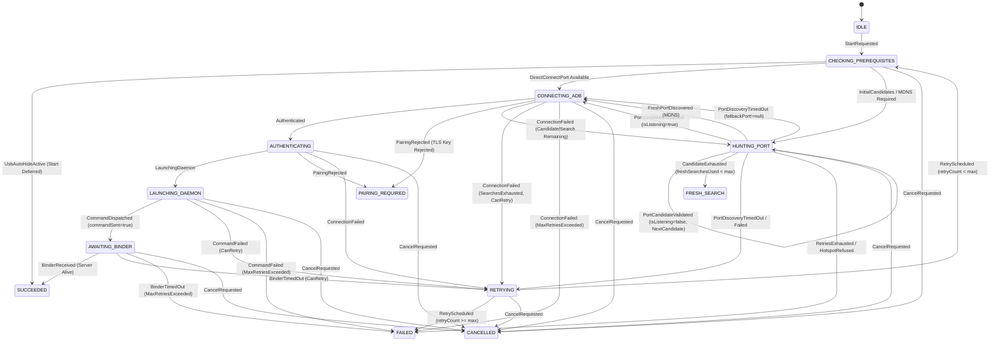

# OmniShizuku — ADB Start & Port Discovery State Machine

## 1. Executive Summary & Objectives

The ADB Start & Port Discovery Engine is the core mechanism enabling OmniShizuku to establish local privileged ADB connections (over Wireless TLS or classic TCP/USB) and launch the native `shizuku_server` daemon without tethering to a computer.

Previously, this process was managed procedurally across `AdbStartRun.kt` (948 lines) and `AdbStarter.kt` (642 lines), utilizing scattered mutable variables, asynchronous callback flows, uncoordinated toggle bouncing, and ad-hoc retries.

This document describes the formalized, deterministic **`AdbStartStateMachine`** and **`AdbStartCoordinator`**, providing:
- Explicit generation tokens for stale callback rejection.
- Single-flight startup protection.
- Safe cancellation and idempotent resource cleanup.
- Bounded retries with explicit timeout states.
- Revalidation of candidate ports to prevent dead port reuse.
- Formal coordination with `UsbDebuggingStateMachine` to prevent conflicting toggle changes during auto-hide.
- 100% pure Kotlin design with zero Android framework dependencies, verified via pure JVM unit tests.

---

## 2. Pre-Implementation Audit & Vulnerability Analysis

### 2.1 Execution Paths & Mutability Audit
1. **Worker Path**: `AdbStartWorker.doWork()` calls `AdbStartRun.execute()`, which coordinates port resolution, authentication, and execution.
2. **Pre-Unlock Service Path**: `LockedBootStartService` runs `AdbStartRun(..., lockedStart = true)` before first user unlock.
3. **Direct Start Path**: `AdbStarter.startAdb(...)` called directly from interactive screens or watchdog background routines.

### 2.2 Critical Concurrency & Race Conditions Identified
- **Toggle Bouncing Collisions**: In `AdbStartRun`, when wireless debugging was already enabled, the engine wrote `adb_wifi_enabled = 0`, delayed 200ms, and wrote `adb_wifi_enabled = 1` to force an mDNS announcement. If a concurrent startup or watchdog recovery fired during this window, adbd restarted mid-handshake.
- **Dead Port Reuse**: A candidate port read from system properties (`service.adb.tcp.port`) or remembered from a previous start was previously assumed live, spending up to 10 seconds in connection retries when the port had actually closed.
- **Stale Port Discovery Overwrites**: If an mDNS hunt resolved after an attempt was cancelled or superseded by a newer start attempt, the callback could overwrite the active port of the newer attempt.
- **Auto-Hide Conflicts**: If USB Debugging Auto-Hide (`UsbDebuggingStateMachine`) had hidden USB debugging for a target banking application, an automated USB start attempt would overwrite `Settings.Global.ADB_ENABLED = 1`, defeating the auto-hide security policy.
- **Starter Re-execution Hazard**: If an attempt failed after the starter command was dispatched (`commandSent = true`), retrying over another port could spawn a second daemon over an already booting server, causing daemon crash and SIGSEGV.

---

## 3. Formal State Model

### 3.1 State Diagram

### 3.2 State Definitions (`AdbStartState`)
- `IDLE`: Engine inactive; ready for startup requests.
- `CHECKING_PREREQUISITES`: Inspecting permissions, target method, and USB debugging auto-hide coordination.
- `HUNTING_PORT`: Evaluating candidate ports (classic TCP, remembered port, TLS property) and driving mDNS discovery.
- `PAIRING_REQUIRED`: Device rejected pairing certificate or key; terminal state requiring user intervention.
- `CONNECTING_ADB`: Socket TCP handshake in flight.
- `AUTHENTICATING`: ADB authentication & key exchange in progress.
- `LAUNCHING_DAEMON`: Executing starter command (`shell:sh /data/local/tmp/shizuku_starter`) over ADB stream.
- `AWAITING_BINDER`: Starter script dispatched; polling Shizuku Binder IPC.
- `RETRYING`: Transient error encountered; scheduled for backoff and retry.
- `SUCCEEDED`: Server confirmed running and healthy.
- `FAILED`: Terminal failure (unrecoverable error or retries exhausted).
- `CANCELLED`: Explicitly cancelled by caller, host, or user.

---

## 4. Concurrency & Lifecycle Invariants

1. **Generation Tokens**:
   Every `StartRequested` generates an incremented monotonic `generation: Long`. All subsequent callbacks (`PrerequisitesChecked`, `PortCandidateValidated`, `FreshPortDiscovered`, `ConnectionFailed`, `BinderReceived`) must match `snapshot.generation`. Events with mismatched generations are safely dropped without mutating state.
2. **Single-Flight Protection**:
   If a new `StartRequested` arrives while `snapshot.isInFlight` is `true`, it is rejected unless `force == true`. A forced start cooperatively increments the generation and aborts the previous attempt.
3. **Command-Sent Protection**:
   Once `CommandDispatched` transitions the machine to `AWAITING_BINDER`, `commandSent` is set to `true`. From this point forward, reconnecting or hunting alternative ports is strictly forbidden to prevent killing an in-flight server.
4. **Dead Port Probe Revalidation**:
   Candidate ports are probed with `PortCandidateValidated(port, isListening)`. If not listening, the port is marked in `failedPorts` and the machine advances to the next candidate or triggers a fresh mDNS search without attempting a full 10-second TLS connection.
5. **USB Auto-Hide Coordination**:
   If `UsbDebuggingStateMachine` indicates that USB debugging is currently in `HIDDEN` phase:
   - A `USB` startup request transitions immediately to `SUCCEEDED` with `lastFailureKind = DEFERRED_AUTO_HIDE`, avoiding any mutation of `Settings.Global.ADB_ENABLED`.
   - A `WIRELESS` startup request proceeds independently over TLS without touching USB debugging toggles.

---

## 5. Verification Results

Pure JVM tests located in `manager/src/test/java/moe/shizuku/manager/start/AdbStartStateMachineTest.kt` and `manager/src/test/java/moe/shizuku/manager/integration/CrossSubsystemStateTest.kt`:

- **AdbStartStateMachineTest**: 31 unit tests covering valid transitions, invalid transitions, single-flight protection, cancellation across all stages, stale generation rejection, candidate probing, dead port exhaustion, pairing rejections, command-sent protection, retry exhaustion, and thread-safe coordinator dispatch.
- **CrossSubsystemStateTest**: Verifies that USB Auto-Hide in `HIDDEN` state properly defers USB ADB start while allowing Wireless ADB start, and verifies recovery after the target banking app leaves the foreground.
