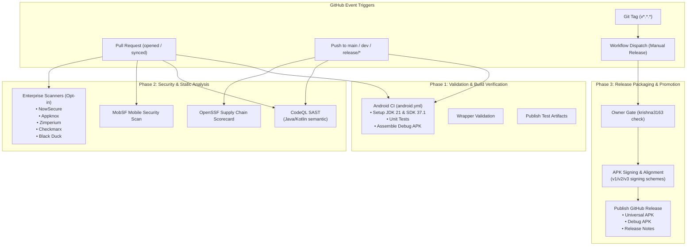

# OmniShizuku — CI/CD Pipeline Architecture & Execution Flow

## 1. Architectural Overview

OmniShizuku employs a layered, event-driven CI/CD architecture designed to balance rapid developer feedback on pull requests with enterprise-grade security analysis and production release automation.

---

## 2. Pipeline Execution Pathways

### 2.1 The Pull Request Pipeline (Developer Fast Gate)
- **Workflows Triggered:** `android.yml`, `codeql.yml`, `mobsf.yml`, `checkmarx-one.yml`, `copilot-auto.yml`, `issue-similarity.yml`.
- **Target Tasks:**
  - Execute `:manager:testDebugUnitTest` to guarantee regression prevention.
  - Compile `:manager:assembleDebug` to verify resource merging and DEX compilation.
  - Run CodeQL and MobSF security scans to catch regressions before merge.
- **Fail-Safe Policy:** Third-party commercial security tools gracefully detect absent vendor tokens and exit with notices rather than failing PR checks.

### 2.2 The Main Branch Pipeline (Integration & Supply Chain)
- **Workflows Triggered:** `android.yml`, `codeql.yml`, `openssf.yml`, `apk-build.yml`, Dependabot.
- **Target Tasks:**
  - Full regression test execution.
  - Scorecard security evaluation verifying commit signing, branch protection, and dependency pinning.
  - Incremental version computation and continuous development APK artifact generation.

### 2.3 The V1.0.0 Release Promotion Pipeline (`release.yml`)
- **Workflow:** `release.yml`
- **Trigger:** Manual dispatch by repository owner or tag push.
- **Execution Flow:**
  1. **Owner Gate:** Validates that the initiating actor is `krishna3163`; aborts with `exit 1` for unauthorized callers.
  2. **Tag Validation:** Verifies semantic versioning format (e.g. `v1.0.0`).
  3. **Keystore Extraction:** Decodes `${{ secrets.KEYSTORE_BASE64 }}`; if omitted, generates a valid fallback debug keystore for automated testing.
  4. **Compilation & Packaging:** Runs `./gradlew :manager:assembleRelease :manager:assembleDebug "-PomniVersionName=v1.0.0"`.
  5. **Artifact Publishing:** Creates GitHub Release `v1.0.0`, attaches signed APKs, and generates markdown release changelog.

