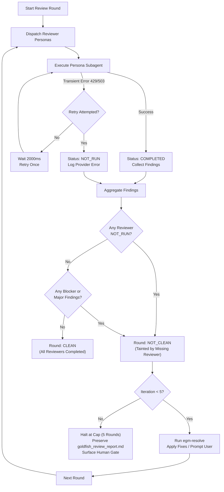

# EGM Verification & Provider Resilience Protocol

*   **Authors:** Google DeepMind Antigravity Engineering
*   **Status:** In Review
*   **Date:** 2026-11-14

--------------------------------------------------------------------------------

## Overview

In the Elephant-Goldfish Model (EGM), language model API providers can experience transient operational failures, including HTTP `429` (Rate Limit Exceeded), `500` (Internal Server Error), and `503` (Service Unavailable / Overloaded).

This protocol defines operational invariants for EGM execution during provider API failures and establishes deterministic verification gates for multi-agent workflows.

## The Problem

Previously, the review runner recorded uncaught subagent errors as zero findings, allowing unverified changes to bypass review gates. When an upstream model provider returned a transient failure (e.g. `503 Service Unavailable`), the review loop could either stall infinitely or falsely mark the review round as clean.

## Goals

*   Guarantee that provider failures never silently bypass review or verification gates.
*   Enforce deterministic categorization of failed reviewers as `NOT_RUN`.
*   Prevent false-clean review passes when any required reviewer fails.
*   Bound retry overhead with fixed backoff and enforce a strict 5-iteration loop cap.
*   Retain all review findings and audit evidence for human developer inspection.

## Non-Goals

*   Automatic failover to unvetted or untrusted third-party model providers.
*   Bypassing required review stages when a model provider is completely offline.
*   Autonomous execution of destructive file operations without developer consent.

--------------------------------------------------------------------------------

## Invariants and Guarantees

### Invariant 1: Explicit `NOT_RUN` Designation

Any reviewer persona that fails, times out, throws an unhandled exception, or receives an HTTP `429`, `500`, or `503` status from an upstream API provider MUST be categorized as `NOT_RUN`. The review runner MUST NOT record an unrun reviewer as having zero findings.

### Invariant 2: Tainted Round / No False Clean Passes

A review iteration is `CLEAN` if and only if:
1. Every requested reviewer completed successfully (`Status == COMPLETED`).
2. No unsettled Blocker or Major findings remain.

If any reviewer is marked `NOT_RUN`, the iteration status is `NOT_CLEAN`, even if all other reviewers report zero issues.

### Invariant 3: Bounded Retries and Backoff

Transient provider errors (HTTP 429/503) trigger at most one retry after a 2000ms delay. If the retry fails, the runner marks the reviewer as `NOT_RUN` and execution continues.

### Invariant 4: Maximum Loop Cap

The review loop driver (`egm-review-loop`) enforces a hard limit of 5 iterations. Upon reaching the cap, the driver halts execution, records all findings in `goldfish_review_report.md`, and prompts the developer for intervention.

### Invariant 5: Human Gate for Destructive Changes

The resolver (`egm-resolve`) categorizes findings as `CONTEST` or `PROPOSE FIX`. It restricts automated edits to documentation text repairs; any file deletion, structural refactor, or code change requires explicit user approval.

--------------------------------------------------------------------------------

## Architectural Workflow

The following state diagram illustrates the deterministic handling of reviewer outcomes and round classification:

--------------------------------------------------------------------------------

## Alternatives Considered

| Alternative | Evaluation & Trade-offs | Decision |
| :--- | :--- | :--- |
| **1. Optimistic Zero-Finding Pass on Provider Error** | Treat API timeouts or 503s as "no issues found" to avoid blocking developers. *Severe flaw*: critical regressions and security defects bypass review. | **Rejected**. Compromises verification integrity. |
| **2. Unbounded Exponential Backoff** | Continuously retry failed API calls with exponential delays up to minutes. *Flaw*: during extended outages, user sessions hang indefinitely. | **Rejected**. Replaced with 1 retry (2000ms) then fail-safe `NOT_RUN`. |
| **3. Autonomous Unbounded Review Loop** | Let the loop run indefinitely until all findings are resolved. *Flaw*: cycles can oscillate or burn excessive API tokens without convergence. | **Rejected**. Enforce strict cap of 5 iterations with user escalation. |

--------------------------------------------------------------------------------

## Detailed Implementation Plan

### Target Files to Create/Modify

*   `skills/egm-review-loop/SKILL.md`: Update loop convergence rules to check for any reviewer with `Status == NOT_RUN` before declaring a round `CLEAN`.
*   `skills/egm-resolve/SKILL.md`: Enforce interactive user confirmation gate before applying structural file modifications.
*   `docs/designs/README.md`: Index `docs/designs/egm-verification-protocol.md` in the design document registry.
*   `docs/designs/SITEMAP.md`: Register protocol document under active specifications.

### Verification Plan

1. **Simulated Reviewer Failure Test**:
   - Dispatch review swarm with an injected 503 Service Unavailable on one persona.
   - Verify persona output records `Status: NOT_RUN` and reason `503 Service Unavailable`.
   - Verify round outcome is evaluated as `NOT_CLEAN`.
2. **Cap Enforcement Test**:
   - Verify loop terminates on iteration 5 if convergence is not reached.
3. **Artifact Retention**:
   - Confirm `goldfish_review_report.md` persists all findings and audit logs.

--------------------------------------------------------------------------------

*Drafted with EGM*
