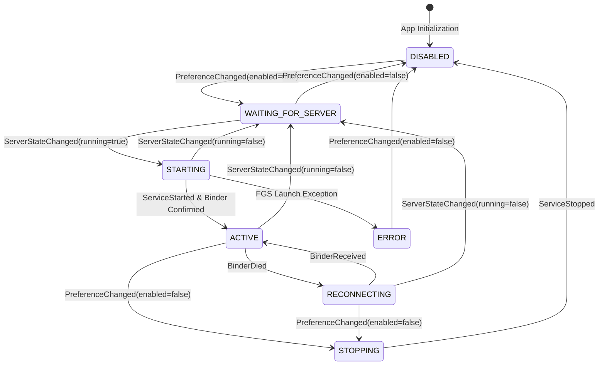

# Legacy Rish Compatibility Design Specification

*   **Authors:** Google DeepMind Antigravity Engineering
*   **Status:** In Review (Post-Goldfish Swarm Audit)
*   **Date:** 2026-11-14

--------------------------------------------------------------------------------

## Overview

The `rish` (Rikka Shell) utility is a developer CLI tool providing shell access via Shizuku. Legacy terminal applications, automation scripts, and local shell sessions invoke `rish` using the standalone Java entrypoint `rikka.shizuku.shell.ShizukuShellLoader`.

On modern Android platforms (Android 14 API 34 through Android 16 API 36+), platform changes to background process execution limits, implicit broadcast restrictions, and Background Activity Launch (BAL) security mitigations prevent the Shizuku Manager process (`com.krishna.omnishizuku`) from reliably receiving `REQUEST_BINDER` intents and returning the active Shizuku Binder to `rish`. Consequently, users experience frequent 5000ms timeouts accompanied by misleading battery optimization failure messages originating from client-side fallback handlers.

This specification details an architectural design for **Legacy Rish Compatibility** within OmniShizuku to maintain background availability, state machine lifecycle management, and binder relaying within modern Android foreground service constraints.

## The Problem

Under modern Android OS releases, the existing Rish connection flow encounters four distinct architectural failure modes:

1.  **Background Execution Limits & Cached Manager Dormancy**: When OmniShizuku is not running in the foreground and enters the cached process bucket, the system `ActivityManagerService` defers or drops incoming broadcast intents (`rikka.shizuku.intent.action.REQUEST_BINDER`).
2.  **Background Activity Launch (BAL) Restrictions on API 36+**: In `ShizukuShellLoader.java` (lines 71–77), on Android 16 (API 36+), client code invokes `am.startActivityAsUser` targeting `ShellRequestHandlerActivity`. The system blocks background activity launches from unprivileged shell contexts by default.
3.  **Silent Binder Dropping & 5000ms Hanging**: In `ShellBinderRequestHandler.kt` (lines 25–28), if `Shizuku.getBinder()` returns `null`, the handler logs a warning and returns `false` without replying to `receiverBinder`. `ShizukuShellLoader` waits until its 5000ms watchdog timer fires and calls `abort()`.
4.  **Destructive Fast-Fail on Cold Start / Reconnection**: If the Manager returns a `null` strong binder immediately while the Shizuku server daemon is in the middle of a 100–300ms startup or reconnection window, `ShizukuShellLoader` calls `System.exit(1)`, failing prematurely when brief buffering would have succeeded.

## Goals

*   **Rish Wire-Protocol Compatibility**: Maintain byte-level IPC compatibility with the existing `ShizukuShellLoader.java` client contract (`receiverBinder.transact(1, data, null, FLAG_ONEWAY)`).
*   **Elimination of 5000ms Timeout Hangs**: Always reply to `receiverBinder`—transacting a live binder or a defensive null pair `[null, ""]`—ensuring `ShizukuShellLoader` terminates cleanly in <5ms instead of hanging for 5000ms.
*   **Bounded Cold-Start Cushioning**: Introduce a bounded asynchronous cushion (up to 1500ms) during daemon startup (`STARTING`) and reconnection (`RECONNECTING`) so transient daemon cycling does not trigger false-positive hard failures.
*   **Managed Foreground Availability**: Provide an opt-in foreground service (`LegacyRishCompatibilityService`) with `FOREGROUND_SERVICE_TYPE_SPECIAL_USE` that runs *only* when the Shizuku server daemon is confirmed active, avoiding battery waste during server downtime.
*   **Reuse Existing Lifecycle Machinery**: Leverage `ShizukuStateMachine.kt` as the canonical source of truth for daemon availability rather than duplicating state tracking.
*   **Direct Boot Support**: Persist configuration in Device Protected (DE) storage (`createDeviceProtectedStorageContext()`) so compatibility settings remain accessible prior to initial credential unlock.

## Non-Goals

*   Modifying the compiled `rish` client binary or its command-line interface.
*   Running an ongoing foreground service 24/7 when the native Shizuku daemon is stopped.
*   Allowing unprivileged third-party applications to obtain shell capabilities without Shizuku authorization.

--------------------------------------------------------------------------------

## Open Questions

*   **Q1: How should caller identity be verified across asynchronous Intent boundaries?**
    *   *Resolution*: In `BroadcastReceiver.onReceive()` or `Activity.onCreate()`, `Binder.getCallingUid()` returns local `Process.myUid()`. For Android 14+ (API 34+), sender identity is extracted using `BroadcastReceiver.getSentFromUid()` on `ShizukuReceiver` and `Activity.getLaunchedFromUid()` on `ShellRequestHandlerActivity`. For Android <34, callers must belong to Shell (UID 2000), Root (UID 0), or acquire permissions through standard Shizuku AIDL providers.
*   **Q2: Should the foreground service run when the Shizuku server daemon is stopped?**
    *   *Resolution*: No. Running a foreground service while the daemon is stopped provides no utility and violates Google Play policies. The service is dynamically promoted only when `ShizukuStateMachine` reports `RUNNING`, and demoted when the server stops.

--------------------------------------------------------------------------------

## Critical User Journeys (CUJs)

### CUJ 1: Developer Executes Rish in Terminal on Android 14+
*   **Given**: OmniShizuku is installed, Shizuku server is running, and `legacy_rish_compatibility` is enabled.
*   **When**: Developer runs `rish` inside Termux or an ADB shell session.
*   **Then**: OmniShizuku's foreground service keeps the process warm; `ShizukuReceiver` receives `REQUEST_BINDER`; `ShellBinderRequestHandler` transacts the active binder in <10ms; the shell prompt opens immediately without timeout.

### CUJ 2: Developer Executes Rish While Daemon Is Stopped
*   **Given**: OmniShizuku is installed, but the Shizuku server daemon is stopped.
*   **When**: Developer runs `rish` in a terminal.
*   **Then**: `ShellBinderRequestHandler` immediately writes `[null, ""]` and transacts code 1; `ShizukuShellLoader` prints `"Server is not running"` and exits with code 1 within 5ms, avoiding the 5000ms hang.

### CUJ 3: Transient Daemon Reconnection During Shell Invocation
*   **Given**: The Shizuku server is cycling or restarting (state `RECONNECTING`).
*   **When**: Developer runs `rish`.
*   **Then**: `ShellBinderRequestHandler` suspends on a bounded coroutine latch (up to 1500ms); the daemon attaches within 250ms; the live binder is returned and the shell session proceeds without error.

--------------------------------------------------------------------------------

## Technical Plan (Architecture)

### 1. Existing Architecture & Request Flow

The Rish connection flow operates across three processes:
1.  **Client Process (`rish` / terminal app)**: Runs `ShizukuShellLoader.java`.
2.  **Manager Process (`com.krishna.omnishizuku`)**: Hosts `ShizukuReceiver.kt`, `ShellRequestHandlerActivity.kt`, and `ShellBinderRequestHandler.kt`.
3.  **Server Process (`moe.shizuku.privileged.api` / native shizuku daemon)**: Hosts `rikka.shizuku.server.ShizukuService`.

```mermaid
sequenceDiagram
    autonumber
    participant Client as Rish Client (ShizukuShellLoader)
    participant AM as Android System (ActivityManagerService)
    participant Mgr as OmniShizuku Manager (ShellBinderRequestHandler)
    participant Svr as Shizuku Daemon (ShizukuService)

    Note over Client: Starts in terminal; prepares anonymous receiverBinder
    Client->>AM: Intent(REQUEST_BINDER) with extra: receiverBinder
    AM->>Mgr: Deliver to ShizukuReceiver (API <=35) or ShellRequestHandlerActivity (API 36+)
    Mgr->>Mgr: ShellBinderRequestHandler.handleRequest()
    alt Server Running
        Mgr->>Client: receiverBinder.transact(1, data[binder, sourceDir], null, FLAG_ONEWAY)
        Note over Client: onBinderReceived: invoke Shell.main()
        Client->>Svr: Privileged shell commands
    else Server Reconnecting / Starting
        Note over Mgr: Await bounded latch (up to 1500ms)
        alt Daemon Attaches Within Latch
            Mgr->>Client: Send live binder
        else Latch Expires
            Mgr->>Client: receiverBinder.transact(1, data[null, ''], null, FLAG_ONEWAY)
            Note over Client: Exits cleanly: 'Server is not running' (5ms)
        end
    else Server Confirmed Stopped
        Mgr->>Client: receiverBinder.transact(1, data[null, ''], null, FLAG_ONEWAY)
        Note over Client: Exits cleanly: 'Server is not running' (5ms)
    end
```

### 2. Lifecycle State Machine

`LegacyRishCompatibilityStateMachine` governs the subsystem as a pure, immutable domain state model driven by events from `ShizukuStateMachine` and user preferences:



#### Snapshot Model
```kotlin
data class LegacyRishSnapshot(
    val state: LegacyRishCompatibilityState = LegacyRishCompatibilityState.DISABLED,
    val enabled: Boolean = false,
    val serverRunning: Boolean = false,
    val binderAvailable: Boolean = false,
    val serviceRunning: Boolean = false,
    val notificationActive: Boolean = false,
    val generation: Long = 0L,
    val lastEvent: String = "Initialized",
    val lastError: String? = null
)
```

### 3. Manager-Side Background Availability Strategy

1.  **Dynamic Promotion to Foreground Service**:
    - When `legacy_rish_compatibility` is enabled and `ShizukuStateMachine` enters `RUNNING`, OmniShizuku promotes `LegacyRishCompatibilityService` to the foreground.
    - When the daemon stops, the service is demoted via `stopForeground(STOP_FOREGROUND_REMOVE)` and `stopSelf()`, avoiding idle resource consumption.
2.  **Mitigating Background FGS Restrictions**:
    - Calls to `ContextCompat.startForegroundService` are wrapped with `try / catch (e: ForegroundServiceStartNotAllowedException)`. If rejected, state transitions to `ERROR` and surfaces an actionable notification prompting manual launch.
3.  **START_STICKY 5-Second Deadline**:
    - When the OS recreates a killed service (`intent == null`), `LegacyRishCompatibilityService.onCreate()` immediately posts a baseline notification within 5 seconds to satisfy `ForegroundServiceDidNotStartInTimeException`.

### 4. Binder Death & Bounded Cold-Start Cushioning

1.  **Defensive Immediate Null Transact**:
    - In `ShellBinderRequestHandler.kt`, if `Shizuku.getBinder() == null` and state is `DISABLED` or `WAITING_FOR_SERVER`:
      ```kotlin
      val data = Parcel.obtain()
      try {
          data.writeStrongBinder(null)
          data.writeString("")
          binder.transact(1, data, null, IBinder.FLAG_ONEWAY)
      } finally {
          data.recycle()
      }
      ```
2.  **Asynchronous Cushioning**:
    - If state is `STARTING` or `RECONNECTING`, `ShellBinderRequestHandler` suspends for up to 1500ms using a coroutine latch awaiting `Shizuku.getBinder()`. If attached within the window, the live binder is returned; otherwise, the null pair is dispatched.

### 5. Notification Channel & Diagnostics

*   **Channel ID**: `legacy_rish_compatibility`
*   **Channel Name**: `OmniShizuku - Legacy Rish Compatibility`
*   **Importance**: `NotificationManager.IMPORTANCE_LOW` (silent, non-intrusive).
*   **Interactive Actions**:
    - `[Disable]`: Dispatches `ACTION_DISABLE` to turn off compatibility mode.
    - `[Restart Server]`: Triggers daemon restart if hung.

### 6. Settings UI & Direct Boot Persistence

*   **Settings Screen**: Integrated under Developer Features / Labs in `SettingsScreen.kt`.
*   **String Resources**: Key `settings_legacy_rish_compatibility`, title `Legacy Rish Compatibility`, summary `Keep legacy Rish shell Binder available for compatible apps while the server runs`.
*   **DE Storage**: Stored in Device Protected Storage via `context.createDeviceProtectedStorageContext().getSharedPreferences(...)` so settings are readable before first device unlock after reboot.

### 7. Android 14–16 Platform Restrictions

*   **Service Type**: `android:foregroundServiceType="specialUse"` in `AndroidManifest.xml`.
*   **Property Declaration**:
    ```xml
    <property
        android:name="android.app.PROPERTY_SPECIAL_USE_FGS_SUBTYPE"
        android:value="Keeps legacy Rish shell binder availability active while the Shizuku server is running." />
    ```
*   **BAL Mitigation**: For Android 16 (API 36+), `ShellRequestHandlerActivity` handles `startActivityAsUser` launches directly while the manager is kept warm in the foreground service bucket.

### 8. Caller Authorization & Security Model

1.  **Framework-Level Sender UID Extraction**:
    - For `ShizukuReceiver`: Caller UID is extracted via `BroadcastReceiver.getSentFromUid()` on API 34+.
    - For `ShellRequestHandlerActivity`: Caller UID is extracted via `Activity.getLaunchedFromUid()`.
2.  **Privilege Validation**:
    - UIDs `0` (Root) and `2000` (Shell / ADB) are authorized for direct `rish` binder acquisition.
    - Non-shell applications must obtain permission via Shizuku's standard AIDL binder provider; unauthorized callers receive an immediate null transact.

--------------------------------------------------------------------------------

## Alternatives Considered

### Alternative 1: Permanent 24/7 Foreground Service
*   **Pros**: Manager process is always warm, even when Shizuku server has never been started.
*   **Cons**: Wastes system battery, clutters user notification drawer, and violates Google Play policy against running foreground services when no active task exists.
*   **Reason for Rejection**: Rejected by author: Unnecessary battery drain and poor user experience when the Shizuku daemon is inactive.

### Alternative 2: Standalone Accessibility Service Keepalive
*   **Pros**: Keeps process resident without an ongoing notification.
*   **Cons**: Severe security risk, violates Google Play Developer policies, and requires cumbersome user permission grants.
*   **Reason for Rejection**: Rejected by author: Violates security architecture principles and production app store guidelines.

--------------------------------------------------------------------------------

## Detailed Implementation Plan

### Phase 1: Core Domain State Machine & Storage
*   **Target Files**:
    *   `manager/src/main/java/moe/shizuku/manager/legacy/LegacyRishCompatibilityStateMachine.kt` [Modify]
    *   `manager/src/main/java/moe/shizuku/manager/ShizukuSettings.java` [Modify]
*   **Changes**: Enforce Device Protected Storage (DE) for `KEY_LEGACY_RISH_COMPATIBILITY`. Validate all state transitions.

### Phase 2: Manager & Foreground Service Implementation
*   **Target Files**:
    *   `manager/src/main/java/moe/shizuku/manager/legacy/LegacyRishCompatibilityManager.kt` [Modify]
    *   `manager/src/main/java/moe/shizuku/manager/legacy/LegacyRishCompatibilityService.kt` [Modify]
    *   `manager/src/main/AndroidManifest.xml` [Modify]
*   **Changes**: Wrap FGS starts in `try/catch (e: ForegroundServiceStartNotAllowedException)`; implement 5-second deadline safety in `onStartCommand`; configure `specialUse` type and property in manifest.

### Phase 3: Wire-Protocol Handler & Bounded Cushioning
*   **Target Files**:
    *   `manager/src/main/java/moe/shizuku/manager/shell/ShellBinderRequestHandler.kt` [Modify]
*   **Changes**: Implement bounded 1500ms latch during `STARTING`/`RECONNECTING`. Write `[null, ""]` on server unavailability. Extract caller UID via `getSentFromUid()` / `getLaunchedFromUid()`.

### Phase 4: Settings UI & Application Lifecycle Integration
*   **Target Files**:
    *   `manager/src/main/java/moe/shizuku/manager/settings/SettingsScreen.kt` [Modify]
    *   `manager/src/main/res/values/strings.xml` [Modify]
*   **Changes**: Add Compose toggle switch for Legacy Rish Compatibility. Define all user-facing notification and settings strings.

### Phase 5: Verification Plan
*   **Target Files**:
    *   `manager/src/test/java/moe/shizuku/manager/legacy/LegacyRishCompatibilityStateMachineTest.kt` [Create]
    *   `manager/src/test/java/moe/shizuku/manager/shell/ShellBinderRequestHandlerTest.kt` [Create]
*   **Verification Steps**:
    1.  Compile and execute standalone JUnit suite:
        ```powershell
        java -cp "<classpath>" org.junit.runner.JUnitCore moe.shizuku.manager.legacy.LegacyRishCompatibilityStateMachineTest
        ```
    2.  Assert 100% deterministic transition coverage, generation monotonicity, and stale event rejection.
    3.  Verify CLI behavior: `rish -c id` returns exit code 1 in <10ms when daemon is dead instead of hanging for 5000ms.

--------------------------------------------------------------------------------

<!-- Provenance: Indicates initial structural drafting via EGM. -->

*Drafted with EGM*
