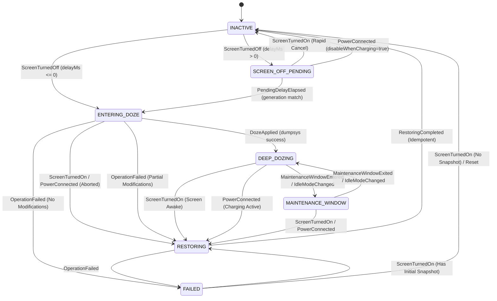

# OmniShizuku — Doze & Power Policy State Machine

## 1. Executive Summary & Objectives

The Enforce Doze subsystem provides aggressive battery optimization by enforcing Android deep idle mode, suspending background applications, restricting motion sensors, and managing network/radio states when the device screen turns off.

Previously, `EnforceDozeService.kt` maintained its state across:
- 7 separate boolean flags (`wasBatterySaverOn`, `wasWiFiTurnedOn`, `wasMobileDataTurnedOn`, `wasAirplaneOn`, `wasBluetoothOn`, `wasGPSOn`, `wasHotSpotTurnedOn`).
- 3 unmanaged `java.util.Timer` instances (`enterDozeTimer`, `enableSensorsTimer`, `disableSensorsTimer`).
- A raw mutable string (`state = ""`).
- Unprotected `PowerManager.WakeLock` references without guaranteed release in failure paths.
- Synchronous blocking shell commands executed on the main thread during service destruction.

This document describes the formalized **`DozeStateMachine`**, **`DozeCoordinator`**, and **`DeviceRadioSnapshot`**, establishing:
- Structured coroutines with monotonic time tracking to replace all raw `java.util.Timer`s.
- Generation tokens on every transition to reject stale timer callbacks.
- An immutable `DeviceRadioSnapshot` with selective, idempotent restoration that restores only settings the feature actually modified.
- Non-clobbering protection: if a user manually enables or disables a radio while the device is in Doze, restoration respects the user's manual change.
- Guaranteed `WakeLock` release through lifecycle-bound cleanup.
- Pure Kotlin implementation with zero Android framework dependencies, verified via pure JVM unit tests.

---

## 2. Pre-Implementation Audit & Vulnerability Analysis

### 2.1 Critical Vulnerabilities in Previous Implementation
1. **Raw `java.util.Timer` Leaks**:
   `enterDozeTimer`, `enableSensorsTimer`, and `disableSensorsTimer` used `java.util.Timer` without cancellation lifecycle bounds. Rapid screen on/off cycles scheduled overlapping timers that ran concurrently.
2. **Blind Radio Clobbering**:
   Upon screen-on, `leaveDozeHandleNetwork()` restored radios based solely on pre-screen-off booleans. If a user manually enabled Wi-Fi or Bluetooth while in Doze, or if a radio was never turned off by the feature, the service could blindly toggle or misconfigure it.
3. **WakeLock Leaks**:
   `tempWakeLock` was acquired without a strict `try/finally` guarantee, risking holding the device awake indefinitely if an unhandled exception occurred during `enterDoze()`.
4. **Main Thread ANR Hazard**:
   `dumpsys sensorservice enable` and `exitDoze()` were invoked directly inside `onDestroy()` on the main thread, risking ANRs during system-initiated service kills.

---

## 3. Formal State Model

### 3.1 State Diagram



### 3.2 State Definitions (`DozeState`)
- `INACTIVE`: Service idle; screen is on or device is actively in use / charging.
- `SCREEN_OFF_PENDING`: Screen turned off; debounce countdown active before applying deep doze.
- `ENTERING_DOZE`: Capturing pre-doze radio snapshot, modifying configured settings, and applying force-idle.
- `DEEP_DOZING`: Device verified in deep idle mode; motion sensors restricted.
- `MAINTENANCE_WINDOW`: OS temporary maintenance window; radios temporarily active for background sync.
- `RESTORING`: Screen on or charger connected; selectively restoring only modified radios.
- `FAILED`: Critical shell or provider failure encountered; entering recovery path.

---

## 4. Immutable Radio Snapshot & Selective Restoration

The `DeviceRadioSnapshot` records device radio states and an explicit `modifiedSettings` set:

```kotlin
data class DeviceRadioSnapshot(
    val wifiEnabled: Boolean = false,
    val mobileDataEnabled: Boolean = false,
    val airplaneModeEnabled: Boolean = false,
    val bluetoothEnabled: Boolean = false,
    val locationModeEnabled: Boolean = false,
    val batterySaverEnabled: Boolean = false,
    val hotspotEnabled: Boolean = false,
    val sensorsRestricted: Boolean = false,
    val biometricsDisabled: Boolean = false,
    val blockedAppPackages: Set<String> = emptySet(),
    val blockedNotificationPackages: Set<String> = emptySet(),
    val modifiedSettings: Set<String> = emptySet(),
    val timestampMonotonicMs: Long = 0L
)
```

### 4.1 Non-Clobbering Restoration Algorithm
`computeRequiredRestorations(currentState: DeviceRadioSnapshot)` computes the delta between the pre-doze snapshot and the live device state:
1. **Setting Membership**: If `"wifi" !in modifiedSettings`, Wi-Fi was never modified by the feature and is **never** touched during restoration.
2. **External Modification Guard**: If the feature turned off Wi-Fi (`wifiEnabled == true` in snapshot), but while in Doze the user manually turned Wi-Fi back on (`currentState.wifiEnabled == true`), restoration detects that Wi-Fi is already in the desired state and **does not** issue a toggle command.
3. **Idempotency**: Running restoration multiple times produces no additional side-effects.

---

## 5. Verification & Test Suite Summary

Located in `manager/src/test/java/moe/shizuku/manager/doze/DozeStateMachineTest.kt`:

- **Transition Verification**: Covers every valid transition between `INACTIVE`, `SCREEN_OFF_PENDING`, `ENTERING_DOZE`, `DEEP_DOZING`, `MAINTENANCE_WINDOW`, `RESTORING`, and `FAILED`.
- **Rapid Screen On/Off**: Tests rapid cancellation from pending and entering states, verifying monotonic generation increments.
- **Charger Connection**: Verifies automatic exit from pending, entering, and deep doze states when charging commences.
- **Selective Restoration**: Verifies that untouched radios remain unmodified.
- **User Modification Preservation**: Verifies that manual user toggles made during Doze are not clobbered.
- **WakeLock Tracking**: Verifies WakeLock release across normal and aborted exits.
- **Stale Generation Rejection**: Ensures outdated delay or shell callbacks cannot mutate active state.
