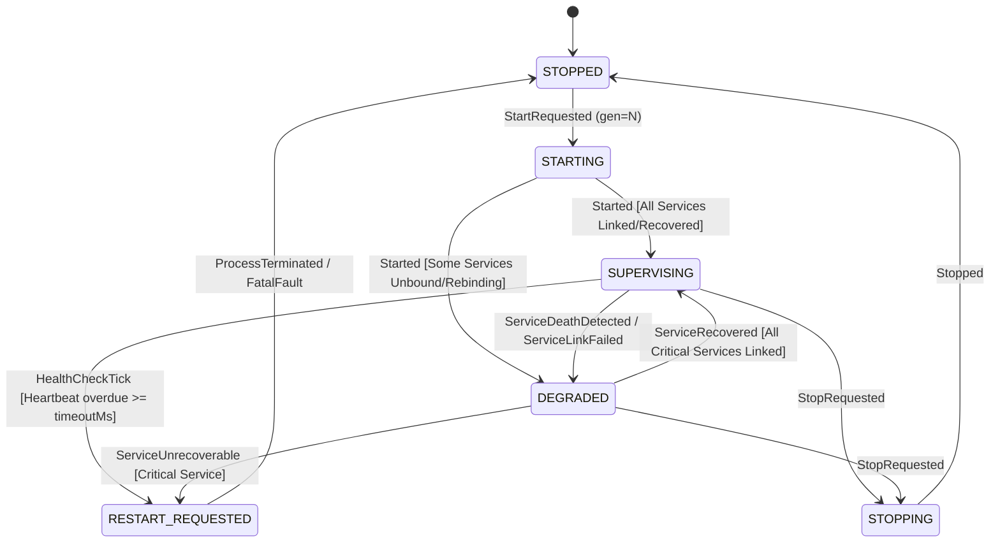
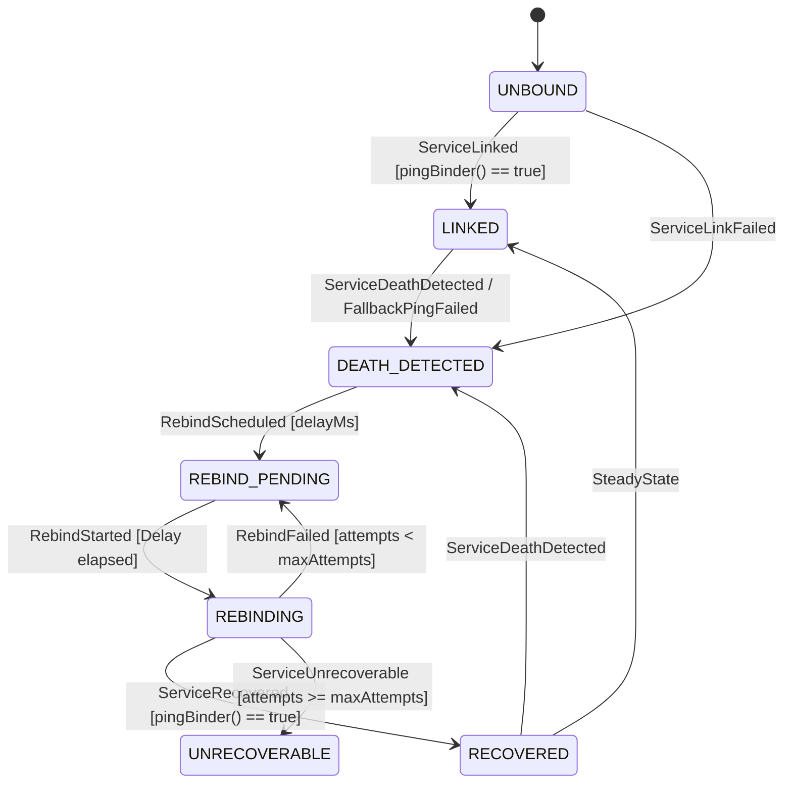

# OmniShizuku — NightDog System Service Supervisor State Machine Architecture

## 1. System Overview

NightDog is the internal watchdog and system service supervisor embedded directly inside the `shizuku_server` daemon process. It provides two critical reliability guarantees:

1. **Main-Thread Responsiveness Watchdog**: Continuously monitors the server process's main looper thread via periodic heartbeats (`NightDog.beat()`) and terminates stalled processes so the native `starter` supervisor can restart them.
2. **System Service Death & Recovery Supervisor**: Monitors Binder connectivity to critical Android framework services (`package`, `activity`, `user`, `appops`) and optional services (`permissionmgr`), detecting system server restarts, managing exponential backoff reconnection, and refreshing client/manager registrations upon recovery.

---

## 2. State Machine Models

### A. Supervisor Lifecycle State Machine

The top-level supervisor coordinates health evaluation, heartbeat monitoring, and daemon process lifecycle:



#### Supervisor States:
- **`STOPPED`**: Idle baseline state. No threads running, no service bindings tracked, no heartbeats monitored.
- **`STARTING`**: Initializing `HandlerThread("nightdog")`, registering service snapshots in `UNBOUND` state, and initiating initial bindings.
- **`SUPERVISING`**: All critical system services are alive (`LINKED` or `RECOVERED`) and the main-thread heartbeat is fresh.
- **`DEGRADED`**: The server is active, but one or more critical services are currently reconnecting (`REBIND_PENDING` / `REBINDING`), or an optional service has become `UNRECOVERABLE`.
- **`RESTART_REQUESTED`**: An unrecoverable condition has occurred (e.g. heartbeat deadline exceeded or a critical service exhausted all 10 rebind attempts). The supervisor logs thread stack traces and triggers `terminateForRecovery()`.
- **`STOPPING`**: Transitioning to shutdown. In-flight rebind tasks and delayed checks are cancelled.
- **`FAILED`**: Internal supervisor failure.

---

### B. Monitored Service Lifecycle State Machine

Each monitored Android framework service (`package`, `activity`, `user`, `appops`, `permissionmgr`) is managed independently as an isolated sub-state machine:



#### Service States:
- **`UNBOUND`**: Service has not yet been bound to an active `IBinder`.
- **`LINKED`**: Service binder is actively held, verified responsive via `pingBinder()`, and has a registered `IBinder.DeathRecipient`.
- **`DEATH_DETECTED`**: Service binder died (reported via Binder death recipient or periodic ping failure). Unlinked from previous proxy.
- **`REBIND_PENDING`**: Scheduled to attempt reconnection after backoff delay.
- **`REBINDING`**: Actively querying `ServiceManager.getService()` and verifying ping response.
- **`RECOVERED`**: Re-bound to a healthy system service. `ShizukuService` invalidates cached proxy stubs and re-dispatches Binder tokens to client applications.
- **`UNRECOVERABLE`**: Reconnection failed after 10 consecutive exponential backoff attempts.

---

## 3. Critical Process Recovery & Native Starter Coordination

### Why Process Termination is Necessary
`shizuku_server` runs as a standalone daemon spawned by the native `starter` process (`starter.cpp`). The native supervisor forks `shizuku_server` and waits in a `waitpid` loop:

```cpp
int status = 0;
while (waitpid(pid, &status, 0) == -1) {
    if (errno == EINTR) continue;
    break;
}
if (!killed_by_signal && exit_code == 0) {
    exit(0); // Clean exit, do not restart
}
restart_count += 1;
if (restart_count > max_restarts) {
    exit(EXIT_FATAL_APP_PROCESS); // Crash loop capped at 5 consecutive attempts
}
sleep(restart_delay_secs);
```

When `shizuku_server` detects an unrecoverable fault:
1. **Heartbeat Timeout**: If the main looper freezes (e.g. system deadlock, synchronous Binder hang), `shizuku_server` cannot process client requests or permissions.
2. **Critical Service Loss**: If `system_server` crashes or a critical service (`package`, `activity`, `user`, `appops`) remains unresponsive across 10 retry attempts (~5 minutes of backoff), `shizuku_server` cannot continue functioning safely.

Calling `terminateForRecovery()` via `Process.killProcess(Process.myPid())`:
- Safely terminates the stalled server.
- The native supervisor detects the abnormal termination via `waitpid`.
- The native supervisor waits 5 seconds and respawns a fresh `shizuku_server` process with clean IPC state.
- If uptime $\ge 60$ seconds, the consecutive crash counter is automatically reset to 0.

### Pluggable Termination for Testing
In production, `processTerminator` calls `Process.killProcess(Process.myPid())`. In test suites, `NightDogCoordinator` and `NightDog` allow injecting `processTerminator = { reason -> ... }`, allowing test suites to verify exact termination reasons without killing the JVM test runner.

---

## 4. Race Conditions & Failure Modes Resolved

1. **Rebind After Supervisor Shutdown**:
   - Every rebind runnable and scheduled callback carries the supervisor's `generation: Long` ID.
   - When a rebind runnable executes, it validates `coordinator.generation == myGen && coordinator.isRunning`. If the supervisor has been stopped or restarted, stale tasks abort before touching `ServiceManager`.
2. **Handler Callback Leaks**:
   - `NightDog.stop()` clears all callbacks from `handler` via `removeCallbacksAndMessages(null)` and quits the underlying `HandlerThread` safely.
3. **Duplicate Rebind Prevention**:
   - Pending rebinds are tracked in `pendingRebinds` set and governed by `NightDogServiceState.REBIND_PENDING` / `REBINDING`.
   - Rebind requests for a service that is already scheduled or active are safely ignored.
4. **Binder Death During Active Rebind**:
   - If a replacement service dies during or immediately after `linkTo`, `ServiceDeathDetected` updates state back to `DEATH_DETECTED` with generation safety.
5. **Stale Heartbeats**:
   - Calling `NightDog.beat()` while stopped or during shutdown has zero effect and cannot mark a stopped or restarting supervisor healthy.
6. **Monotonic Timing Invariant**:
   - All timeouts, heartbeats, and exponential backoff deadlines use monotonic `SystemClock.uptimeMillis()`, preventing NTP time jumps or user clock changes from falsely triggering timeouts or breaking backoff curves.
7. **Idempotent Resource Cleanup**:
   - Unlinking services and clearing listeners are idempotent and resilient to dead proxies or unlinked recipients.

---

## 5. Verification & Test Coverage

The subsystem is verified by `NightDogStateMachineTest.kt` (18 pure JVM unit tests):

- `initialStateIsStopped`: Verifies clean baseline snapshot.
- `startRequestedInitializesServicesInUnboundState`: Verifies critical/optional service partitions and 0 initial retries.
- `startedTransitionsToSupervisingWhenAllBound`: Verifies health computation.
- `heartbeatReceivedUpdatesLastBeatAndCount`: Verifies monotonic heartbeat tracking and stale heartbeat rejection.
- `healthCheckOverdueHeartbeatTransitionsToRestartRequested`: Verifies overdue heartbeat triggers restart.
- `serviceLinkedUpdatesServiceAndRecoversSupervisingState`: Verifies recovery to `SUPERVISING`.
- `serviceDeathDetectedTransitionsToDegraded`: Verifies death moves supervisor to `DEGRADED`.
- `rebindScheduledAndStartedProgressState`: Verifies transition from `REBIND_PENDING` to `REBINDING`.
- `serviceRecoveredResetsAttemptsAndIncrementsTotalRecoveries`: Verifies recovery tracking.
- `rebindFailedIncrementsAttemptsAndAppliesBackoff`: Verifies exponential backoff curve (5s, 10s, 20s, 40s, 60s).
- `criticalServiceRetryExhaustionTransitionsToRestartRequested`: Verifies 10 attempts exhaustion triggers `RESTART_REQUESTED`.
- `optionalServiceRetryExhaustionRemainsDegradedWithoutRestart`: Verifies optional service failure remains in `DEGRADED` without killing server.
- `multipleServicesFailingSimultaneouslyHandledIndependently`: Verifies multi-service concurrent failures.
- `staleGenerationEventsAreSafelyRejected`: Verifies stale generations cannot alter state.
- `stopRequestedAndStoppedClearsAllState`: Verifies clean shutdown sequence.
- `cleanupIdempotency`: Verifies repeated stops and resets are idempotent.
- `binderDeathDuringActiveRebindHandledDeterministically`: Verifies death during rebind.
- `coordinatorAtomicTransitionsAndCallbacks`: Verifies thread-safe atomic transitions and callbacks.
