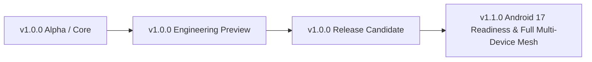

# Welcome to the OmniShizuku Wiki!

Welcome to the **OmniShizuku** project documentation hub. OmniShizuku is an enhanced, multi-module Android system management framework built upon Shizuku, incorporating autonomous diagnosis (AGY Shell / Comput Agent), stealth stubbing, advanced ADB module virtualization, Call Recorder modeling, WallYou wallpaper integration, and security-hardened toolchains.

---

## 🗺️ Project Roadmap & Milestones



| Milestone | Target Status | Key Deliverables |
| :--- | :--- | :--- |
| **v1.0.0-alpha** | **Completed** | Initial core migration, Android Gradle Plugin 9.5+, OpenJDK 21, multi-module consolidation. |
| **v1.0.0-rc** | **Active / Current** | AGY Shell debugging, autonomous bug remediation, Maestro E2E test flows, full SAST/CodeQL/MobSF clean passes. |
| **v1.1.0** | **Upcoming** | Android 17 compatibility validations, advanced kernel module sandboxing, and expanded Tasker automation plugins. |

---

## 📊 Current Project Status

- **Android SDK Target**: API 37 (`Android 16 / VanillaIceCream+`)
- **Minimum Supported SDK**: API 26 (`Android 8.0 Oreo`)
- **Compilation Toolchain**: OpenJDK 21, AGP 9.5.0-rc01, Kotlin 2.4.21, NDK 29.0.14206865, CMake 3.22.1
- **Security & Quality Status**:
  - **CodeQL SAST**: Active & Passing
  - **MobSF Scanner**: Integrated with `.mobsf` rule suppressions
  - **Code Scanning Alerts**: 0 Open
  - **Dependabot Alerts**: 0 Open
  - **Secret Scanning Alerts**: 0 Open
  - **Unit Tests**: 63/63 passing (100% pass rate across `:manager`, `:database`, `:common`)

---

## 📚 Core Documentation Index

| Topic | Description | Link |
| :--- | :--- | :--- |
| **Architecture** | Architectural blueprints & component interactions | [Integration Architecture](file:///C:/Users/Krishna%20Kumar/Downloads/Project/repo/docs/integration-architecture.md) |
| **AGY & Comput Agent** | Built-in autonomous terminal engine & bug diagnosis | [Comput Agent Guide](file:///C:/Users/Krishna%20Kumar/Downloads/Project/repo/docs/comput-agent.md) |
| **ADB Modules** | Shizuku ADB module virtualization and APIs | [ADB Modules Guide](file:///C:/Users/Krishna%20Kumar/Downloads/Project/repo/docs/adb-modules-guide.md) |
| **Stealth & Stubs** | Detection evasion and root/hook stubs | [Stealth & Stubs](file:///C:/Users/Krishna%20Kumar/Downloads/Project/repo/docs/stealth-and-stubs.md) |
| **NightDog Service** | Background monitoring and keep-alive subsystem | [NightDog Overview](file:///C:/Users/Krishna%20Kumar/Downloads/Project/repo/docs/nightdog.md) |
| **Tasker Plugin** | Automation integration and intent specifications | [Tasker Plugin Guide](file:///C:/Users/Krishna%20Kumar/Downloads/Project/repo/docs/tasker-plugin.md) |
| **Compatibility Matrix** | Device manufacturer (OneUI, HyperOS, ColorOS, Pixel) matrix | [Compatibility Matrix](file:///C:/Users/Krishna%20Kumar/Downloads/Project/repo/docs/compatibility-matrix.md) |
| **QA & Verification** | Regression suites and Maestro flow coverage | [Autonomous Test Report](file:///C:/Users/Krishna%20Kumar/Downloads/Project/repo/docs/qa/autonomous-test-report.md) |

---

## 🛠️ Quick Start & Build Instructions

### 1. Prerequisites
- **JDK**: OpenJDK 21
- **Android SDK**: Build Tools `37.0.0`, NDK `29.0.14206865`, CMake `3.22.1`

### 2. Building Debug APK
```bash
# Clone the repository
git clone https://github.com/krishna3163/OmniShizuku.git
cd OmniShizuku

# Build manager APK
./gradlew :manager:assembleDebug --no-daemon
```

### 3. Running Test Suites
```bash
# Run all unit tests
./gradlew testDebugUnitTest --no-daemon
```
