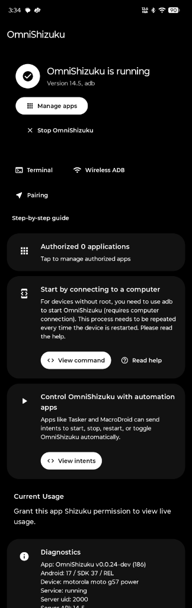
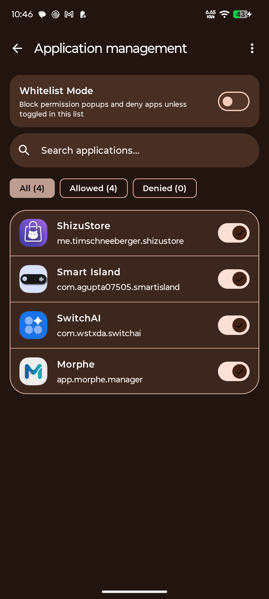
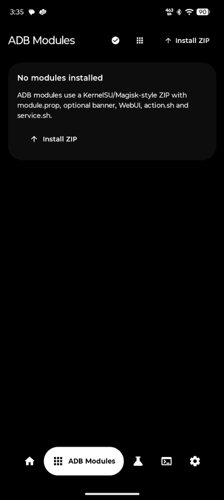
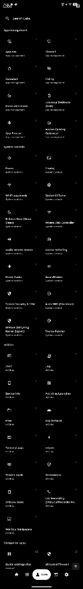
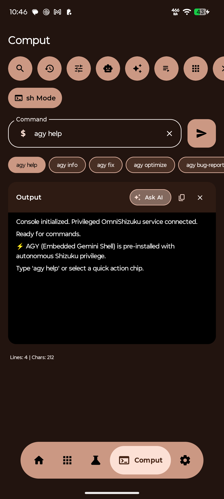
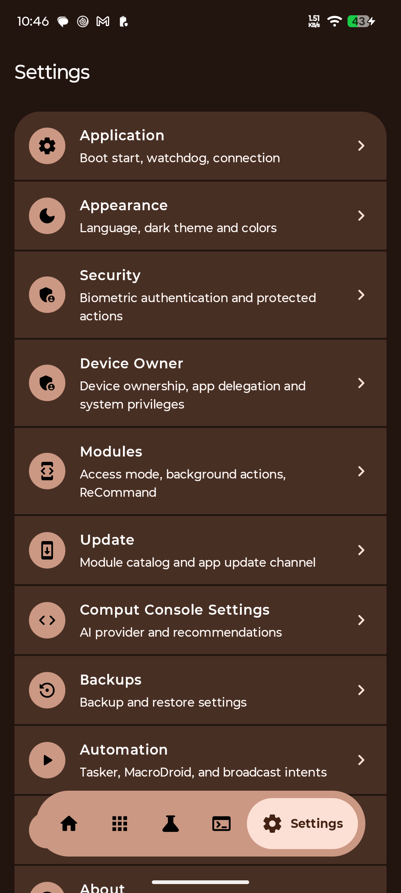
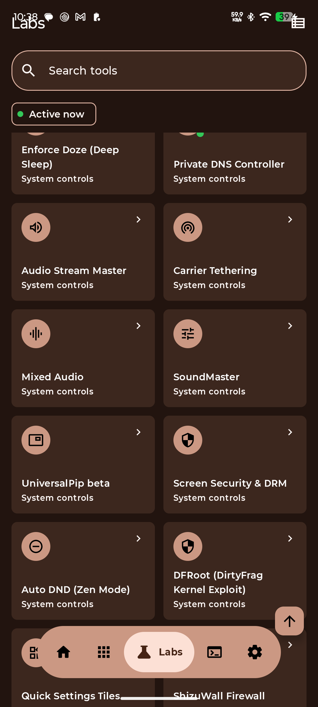
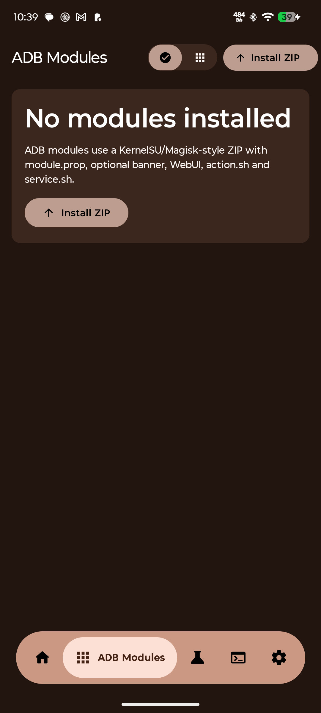

<div align="center">


# OmniShizuku

**Shizuku का एक शक्तिशाली और बेहतरीन वर्ज़न (fork), जिसमें एडवांस्ड मॉड्यूल्स, मॉडर्न UI, और सिस्टम को कंट्रोल करने के लिए कई नए फीचर्स दिए गए हैं।**

[](https://github.com/krishna3163/OmniShizuku)
[](../LICENSE)
[](https://developer.android.com)
[](https://developer.android.com/guide/topics/manifest/uses-sdk-element)
[](https://github.com/RikkaApps/Shizuku)

🌐 **डॉक्यूमेंटेशन अन्य भाषाओं में उपलब्ध है:** [English](../README.md) • [हिन्दी](./README.hi.md) • [Español](./README.es.md) • [Français](./README.fr.md) • [中文（简体）](./README.zh.md) • [中文（繁體）](./README.zh_tw.md) • [Русский](./README.ru.md) • [العربية](./README.ar.md) • [日本語](./README.ja.md) • [Português](./README.pt.md) • [Қазақша](./README.kk.md) • [Qazaqşa](./README.kk-Latn.md)

</div>

---

## 📖 विषय सूची (Table of Contents)

- [अवलोकन (Overview)](#-अवलोकन-overview)
- [स्क्रीनशॉट्स (Screenshots)](#-स्क्रीनशॉट्स-screenshots)
- [OmniShizuku का उपयोग क्यों करें?](#-omnishizuku-का-उपयोग-क्यों-करें)
- [प्रमुख फीचर्स (Key Features)](#-प्रमुख-फीचर्स-key-features)
  - [Labs - एडवांस्ड सिस्टम टूल्स (40 टूल्स)](#labs---एडवांस्ड-सिस्टम-टूल्स-40-टूल्स)
  - [मॉड्यूल्स सिस्टम (Modules System)](#मॉड्यूल्स-सिस्टम-modules-system)
  - [कॉल रिकॉर्डिंग (Call Recording)](#कॉल-रिकॉर्डिंग-shizucallrecorder-integration)
  - [AI और डेवलपर फीचर्स](#ai--डेवलपर-फीचर्स)
  - [UI/UX में सुधार](#uiux-में-सुधार)
- [फीचर्स की तुलना (Feature Comparison)](#-फीचर्स-की-तुलना)
- [सिस्टम आवश्यकताएँ (System Requirements)](#-सिस्टम-आवश्यकताएँ)
- [इंस्टॉलेशन (Installation)](#-इंस्टॉलेशन)
- [शुरुआत कैसे करें (Getting Started)](#-शुरुआत-कैसे-करें)
- [सोर्स कोड से बिल्ड करना (Building from Source)](#-सोर्स-कोड-से-बिल्ड-करना)
- [आर्किटेक्चर और सुरक्षा (Architecture & Security)](#-आर्किटेक्चर-और-सुरक्षा)
- [परमिशन्स की जानकारी (Permissions Explained)](#-परमिशन्स-की-जानकारी)
- [योगदान (Contributing)](#-योगदान)
- [क्रेडिट्स और आभार (Credits)](#-क्रेडिट्स-और-आभार)
- [लाइसेंस (License)](#-लाइसेंस)
- [सपोर्ट (Support)](#-सपोर्ट)

---

## 🔍 अवलोकन (Overview)

**OmniShizuku** मूल [Shizuku](https://github.com/RikkaApps/Shizuku) प्रोजेक्ट का एक ओपन-सोर्स और काफी बेहतर वर्ज़न (fork) है। यह Shizuku के पावरफुल सिस्टम-लेवल API एक्सेस को बहुत सारे काम के यूटिलिटीज, सिस्टम सुधार (tweaks), प्राइवेसी कंट्रोल और एक शानदार मॉडर्न इंटरफ़ेस के साथ जोड़ता है।

**Material Design 3 Expressive** के साथ बना OmniShizuku यूज़र्स को उनके एंड्रॉइड डिवाइस पर पूरा कंट्रोल देता है, और इसके लिए ज़्यादातर मामलों में आपको फोन को पूरी तरह से 'Root' करने की भी ज़रूरत नहीं होती। यह Shizuku के ADB/root ब्रिजिंग फीचर्स का इस्तेमाल करता है। डिस्प्ले कस्टमाइज़ेशन और बैटरी बचाने से लेकर, फालतू ऐप्स को हटाने (debloating), कॉल रिकॉर्डिंग, और एडवांस्ड ऑटोमेशन तक, OmniShizuku आपके डिवाइस के लिए एक 'ऑल-इन-वन' टूल है।

---

## 📸 स्क्रीनशॉट्स (Screenshots)

| **होम और स्टेटस** | **ऐप परमिशन्स** | **ADB मॉड्यूल्स** | **Labs कैटलॉग** | **Comput (Terminal & AI)** | **सेटिंग्स** |
|:---:|:---:|:---:|:---:|:---:|:---:|
|  |  |  |  |  |  |
| रियल-टाइम सर्विस स्टेटस और वायरलेस ADB पेयरिंग | व्हाइटलिस्ट मोड, डिटेल में परमिशन्स और सिर्फ सेशन तक की एक्सेस | Magisk/KernelSU जैसा ZIP मॉड्यूल इंस्टॉलर और मैनेजर | 39+ पावरफुल सिस्टम कंट्रोल्स और सुधार (Tweaks) | प्रिविलेज्ड शेल टर्मिनल (Gemini/AI सपोर्ट के साथ) | डिवाइस ओनर, बैकअप, ऑटोमेशन और सिक्योरिटी सेटिंग्स |

---

### 🔬 खास Labs और सिस्टम फीचर्स

| **सिस्टम कंट्रोल्स और पावर टूल्स** | **इन-बिल्ट ShizuWall फायरवॉल** |
|:---:|:---:|
|  |  |
| Doze मोड लागू करना, मिक्स्ड ऑडियो, प्राइवेट DNS, स्क्रीन सिक्योरिटी और DFRoot | Zero-VPN फायरवॉल (ट्रैकर स्कैनर और appop रूल्स के साथ) |

---

## 💡 OmniShizuku का उपयोग क्यों करें?

- **सब कुछ एक जगह (All-in-One Solution)** - कई सारे रूट या ADB ऐप्स रखने की ज़रूरत नहीं। ऐप्स हटाने (debloat) से लेकर डिस्प्ले सेटिंग बदलने तक, सब कुछ यहीं है।
- **Root की कोई ज़रूरत नहीं** - यह वायरलेस ADB (Android 11+) या कंप्यूटर से ADB के ज़रिए Shizuku के साथ काम करता है, इसलिए कोई भी इसका इस्तेमाल कर सकता है।
- **मॉडर्न और आसान UI** - यह देखने में बहुत साफ़-सुथरा है। इसमें स्मूथ एनिमेशन और डार्क/लाइट थीम है, जो फ़ोन, टैबलेट, टीवी और स्मार्टवॉच (Wear OS) सब पर अच्छा दिखता है।
- **लगातार अपडेट्स** - इसमें ओरिजिनल Shizuku के मुकाबले लगातार नए फीचर्स, बग फिक्स और सुधार किए जाते हैं।
- **प्राइवेसी पर फोकस** - आप तय कर सकते हैं कि कौन-सा ऐप क्या कर सकता है। आप सिस्टम-लेवल की परमिशन्स को बारीकी से कंट्रोल कर सकते हैं।
- **सुरक्षित (Safe & Reversible)** - इसमें किए गए ज़्यादातर बदलावों को आसानी से पहले जैसा किया जा सकता है। ऐप्स हटाने (debloating) या मॉड्यूल्स के लिए बैकअप और रिस्टोर की सुविधा है।
- **मॉड्यूल सिस्टम (Modules System)** - इसमें कम्युनिटी द्वारा बनाए गए मॉड्यूल्स के लिए इन-बिल्ट कैटलॉग है, जहां से आप नए मॉड्यूल्स खोज कर आसानी से इंस्टॉल कर सकते हैं।
- **भरोसेमंद और स्टेबल** - इसे इस तरह से कोड किया गया है कि ऐप क्रैश कम से कम हो।

---

## ✨ प्रमुख फीचर्स (Key Features)

### Labs - एडवांस्ड सिस्टम टूल्स (40 टूल्स)

Labs सेक्शन में 40 सिस्टम-लेवल के टूल्स हैं, जिन्हें 3 कैटेगिरी (ऐप मैनेजमेंट, सिस्टम कंट्रोल्स और यूटिलिटीज़) में बांटा गया है:

#### 📱 ऐप मैनेजमेंट (App Management - 8 टूल्स)
| फीचर (Feature) | जानकारी (Description) |
| --- | --- |
| **App Ops** | बैकग्राउंड की परमिशन्स और छिपी हुई सेटिंग्स पर पूरा कंट्रोल। |
| **फायरवॉल (Firewall)** | किसी भी VPN स्लॉट को घेरे बिना, हर ऐप के लिए अलग से Wi-Fi और मोबाइल डेटा ब्लॉक करने की सुविधा। |
| **ऑटोस्टार्ट (Autostart)** | फ़ोन चालू होते ही ऐप्स को अपने आप स्टार्ट होने या बैकग्राउंड में चलने से रोकें। |
| **हाइडिंग मोड्स (Hiding Modes)** | ऐप्स से डेवलपर ऑप्शन्स, USB/वायरलेस डिबगिंग, प्राइवेट DNS और VPN जैसी चीज़ों को छिपाएं। |
| **फोर्स डार्क मोड (Force Dark Mode)** | किसी भी थर्ड-पार्टी ऐप में ज़बरदस्ती डार्क मोड चालू करें, भले ही वो ऐप इसे सपोर्ट न करता हो। |
| **यूनिवर्सल डेब्लोटर (UAD)** | फ़ोन के फालतू ऐप्स (Bloatware) हटाने का टूल। इसमें सुरक्षा रेटिंग्स होती हैं और 1-क्लिक में ऐप्स रिस्टोर किए जा सकते हैं। |
| **ऐप फ्रीज़र (App Freezer)** | बैकग्राउंड ऐप्स को तुरंत फ्रीज़ करें ताकि वो आपकी रैम (RAM) और बैटरी ख़राब न करें। |
| **गेमिंग ऑप्टिमाइज़र (Axeron)** | गेम्स को स्मूथ चलाने के लिए सिस्टम की परफॉरमेंस बढ़ाएं और बैकग्राउंड प्रोसेस कम करें। |

#### ⚙️ सिस्टम कंट्रोल्स (System Controls - 18 टूल्स)
| फीचर (Feature) | जानकारी (Description) |
| --- | --- |
| **पावर मेन्यू (Power Menu)** | फ़ोन को सिस्टम, रिकवरी, बूटलोडर (Fastboot), सेफ मोड में रीबूट करें या तुरंत स्विच ऑफ करें। |
| **डिस्प्ले ट्वीकर (Display Tweaker)** | डिस्प्ले का रेजोल्यूशन बदलें, DPI सेट करें और अपने हिसाब से रिफ्रेश रेट लागू करें। |
| **Wi-Fi पासवर्ड्स (Wi-Fi Passwords)** | फ़ोन में सेव किए गए वाई-फाई के पासवर्ड देखें, कॉपी करें और एक्सपोर्ट करें। |
| **SystemUI ट्यूनर** | स्टेटस बार के आइकॉन छिपाएं, बैटरी का स्टाइल बदलें, और बहुत कुछ कस्टमाइज़ करें। |
| **Enforce Doze (डीप स्लीप)** | स्क्रीन बंद होते ही फ़ोन को तुरंत डीप स्लीप (Doze) मोड में डालें ताकि बैटरी बचे। |
| **प्राइवेट DNS कंट्रोलर** | Cloudflare, AdGuard, Google जैसे प्राइवेट DNS के बीच तुरंत स्विच करें। |
| **ऑडियो स्ट्रीम मास्टर (Audio Stream Master)** | मीडिया, रिंगटोन, अलार्म, और सिस्टम के वॉल्यूम को अलग-अलग बारीकी से कंट्रोल करें। |
| **कैरियर टीथरिंग (Carrier Tethering)** | टेलिकॉम कंपनियों द्वारा वाई-फाई हॉटस्पॉट और USB टीथरिंग पर लगाई गई पाबंदियों को बायपास करें। |
| **मिक्स्ड ऑडियो (Mixed Audio)** | एक साथ कई ऐप्स में ऑडियो चलाएं (ताकि जब एक ऐप में गाना चले, तो दूसरे का गाना पॉज़ न हो)। |
| **SoundMaster** | हर ऐप का वॉल्यूम अलग-अलग सेट करें। |
| **यूनिवर्सल PiP (Picture-in-Picture)** | ऐसे ऐप्स जो PiP मोड सपोर्ट नहीं करते, उन्हें भी ज़बरदस्ती छोटी स्क्रीन (PiP) में चलाएं। |
| **स्क्रीन सिक्योरिटी (DRM Bypass)** | बैंकिंग या सिक्योर ऐप्स में स्क्रीनशॉट लेने और स्क्रीन रिकॉर्ड करने की पाबंदी (FLAG_SECURE) को बायपास करें। |
| **ऑटो DND (Zen Mode)** | कौन सा ऐप चल रहा है या समय के हिसाब से, अपने आप 'Do Not Disturb' (DND) चालू करें। |
| **Quick Settings टाइल्स** | 18 अलग-अलग कस्टम क्विक सेटिंग्स टाइल्स सेट करने का ऑप्शन। |
| **ShizuWall फायरवॉल** | एडवांस्ड फायरवॉल जिसमें बिल्ट-इन ट्रैकर स्कैनर और सॉकेट मॉनिटर मौजूद है। |
| **Caffeinate** | पढ़ते समय या नेविगेशन इस्तेमाल करते समय स्क्रीन को हमेशा चालू (Awake) रखें। |
| **थीम पैचर (Theme Patcher)** | सिस्टम के रंग, फॉन्ट स्टाइल और डिज़ाइन में बदलाव करें। |

#### 🛠️ यूटिलिटीज़ (Utilities - 14 टूल्स)
| फीचर (Feature) | जानकारी (Description) |
| --- | --- |
| **शेल (Shell)** | कमांड टाइप करने के लिए लाइव टर्मिनल (Terminal)। |
| **लॉग व्यूअर (Log Viewer)** | सिस्टम के लॉग्स (Logcat) को लाइव देखने, फ़िल्टर करने और सेव करने की सुविधा। |
| **डिवाइस इन्फो (Device Info)** | हार्डवेयर, बैटरी की हेल्थ, हीटिंग (Thermal) सेंसर्स और प्रोसेसर की पूरी जानकारी। |
| **एक्टिविटीज लॉन्चर (Activities Launcher)** | छिपी हुई एंड्रॉइड एक्टिविटीज़ (Activities) को खोजें और लॉन्च करें। |
| **फाइल्स (Files)** | सुरक्षित `/data` फोल्डर और ऐप डायरेक्टरी को देखने और एडिट करने के लिए फ़ाइल मैनेजर। |
| **ऐप इंस्टॉलर प्रो (App Installer Pro)** | APK, स्प्लिट APKS और XAPK फाइलें आसानी से इंस्टॉल करें। |
| **स्टील्थ मोड (Stealth Mode)** | यह सुनिश्चित करने के लिए एंटी-डिटेक्शन तरीके कि अन्य ऐप्स को पता न चले कि Shizuku, रूट या डिबगिंग ऑन है। |
| **परमिशन्स मैनेजर** | फोन के सभी ऐप्स की परमिशन्स एक ही जगह से देखें और कंट्रोल करें। |
| **Shizuku स्टोर (Shizuku Store)** | Shizuku को सपोर्ट करने वाले नए ओपन-सोर्स ऐप्स खोजने और डाउनलोड करने का बिल्ट-इन स्टोर। |
| **कॉल रिकॉर्डिंग (ShizuCallRecorder)** | सिस्टम शेल के ज़रिए दोनों तरफ की आवाज़ वाली कॉल रिकॉर्डिंग। |
| **WallYou वॉलपेपर्स** | ऐप के अंदर ही वॉलपेपर खोजने और सेट करने की सुविधा। |

### मॉड्यूल्स सिस्टम (Modules System)

OmniShizuku में Magisk या KernelSU जैसा ही एक पावरफुल मॉड्यूल सिस्टम दिया गया है, लेकिन यह बिना रूट वाले Shizuku मॉड्स के लिए डिज़ाइन किया गया है:

- **मॉड्यूल कैटलॉग** - ऐप के अंदर से ही कम्युनिटी द्वारा बनाए गए मॉड्यूल्स खोजें और डाउनलोड करें।
- **1-टैप इंस्टॉलेशन** - ऐप से सीधे मॉड्यूल्स डाउनलोड और इंस्टॉल करें।
- **मॉड्यूल मैनेजर** - इंस्टॉल किए गए मॉड्यूल्स को ऑन, ऑफ, अपडेट या डिलीट करें।

### कॉल रिकॉर्डिंग (Call Recording)

- **शेल-आधारित रिकॉर्डिंग इंजन** - एकदम साफ़ आवाज़ रिकॉर्ड करने के लिए सिस्टम-लेवल सर्विस का इस्तेमाल।
- **ऑटोमैटिक कॉल डिटेक्शन** - कॉल आते ही अपने-आप रिकॉर्डिंग शुरू हो जाना।
- **आसान मैनेजमेंट** - रिकॉर्डिंग को सुनें, नाम बदलें या डिलीट करें, सब कुछ एक आसान UI के साथ।
- बैकग्राउंड में बिना किसी दिक्कत के रिकॉर्डिंग चालू रहती है।

### UI/UX में सुधार

- **Material 3 डिज़ाइन** - नए एंड्रॉइड लुक (Material You) के साथ जो आपके वॉलपेपर के हिसाब से रंग बदलता है।
- **डार्क मोड** - आँखों को सुकून देने के लिए AMOLED ब्लैक डार्क थीम सपोर्ट।
- **कई भाषाओं का सपोर्ट** - हिंदी, अंग्रेजी, स्पेनिश, फ्रेंच, चीनी, आदि कई भाषाओं में उपलब्ध।

---

## 📊 फीचर्स की तुलना (Feature Comparison)

| फीचर (Feature) | **OmniShizuku** | **Shizuku (Original)** | **Shizuku Next** | **Xhizuku** | **Shevery** | **ShizukuPlus** |
| --- | :------------: | :--------------------: | :------------: | :--------: | :--------: | :------------: |
| **बेसिक फीचर्स** | ✅ | ✅ | ✅ | ✅ | ✅ | ✅ |
| **वायरलेस ADB** | ✅ | ✅ | ✅ | ✅ | ✅ | ✅ |
| **मॉड्यूल सिस्टम** | ✅ | ❌ | ❌ | ✅ | ✅ | ❌ |
| **Labs एडवांस्ड टूल्स (40 टूल्स)** | ✅ | ❌ | कुछ हद तक | कुछ हद तक | कुछ हद तक | ❌ |
| **ऐप डेब्लोटर (UAD)** | ✅ | ❌ | ❌ | ❌ | ❌ | ❌ |
| **फायरवॉल (Zero-VPN)** | ✅ | ❌ | ❌ | ❌ | ❌ | ❌ |
| **यूनिवर्सल PiP** | ✅ | ❌ | ❌ | ❌ | ❌ | ❌ |
| **कॉल रिकॉर्डिंग** | ✅ | ❌ | ❌ | ❌ | ❌ | ❌ |
| **बिल्ट-इन टर्मिनल** | ✅ | ❌ | ✅ | ❌ | ✅ | ❌ |

*(यह तुलना वर्तमान में उपलब्ध जानकारियों के आधार पर है।)*

---

## 📱 सिस्टम आवश्यकताएँ (System Requirements)

| कंपोनेंट | आवश्यकता (Requirement) |
| --- | --- |
| **Android वर्ज़न** | Android 5.0 (Lollipop) API 21 या इससे ऊपर |
| **आर्किटेक्चर** | arm64-v8a, armeabi-v7a, x86, x86_64 |
| **Shizuku सर्विस** | Shizuku रनिंग स्टेट में होना चाहिए (वायरलेस डिबगिंग, ADB या Root के ज़रिए) |
| **स्टोरेज** | लगभग 50-80 MB की जगह |

---

## 📥 इंस्टॉलेशन (Installation)

### GitHub Releases से (सुझाया गया)

1. [Releases पेज](https://github.com/krishna3163/OmniShizuku/releases) पर जाएँ।
2. लेटेस्ट `manager-release.apk` फाइल डाउनलोड करें।
3. अपने एंड्रॉइड डिवाइस में APK इंस्टॉल करें।
4. ऐप खोलें और सेटअप पूरा करें।

### ADB के ज़रिए

```bash
adb install -r OmniShizuku.apk
```

---

## 🚀 शुरुआत कैसे करें (Getting Started)

1. **OmniShizuku इंस्टॉल करें** - APK डाउनलोड करके इंस्टॉल करें।
2. **Shizuku सेटअप करें** - वायरलेस डिबगिंग (Android 11+) या ADB/Root का उपयोग करके Shizuku सर्विस चालू करें।
3. **परमिशन दें** - OmniShizuku खोलें और जब पूछा जाए तो Shizuku परमिशन (Allow) दें।
4. **एक्सप्लोर करें** - Home, Apps, Modules और Labs टैब में जाकर फीचर्स चेक करें।
5. **कस्टमाइज़ करें** - जो टूल्स आपको चाहिए, उन्हें Labs सेक्शन में जाकर इनेबल करें।

**वायरलेस डिबगिंग के लिए (Android 11 और ऊपर के लिए):**
- फोन की `Settings > Developer Options > Wireless debugging` में जाएं और OmniShizuku के साथ पेयर करें।

**कंप्यूटर से ADB के लिए:**
```bash
adb shell sh /storage/emulated/0/Android/data/moe.shizuku.privileged.api/start.sh
```

---

## 🤝 योगदान (Contributing)

इस प्रोजेक्ट में आपका योगदान (Contributions) हमेशा स्वागत योग्य है! चाहे वो कोई बग रिपोर्ट करना हो, नए फीचर की मांग हो, या कोड में कोई सुधार हो।

विस्तृत जानकारी के लिए [CONTRIBUTING.md](../CONTRIBUTING.md) देखें।

---

## 🙏 क्रेडिट्स और आभार (Credits)

- **[RikkaApps/Shizuku](https://github.com/RikkaApps/Shizuku)** - यह ओरिजिनल प्रोजेक्ट है जिसने यह सब संभव बनाया। Rikka और सभी कॉन्ट्रिब्यूटर्स का बहुत-बहुत धन्यवाद।
- **[Universal Android Debloater (UAD)](https://github.com/0x192/universal-android-debloater)** - डेब्लोटिंग मेथड्स के लिए।
- **[Magisk](https://github.com/topjohnwu/Magisk) / [KernelSU](https://github.com/tiann/KernelSU)** - मॉड्यूल सिस्टम के आर्किटेक्चर की प्रेरणा के लिए।

### OmniShizuku ही क्यों चुनें?

OmniShizuku, Shizuku की ताक़त और बहुत सारे प्रैक्टिकल टूल्स को एक ही ऐप में बेहद खूबसूरत डिज़ाइन के साथ आपके सामने पेश करता है। फ़ोन की सफाई (debloat) करने, सेटिंग्स को सुधारने (tweaking), और डिवाइस मैनेज करने के लिए कई अलग-अलग ऐप्स रखने के बजाय, आप बस OmniShizuku का इस्तेमाल कर सकते हैं।

---

## 📄 लाइसेंस (License)

यह प्रोजेक्ट **Apache License 2.0** के तहत लाइसेंस्ड है। पूरी जानकारी के लिए [LICENSE](../LICENSE) फ़ाइल देखें।

---

## 💬 सपोर्ट (Support)

- **GitHub Issues**: [बग रिपोर्ट करें या नए फीचर की मांग करें](https://github.com/krishna3163/OmniShizuku/issues)
- **GitHub Discussions**: [सवाल पूछें या आईडिया शेयर करें](https://github.com/krishna3163/OmniShizuku/discussions)

---

<div align="center">

**[krishna3163](https://github.com/krishna3163) और शानदार OmniShizuku कम्युनिटी द्वारा ❤️ के साथ बनाया गया**

*अगर आपको OmniShizuku उपयोगी लगता है, तो कृपया GitHub पर इसे एक ⭐ देना न भूलें!*

</div>
