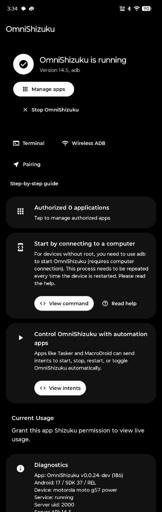
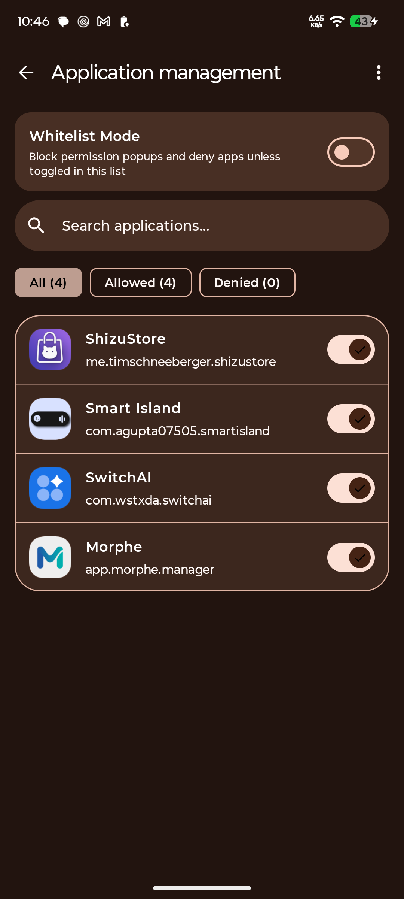
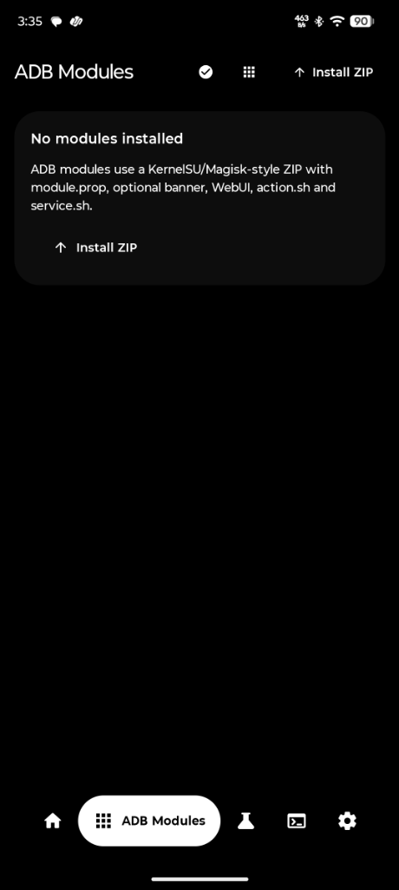
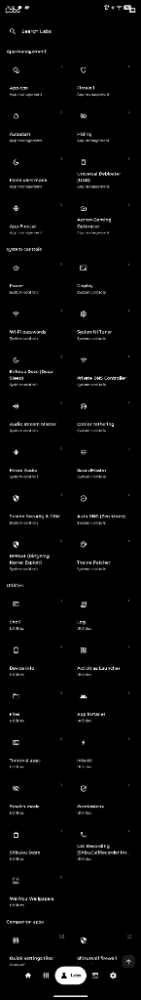
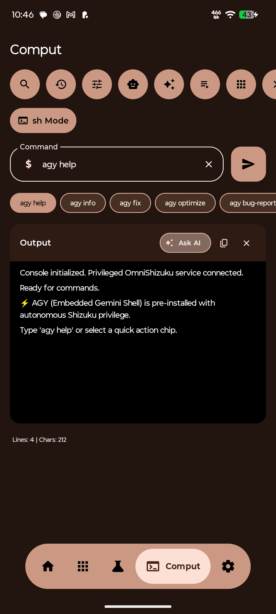
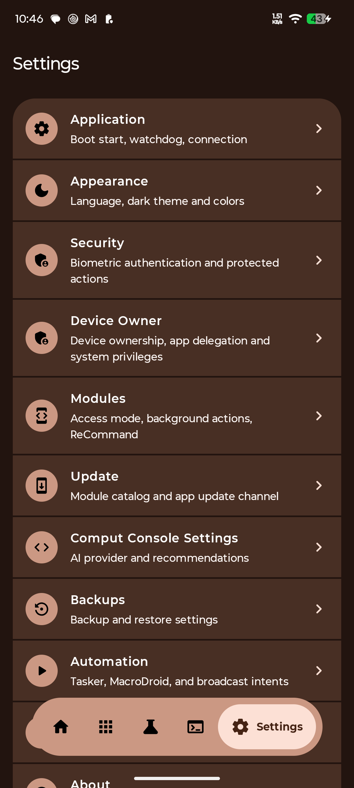
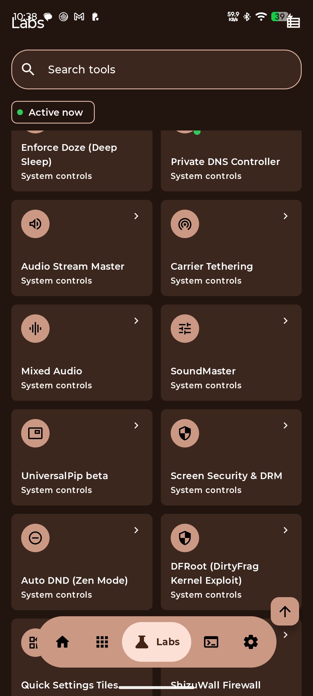
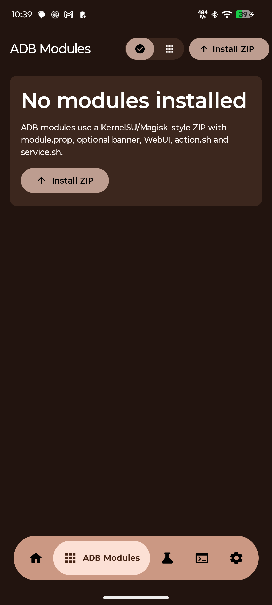

<div align="center">


# OmniShizuku

**Jaqsartylğan modulderi, zamanaui interfeisi jäne keñeýtilgen jüýelik basqaru mümkindikteri bar Shizuku jobasynyñ quatty forki.**

[](https://github.com/krishna3163/OmniShizuku)
[](../LICENSE)
[](https://developer.android.com)
[](https://developer.android.com/guide/topics/manifest/uses-sdk-element)
[](https://github.com/RikkaApps/Shizuku)

🌐 **Documentation available in:** [English](../README.md) • [हिन्दी](./README.hi.md) • [Español](./README.es.md) • [Français](./README.fr.md) • [中文（简体）](./README.zh.md) • [中文（繁體）](./README.zh_tw.md) • [Русский](./README.ru.md) • [العربية](./README.ar.md) • [日本語](./README.ja.md) • [Português](./README.pt.md) • [Қазақша](./README.kk.md) • [Qazaqşa](./README.kk-Latn.md)

</div>

---

## 📖 Mazmūny

- [Overview](#-overview)
- [Screenshots](#-screenshots)
- [Why Use OmniShizuku?](#-why-use-omnishizuku)
- [Key Features](#-key-features)
  - [Labs - Advanced System Tools (40 Tools)](#labs---advanced-system-tools)
  - [Modules System](#modules-system)
  - [Call Recording (ShizuCallRecorder Integration)](#call-recording-shizucallrecorder-integration)
  - [AI & Developer Features](#ai--developer-features)
  - [UI/UX Enhancements](#uiux-enhancements)
- [Feature Comparison](#-feature-comparison-with-other-shizuku-forks)
- [System Requirements](#-system-requirements)
- [Installation](#-installation)
- [Getting Started](#-getting-started)
- [Building from Source](#-building-from-source)
- [Architecture & Security](#-architecture--security)
- [Permissions Explained](#-permissions-explained)
- [Contributing](#-contributing)
- [Credits & Acknowledgments](#-credits--acknowledgments)
- [License](#-license)
- [Support](#-support)

---

## 🔍 Şolu

**OmniShizuku** is an extensively enhanced, open-source fork of the original [Shizuku](https://github.com/RikkaApps/Shizuku) project. It extends Shizuku's powerful system-level API access by combining it with a vast collection of practical utilities, system tweaks, privacy controls, and an intuitive modern interface.

🌐 **Documentation available in:** [English](../README.md) • [हिन्दी](./README.hi.md) • [Español](./README.es.md) • [Français](./README.fr.md) • [中文（简体）](./README.zh.md) • [中文（繁體）](./README.zh_tw.md) • [Русский](./README.ru.md) • [العربية](./README.ar.md) • [日本語](./README.ja.md) • [Português](./README.pt.md) • [Қазақша](./README.kk.md) • [Qazaqşa](./README.kk-Latn.md)
Built with **Material Design 3 Expressive**, OmniShizuku empowers users to take full control of their Android device without requiring full root access in most cases - leveraging Shizuku's ADB/root bridging capabilities. From display customization and battery optimization to app management, debloating, call recording, and advanced automation, OmniShizuku is your all-in-one system utility suite.

---

## 📸 Skrinşottar

| **Home & Status** | **App Permissions** | **ADB Modules** | **Labs Catalog** | **Comput (Terminal & AI)** | **Settings** |
|:---:|:---:|:---:|:---:|:---:|:---:|
|  |  |  |  |  |  |
| Real-time service status & wireless ADB pairing | Whitelist mode, granular permissions & session-only access | Magisk/KernelSU-style ZIP module installer & manager | 39+ powerful system controls & tweaks | Privileged shell terminal with Gemini/AI generation | Device Owner, backups, automation & security config |

---

### 🔬 Featured Labs & System Capabilities

| **System Controls & Power Tools** | **Native ShizuWall Firewall** |
|:---:|:---:|
|  |  |
| Enforce Doze, Mixed Audio, Private DNS, Screen Security & DFRoot | Zero-VPN native firewall with tracker scanner & appop rules |

---

## 💡 Nelikten OmniShizuku tañdau kerek?

- **All-in-One Solution** - No need for multiple root/ADB apps. Everything from debloating to display tweaks in one place.
- **No Root Required** - Works with Shizuku via Wireless ADB (Android 11+) or ADB, making it accessible to a wider audience.
- **Modern & Intuitive UI** - Clean Material 3 Expressive interface with smooth animations, dynamic theming, and optimized layouts for phones, tablets, TVs and Wear OS.
- **Actively Enhanced** - Regular updates with new features, bug fixes, and improvements beyond the original Shizuku.
- **Privacy-Focused** - Granular control over app permissions, appops, hiding features, and system-level restrictions.
- **Safe & Reversible** - Most changes are reversible, with backup/restore capabilities for debloating and module management.
- **Extensible Module System** - Community-driven modules with built-in catalog, discovery, and installation support.
- **Enterprise-Grade Stability** - Defensive coding practices, crash handling, timeout safeguards, and OEM compatibility fixes.

---

## ✨ Negizgi mümkindikter

### Labs - Keñeýtilgen jüýelik qūraldar

Labs katalogı qoldanbalardy basqaru, jüýeni basqaru jäne utilitalarğa bölingen 40 jüýelik qūraldy qamtidy:

#### 📱 Qoldanbalardy basqaru (8 qūral)
| Feature | Description |
| --- | --- |
| **App Ops** | Granular control over hidden app permissions, runtime op gates, and background privileges. |
| **Firewall** | Network-level app firewall blocking Wi-Fi and mobile data per application without consuming a VPN slot. |
| **Autostart** | Restrict applications from waking up or starting services automatically at device boot. |
| **Hiding Modes** | Hide Developer Options, USB/Wireless Debugging, Accessibility services, Private DNS, and VPN states from detection. |
| **Force Dark Mode** | System-wide forced dark theme across third-party applications, even without native dark theme support. |
| **Universal Debloater (UAD)** | Community safety-ranked package debloater with safety ratings, explanations, and 1-tap restore. |
| **App Freezer** | Instantly freeze and suspend background applications to reclaim RAM and halt battery drain. |
| **Axeron Gaming Optimizer** | System-level performance tuning, game boost, animation tweaks, and process optimizations. |

#### ⚙️ Jüýeni basqaru (18 qūral)
| Feature | Description |
| --- | --- |
| **Power Menu** | Privileged reboot to System, Recovery, Bootloader/Fastboot, Safe Mode, or instant power off. |
| **Display Tweaker** | Override display resolution, modify screen density (DPI), and force custom refresh rates. |
| **Wi-Fi Passwords** | View, copy, and export saved Wi-Fi network credentials directly via privileged shell. |
| **SystemUI Tuner** | Customize status bar icon visibility, battery icon styles, clock seconds, and immersive navigation. |
| **Enforce Doze (Deep Sleep)** | Force immediate aggressive Doze deep sleep mode whenever the screen turns off. |
| **Private DNS Controller** | Switch between encrypted DNS providers (Cloudflare, AdGuard, Quad9, Google, NextDNS, Custom) with auto-revert timers. |
| **Audio Stream Master** | Independent fine-grained volume sliders for Media, Ring, Alarm, Call, Voice, and System audio streams. |
| **Carrier Tethering** | Bypass carrier entitlement checks and restrictions on Wi-Fi hotspot and USB tethering. |
| **Mixed Audio** | Multi-app concurrent audio playback bypass (prevent background apps from pausing when another app plays audio). |
| **SoundMaster** | Per-app audio focus and volume routing mixer. |
| **Universal Picture-in-Picture** | Force any unsupported app into Picture-in-Picture (PiP) mode using virtual display projection. |
| **Screen Security & DRM** | Bypass `FLAG_SECURE` restrictions to allow screenshots and screen recording in secure/banking apps. |
| **Auto DND (Zen Mode)** | Automated Do Not Disturb rules based on foreground app focus, custom schedules, and triggers. |
| **DFRoot (DirtyFrag Exploit)** | Built-in privilege escalation helper using CVE-2026-43284 for supported kernel versions. |
| **Quick Settings Tiles** | Interactive manager and setup suite for 18 custom Quick Settings tiles. |
| **ShizuWall Firewall** | Advanced firewall interface featuring an integrated tracker & telemetry scanner and socket monitor. |
| **Caffeinate** | Keep device screen awake with a tile and persistent notification for reading or navigation. |
| **Theme Patcher** | System-level accent colors, font styling, and UI theme modifications. |

#### 🛠️ Utilitalar (14 qūral)
| Feature | Description |
| --- | --- |
| **Shell** | Interactive privileged command-line terminal with real-time streaming output. |
| **Log Viewer** | Real-time system logcat viewer with tag, package, level filtering, and export capabilities. |
| **Device Info** | Comprehensive hardware, kernel, battery health, thermal sensors, and SoC dashboard. |
| **Activities Launcher** | Inspect and launch exported, unexported, or hidden Android activities and intents. |
| **Files** | Privileged filesystem browser with read/write access to protected `/data` and app directories. |
| **App Installer Pro** | Privileged package installer supporting APK, APKS split bundles, and XAPK formats. |
| **Terminal Apps** | Quick switcher and launcher for external terminal emulators. |
| **LocalShell** | Standalone local shell interface. |
| **Intents** | Fire custom explicit or implicit system intents, broadcast receivers, and services. |
| **Stealth Mode** | Anti-detection measures to prevent target apps from detecting Shizuku, root, or debugging state. |
| **Permissions Manager** | Overview and revocation/granting of elevated permissions across all installed packages. |
| **Shizuku Store** | Built-in catalog to discover and download open-source apps built for Shizuku. |
| **Call Recording (ShizuCallRecorder)** | Native two-way call recording powered by privileged shell audio capture. |
| **WallYou Wallpapers** | In-app wallpaper browser, fetcher, and wallpaper switcher. |

### Modules System

OmniShizuku features a powerful, extensible module system inspired by Magisk/KernelSU modules but designed for Shizuku-based mods:

- **Module Catalog** - Browse community modules from a curated GitHub-based catalog with search, filtering, and sorting.
- **Module Discovery** - Automatic discovery of modules from GitHub repositories tagged with `shevery-modules` or official sources.
- **One-Tap Installation** - Download, verify, and install modules directly from the app with progress tracking.
- **Module Manager** - Enable, disable, update, and remove installed modules with ease.
- **WebUI Support** - Many modules include web-based configuration interfaces accessible from within the app.
- **Module Scripts** - Execute install, uninstall, service, and boot scripts with proper logging and error handling.
- **Update Checker** - Automatic update detection for installed modules from their GitHub releases.
- **Safe Installation** - Validation of module structure, props, and scripts before installation.
- **Cross-Platform UI** - Optimized module screens for phones, tablets, TVs, and Wear OS.

### Call Recording (ShizuCallRecorder Integration)

Built-in support for call recording through Shizuku's privileged access:

- **Shell-Based Recording Engine** - Uses privileged shell services for reliable audio capture.
- **Foreground Service** - Persistent recording service with proper notifications.
- **InCallService Integration** - Automatic call detection and recording management.
- **Recording Management** - View, play, rename, and delete recordings with an intuitive UI.
- **Configurable Options** - Customize recording format, codec, source, and storage location.
- **AIDL Interfaces** - Secure IPC between app components for recording control.
- **Permission Handling** - Proper runtime permission management for call recording requirements.
- **Background Operation** - Reliable recording even with app in background.

### AI & Developer Features

- **AI Manager** - Integrated AI capabilities with support for multiple providers (configurable in settings).
- **Developer Options** - Advanced developer tools, debugging utilities, and experimental features.
- **Bug Report System** - Built-in bug reporting with logs, device info, and crash reports.
- **Labs Reapply** - Reapply persistent lab modifications after updates or reboots.
- **Device Info Dashboard** - Comprehensive device information with detailed hardware, software, and system properties.
- **Log Viewer** - Real-time logcat viewer with filtering and search capabilities.

### UI/UX Enhancements

- **Material 3 Expressive Design** - Latest Material Design with dynamic color theming (Material You) support.
- **Multi-Form Factor Support** - Optimized for phones, tablets, foldables, Android TV, and Wear OS.
- **Dark Mode & AMOLED Black** - Full dark theme support with pure black option for AMOLED displays.
- **Smooth Animations** - Polished transitions, lazy motion blur optimization, and fluid interactions.
- **Adaptive Layouts** - Responsive UI that adapts to screen sizes and orientations.
- **Localization** - Extensive multi-language support (English, Hindi, Spanish, French, Chinese, Russian, Japanese, Arabic, Kazakh, and more).
- **Accessibility** - Wireless ADB Auto-PIN with accessibility service support (opt-in only).
- **Performance Optimized** - Lazy loading, bounded data fetching, timeout safeguards, and efficient memory usage.
- **Crash Resilience** - Defensive binder access, uncaught exception handling, and graceful degradation on OEM-specific issues.

---

## 📊 Basqa Shizuku forkterimen salystyru

| Feature | **OmniShizuku** | **Shizuku (Original)** | **Shizuku Next** | **Xhizuku** | **Shevery** | **ShizukuPlus** | **Stellar** |
| --- | :------------: | :--------------------: | :------------: | :--------: | :--------: | :------------: | :--------: |
| **Base Functionality** | ✅ | ✅ | ✅ | ✅ | ✅ | ✅ | ✅ |
| **Wireless ADB / TCP Mode** | ✅ | ✅ | ✅ | ✅ | ✅ | ✅ | ✅ |
| **Root Support** | ✅ | ✅ | ✅ | ✅ | ✅ | ✅ | ✅ |
| **Dhizuku Support** | ✅ | ❌ | ❌ | ❌ | ✅ | ✅ | ❌ |
| **Autostart** | ✅ | ✅ | ✅ | ✅ | ✅ | ✅ | ✅ |
| **Module System** | ✅ | ❌ | ❌ | ✅ | ✅ | ❌ | ❌ |
| **Labs Advanced Tools (40 Tools)** | ✅ | ❌ | Partial | Partial | Partial | ❌ | Partial |
| **App Debloater (UAD)** | ✅ | ❌ | ❌ | ❌ | ❌ | ❌ | ❌ |
| **App Freezer** | ✅ | ❌ | ❌ | ❌ | ❌ | ❌ | ❌ |
| **Firewall (Zero-VPN)** | ✅ | ❌ | ❌ | ❌ | ❌ | ❌ | ❌ |
| **Quick Settings Tiles Suite (18 tiles)** | ✅ | ❌ | ❌ | ❌ | ❌ | ❌ | ❌ |
| **ShizuWall Native Firewall** | ✅ | ❌ | ❌ | ❌ | ❌ | ❌ | ❌ |
| **Tracker & Telemetry Scanner** | ✅ | ❌ | ❌ | ❌ | ❌ | ❌ | ❌ |
| **Caffeinate Screen Stay-Awake** | ✅ | ❌ | ❌ | ❌ | ❌ | ❌ | ❌ |
| **Private DNS Auto-Revert & Cycles** | ✅ | ❌ | ❌ | ❌ | ❌ | ❌ | ❌ |
| **DFRoot (Kernel Exploit Helper)** | ✅ | ❌ | ❌ | ❌ | ❌ | ❌ | ❌ |
| **WallYou Dynamic Wallpapers** | ✅ | ❌ | ❌ | ❌ | ❌ | ❌ | ❌ |
| **Universal Picture-in-Picture** | ✅ | ❌ | ❌ | ❌ | ❌ | ❌ | ❌ |
| **Display Tweaker** | ✅ | ❌ | ❌ | ❌ | ❌ | ❌ | ❌ |
| **Call Recording** | ✅ | ❌ | ❌ | ❌ | ❌ | ❌ | ❌ |
| **Theme Patcher** | ✅ | ❌ | ❌ | ❌ | ❌ | ❌ | ❌ |
| **Built-in Terminal** | ✅ | ❌ | ✅ | ❌ | ✅ | ❌ | ✅ |
| **AI Integration** | ✅ | ❌ | ❌ | ❌ | ✅ | ❌ | ❌ |
| **Material 3 Expressive** | ✅ | ❌ | Material 3 | Material 3 | Material 3 | ❌ | ❌ |
| **TV/Wear OS Support** | ✅ | Partial | Partial | Partial | ❌ | ❌ | ❌ |
| **Onboarding Flow** | ✅ | ❌ | ❌ | ✅ | ❌ | ❌ | ❌ |
| **Stealth Features** | ✅ | ❌ | ❌ | ❌ | ❌ | ❌ | ❌ |
| **Wireless ADB Auto-PIN** | ✅ | ❌ | ❌ | ❌ | ❌ | ❌ | ❌ |
| **License** | Apache-2.0 | Apache-2.0 | Apache-2.0 | Apache-2.0 | Apache-2.0 | Apache-2.0 | MPL-2.0 |

*Comparison is based on publicly available features at the time of writing. Features may change over time.*

---

## 📱 Jüýelik talaptar

| Component | Requirement |
| --- | --- |
| **Android Version** | Android 5.0 (Lollipop) API 21 or higher |
| **Architecture** | arm64-v8a, armeabi-v7a, x86, x86_64 |
| **Shizuku** | Shizuku service must be running (via Wireless Debugging, ADB over USB, or Root) |
| **Permissions** | Shizuku permission grant required for most features |
| **Storage** | ~50-80 MB for installation (varies by features) |
| **Optional** | Accessibility service for Wireless ADB Auto-PIN feature |

---

## 📥 Ornatu

### From GitHub Releases (Recommended)

1. Go to the [Releases page](https://github.com/krishna3163/OmniShizuku/releases)
2. Download the latest `manager-debug.apk` or `manager-release.apk`
3. Install the APK on your Android device
4. Follow the setup process

### Via ADB

```bash
adb install -r OmniShizuku.apk
```

### Important Notes

- If you have the original Shizuku installed, you can usually install OmniShizuku alongside it, or replace it. Check compatibility for your use case.
- Some features require specific Android versions or device capabilities.
- For call recording features, additional permissions may be required depending on Android version.

---

## 🚀 Getting Started

1. **Install OmniShizuku** - Download and install the APK
2. **Setup Shizuku** - Start Shizuku service via Wireless Debugging (Android 11+) or ADB/Root
3. **Grant Permission** - Open OmniShizuku and grant Shizuku permission when prompted
4. **Explore** - Navigate through Home, Apps, Modules, Labs, and Settings tabs
5. **Customize** - Head to Essentials Hub or Labs to enable features you need
6. **Stay Safe** - Read feature descriptions before applying system-level changes

**For Wireless Debugging (Android 11+):**
- Go to `Settings > Developer Options > Wireless debugging` and pair with OmniShizuku or Shizuku

**For ADB (via PC):**
```bash
adb shell sh /storage/emulated/0/Android/data/moe.shizuku.privileged.api/start.sh
```
*(Or use the appropriate start command for your setup)*

---

## 🔨 Bastapqy kodtan qūrastypu

### Prerequisites

- [Android Studio](https://developer.android.com/studio) (latest stable) or [Android SDK](https://developer.android.com/studio#command-tools)
- [JDK 17](https://adoptium.net/) or higher
- [Git](https://git-scm.com/)
- Gradle (wrapper included)

### Clone and Build

```bash
# Clone the repository
git clone https://github.com/krishna3163/OmniShizuku.git
cd OmniShizuku

# Build debug APK
./gradlew :manager:assembleDebug

# Build release APK (requires signing configuration)
./gradlew :manager:assembleRelease

# Install to connected device
./gradlew :manager:installDebug
```

The debug APK will be located at: `manager/build/outputs/apk/debug/manager-debug.apk`

### Build Requirements

- `compileSdk`: 36
- `minSdk`: 21
- `targetSdk`: 36
- Kotlin with Jetpack Compose
- R8/ProGuard for release builds

---

## 🔐 Arhitektura jäne qauipsizdik

### Security Measures

- **Defensive Programming** - Null-safe binder access, try-catch blocks around critical operations, and graceful fallbacks
- **Permission Scoping** - Minimal permission usage with runtime permission requests where necessary
- **Secure IPC** - AIDL interfaces for inter-process communication with proper service binding
- **No Telemetry** - No analytics, tracking, or data collection
- **Open Source** - Fully transparent, auditable codebase
- **Reversible Changes** - Most modifications can be undone through the app
- **Validation** - Module validation, package verification, and safe installation practices
- **OEM Compatibility** - Special handling for Realme, OPPO, Xiaomi, OnePlus and other OEMs with aggressive battery optimization

### Architecture Highlights

- **MVVM Pattern** - Clean separation of concerns with ViewModels and UI state
- **Jetpack Compose** - Modern declarative UI framework
- **Kotlin Coroutines** - Asynchronous operations with proper lifecycle handling
- **Room/Preferences** - Local data persistence
- **Hilt/Dagger** - Dependency injection (where applicable)
- **Modular Design** - Feature modules for better organization and maintainability

---

## 🔑 Rūqsattar tüsindirmesi

| Permission | Purpose | Required For |
| --- | --- | --- |
| `QUERY_ALL_PACKAGES` | List and manage installed apps | App Ops, Debloater, Freezer, Modules |
| `READ_EXTERNAL_STORAGE` / `MANAGE_EXTERNAL_STORAGE` | File access | File Explorer, APK installation |
| `POST_NOTIFICATIONS` | Show notifications | Services, Caffeinate, Recording |
| `FOREGROUND_SERVICE` | Run background services | Call recording, ShizuWall, Caffeinate |
| `READ_PHONE_STATE`, `RECORD_AUDIO` | Call detection and recording | ShizuCallRecorder |
| `BIND_ACCESSIBILITY_SERVICE` | Auto-fill Wireless ADB PIN | Wireless ADB Auto-PIN (opt-in) |
| `PACKAGE_USAGE_STATS` | Usage data access | Some optimization features |
| `REQUEST_INSTALL_PACKAGES` | Install APKs | Package Installer Pro |
| `SYSTEM_ALERT_WINDOW` | Overlay display | Universal PiP, Screen Overlays |

*Most permissions are only requested when needed for specific features.*

---

## 🤝 Jobağa üles qosu

Contributions are welcome! Whether it's bug reports, feature requests, documentation improvements, or code contributions.

### How to Contribute

1. **Fork** the repository
2. **Create** a feature branch (`git checkout -b feature/AmazingFeature`)
3. **Commit** your changes (`git commit -m 'Add some AmazingFeature'`)
4. **Push** to the branch (`git push origin feature/AmazingFeature`)
5. **Open** a Pull Request

### Guidelines

- Follow existing code style and conventions
- Write clear commit messages
- Test your changes thoroughly
- Update documentation if needed
- For major features, open an issue first to discuss

See [CONTRIBUTING.md](../CONTRIBUTING.md) for more details.

---

## 🙏 Alğystar men autorlar

### Core Projects

- **[RikkaApps/Shizuku](https://github.com/RikkaApps/Shizuku)** - The original project that made all of this possible. Huge thanks to Rikka and all contributors.
- **[Dhizuku](https://github.com/iamr0s/Dhizuku)** - For Dhizuku API integration support.

### Communities & Inspirations

- **[Universal Android Debloater (UAD)](https://github.com/0x192/universal-android-debloater)** - Safety rankings and debloating methodology
- **[LSPosed](https://github.com/LSPosed/LSPosed)** - Inspiration for module system concepts
- **[Magisk](https://github.com/topjohnwu/Magisk)** - Module system architecture inspiration
- **[KernelSU](https://github.com/tiann/KernelSU)** - Modern root solution inspiration

### Module Developers & Integrations

- **[kitsumed/ShizuCallRecorder](https://github.com/kitsumed/ShizuCallRecorder)** - Call recording functionality integration
- **[RBN-Apps/Quick-Tile-Settings](https://github.com/RBN-Apps/Quick-Tile-Settings)** - Companion app integration
- **[AhmetCanArslan/ShizuWall](https://github.com/AhmetCanArslan/ShizuWall)** - Companion app integration
- **[Shevery Modules Community](https://github.com/topics/shevery-modules)** - Community module ecosystem

### Special Thanks

A heartfelt thank you to:

- **The Shizuku Community** - For continuous support, feedback, and testing
- **All Contributors** - Everyone who has reported bugs, suggested features, submitted PRs, or helped improve OmniShizuku
- **Translators** - For making OmniShizuku accessible in multiple languages
- **Beta Testers** - For helping catch bugs and ensuring stability
- **OEM Community** - For sharing device-specific workarounds and fixes

### Why Choose OmniShizuku?

OmniShizuku stands apart by combining the power of Shizuku with a comprehensive suite of practical tools in one beautifully designed app. Instead of juggling multiple apps for debloating, tweaking, optimizing, and managing your device, OmniShizuku brings everything together with a cohesive experience. Whether you're a casual user looking to disable bloatware or a power user seeking deep system customization, OmniShizuku provides the tools you need with safety, reversibility, and ease of use at its core.

---

## 📄 Litsenziya

This project is licensed under the **Apache License 2.0**. See the [LICENSE](../LICENSE) file for full details.

```
Copyright 2024-2026 krishna3163

Licensed under the Apache License, Version 2.0 (the "License");
you may not use this file except in compliance with the License.
You may obtain a copy of the License at

    http://www.apache.org/licenses/LICENSE-2.0

Unless required by applicable law or agreed to in writing, software
distributed under the License is distributed on an "AS IS" BASIS,
WITHOUT WARRANTIES OR CONDITIONS OF ANY KIND, either express or implied.
See the License for the specific language governing permissions and
limitations under the License.
```

---

## 💬 Qoldau

- **GitHub Issues**: [Report bugs or request features](https://github.com/krishna3163/OmniShizuku/issues)
- **GitHub Discussions**: [Ask questions and share ideas](https://github.com/krishna3163/OmniShizuku/discussions)
- **Documentation**: Check the README in your preferred language
- **Source Code**: [github.com/krishna3163/OmniShizuku](https://github.com/krishna3163/OmniShizuku)

---

<div align="center">

**Made with ❤️ by [krishna3163](https://github.com/krishna3163) and the amazing OmniShizuku community**

*If you find OmniShizuku useful, please consider giving it a ⭐ on GitHub!*

</div>
