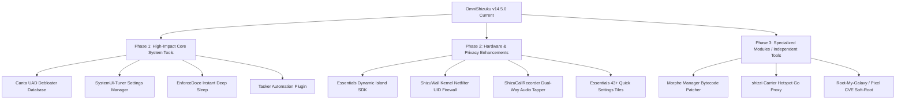

# OmniShizuku: Implemented Features vs. Remaining Roadmap Audit

> **Target Reference**: `/home/krishna/Downloads/tv/Shizuku implementations/ALL_REPOSITORIES_FEATURES_MASTER.md`  
> **Target Project**: `OmniShizuku` (`com.krishna.omnishizuku`)  
> **Audit Date**: 2026-10-24  
> **Total Repositories Analyzed**: 28

---

## Executive Summary

OmniShizuku has already merged the core capabilities of **8 flagship repositories** into a single cohesive super-app, including:
1. **Shizuku Official (01)**: Core daemon, Binder IPC wrapper, isolated `app_process` daemonization, TLS wireless ADB pairing, and PTY allocator.
2. **Shizuku-Next (02)**: Complete ADB Modules packaging engine, sandboxed script runner, module WebUI JavaScript bridge, and all 15 Labs features.
3. **ShizukuPlus (03 - Partial)**: Automated "Magic Setup" root app hijacker (`RootCompatHelper.kt`).
4. **Shizako (04)**: OpenGL/AGSL motion blur shaders, notification shade Quick Settings tiles, USB debugging auto-disable guard, and cyber-cat mascot branding with YouTube-style opening splash animation.
5. **Xhizuku (05)**: `NightDog.kt` watchdog daemon with `DeathRecipient` listeners, plus Android TV (Leanback) and Wear OS Compose layouts.
6. **Stellar (06 - Partial)**: Pure Kotlin on-device ADB client (`AdbStarter.kt`, `AdbClient.kt`), G2 smooth rounded corners, and home screen command shortcuts.
7. **Shevery (07 - Partial)**: Comput AI copilot agent, Commandium shell engine, Dhizuku Device Owner bridge, and anti-detection managers.
8. **Porter (08 - Partial)**: Porsh C++ pseudoterminal subsystem (`api/porsh/`), Kotlin DSL build configuration, and diagnostic probe module.
9. **InstallerX-Revived (10)**: Universal split package parser (`SeekableZipReader.kt`), APKS/APKM/XAPK/ZIP strategies, multi-authorizer session pipelines, and Room database persistence.
10. **InstallWithOptions (11)**: Low-level bitmask installation flag injection (`INSTALL_BYPASS_LOW_TARGET_SDK_BLOCK`, `INSTALL_ALLOW_DOWNGRADE`, `INSTALL_ALLOW_TEST`).
11. **ShizuStore (12)**: Curated Shizuku App Store catalog syncer, Room database cache, background silent APK installer, and Exodus privacy tracker auditing.

Below is the definitive catalog of **What is Already Added** versus **What Remains to be Added**, categorized with file paths and architectural implementation blueprints.

---

## PART 1: Features Already Added in OmniShizuku

| Subsystem | Sourced From | Key Files in OmniShizuku | Core Functionality |
| :--- | :--- | :--- | :--- |
| **Core Binder IPC & Daemon Engine** | Shizuku (01) & Shizuku-Next (02) | `server/src/main/java/rikka/shizuku/server/`, `manager/src/main/jni/` | Direct `CALL_TRANSACTION` bootstrap, kernel camouflage (`setAppName("shizuku_server")`), inotify APK observers (`ApkChangedObservers.kt`), standalone `app_process` child supervisor (`ShizukuUserServiceManager.java`), TLS wireless pairing (`adb_pairing.cpp`). |
| **ADB Modules Platform & WebUI Bridge** | Shizuku-Next (02) & Xhizuku (05) | `manager/.../module/ModulePackage.kt`, `AdbModuleManager.kt`, `ModuleJsBridge.kt`, `ModuleCatalog.kt` | Magisk-style ZIP module packaging, sandboxed script runner (120s timeout, 64KB cap, `ASH_STANDALONE=1`), background `service.sh` daemons, isolated WebView HTML5 WebUI with `@JavascriptInterface window.Shizuku` bridge. |
| **Complete 15 Labs Engines** | Shizuku-Next (02) | `manager/.../manage/`, `manager/.../ui/screen/` | Per-app zero-VPN firewall (`FirewallApi.kt`), autostart `RUN_ANY_IN_BACKGROUND` manager (`PackageTools.kt`), 6-layer anti-detection hiding modes (`Hiding.kt`), cleartext Wi-Fi password dumper (`WifiPasswords.kt`), privileged file explorer (`PrivilegedFileProvider.kt`), unexported activity assistant launcher (`Activities.kt`), force dark mode (`ForceDark.kt`), display resolution/DPI overrides (`DisplayScreen.kt`), advanced power reboot menu (`PowerScreen.kt`), on-device stealth APK stub generator (`StubApk.kt`), phantom process killer disabler (`PhantomProcessKiller.kt`), ADB without Dev Options, interactive shell library (`ShellCommands.kt`), and hardware diagnostics/logcat. |
| **Universal Split Package Installer** | InstallerX-Revived (10) | `manager/.../installerx/` | Memory-mapped non-extracting split reader (`SeekableZipReader.kt`), APKS, APKM, XAPK, and ZIP split strategies, multi-authorizer session manager (Root, Shizuku, Dhizuku), Dexopt optimization mode tracker, and Room database (`InstallerRoom.kt`). |
| **ADB Installation Flag Injector** | InstallWithOptions (11) | `manager/.../installoptions/` | Injects low-level PM bitmask flags: `INSTALL_BYPASS_LOW_TARGET_SDK_BLOCK` (`0x01000000`), `INSTALL_ALLOW_DOWNGRADE` (`0x00000080`), `INSTALL_ALLOW_TEST` (`0x00000004`), `INSTALL_REPLACE_EXISTING`, and `INSTALL_REQUEST_UPDATE_OWNERSHIP`. |
| **Curated Shizuku App Store** | ShizuStore (12) | `manager/.../store/` | Live `awesome-shizuku` catalog synchronization (`CatalogSyncer.kt`), Room database (`ShizuStoreDatabase.kt`), background silent installations via Shizuku (`ShizukuInstaller.kt`), Exodus tracker audit notices (`TrackersNotice.kt`), and Obtainium list exporter (`ObtainiumExporter.kt`). |
| **"Magic Setup" Root App Hijack** | ShizukuPlus (03) | `manager/.../rootcompat/` | Intercepts installed root tools (AdAway, AFWall+, Titanium Backup, Solid Explorer, Neo Backup) and redirects their internal `su` binary paths to Shizuku's privileged shell without requiring root access. |
| **High-Reliability Watchdog** | Xhizuku (05) | `manager/.../nightdog/NightDog.kt` | Background daemon registering `DeathRecipient` listeners to Android core services (`package`, `activity`, `user`, `appops`), executing automated exponential backoff rebinds on `system_server` crashes. |
| **Comput AI & Commandium Terminal** | Shevery (07) | `manager/.../comput/`, `manager/.../commandium/` | Integrated AI copilot terminal agent supporting Gemini, OpenAI, Claude, and local LLMs to generate, review, and explain privileged shell commands with natural language. |
| **Pure Kotlin On-Device ADB Client** | Stellar (06) | `manager/.../adbclient/` | In-app wireless ADB pairing and client (`AdbStarter.kt`, `AdbClient.kt`, `AdbKey.kt`) enabling self-activation without a PC. |
| **Porsh C++ PTY & Probe Subsystem** | Porter (08) | `api/porsh/`, `manager/.../diagnostics/` | Native Unix pseudoterminal master/slave allocator with termios mode and `ioctl(TIOCSWINSZ)` support, plus AIDL diagnostic probe (`ProbeService.kt`). |
| **Device Owner & Security Bridge** | Shevery (07) | `manager/.../dhizuku/`, `manager/.../security/` | Dhizuku Device Owner DPM delegation bridging, biometric authentication gate (`AuthManager.kt`), USB debugging hide manager, and screen-lock security. |
| **Multi-Platform TV & Wear UI** | Xhizuku (05) & Shizako (04) | `manager/.../ui/compose/`, `manager/.../tile/` | Leanback TV layouts (`TvComponents.kt`), Wear OS smartwatch screens, Material 3 Expressive UI (`ShizukuExpressive.kt`), AGSL directional motion blur (`MotionBlur.kt`), Quick Settings tiles (`ServiceTile.kt`, `WirelessAdbTile.kt`), and YouTube-style opening splash animation. |

---

## PART 2: Remaining Features (To Be Added)

The following features from `ALL_REPOSITORIES_FEATURES_MASTER.md` are **NOT** yet integrated into OmniShizuku and represent future milestone candidates:

---

### 1. Universal Android Debloater (UAD Engine)
* **Source Repository**: `Canta` (#27)
* **Source Location**: `/home/krishna/Downloads/tv/Canta`
* **Remaining Features**:
  1. **Community UAD Database Integration**: Bundles the community-vetted Universal Android Debloater catalog classifying system packages by risk profile:
     - `Recommended`: 100% safe to remove, zero system side-effects.
     - `Advanced`: Safe if alternative application (browser, keyboard) is installed.
     - `Expert`: Disables minor carrier or vendor features (VoLTE, OEM Cloud).
     - `Unsafe`: Essential for device bootloader or framework (will bootloop if deleted).
  2. **Multi-User Package Deletion**: Invokes `IPackageManager.deletePackageVersioned` and `setApplicationEnabledSetting` directly via Shizuku binder wrapper across all user profiles (User 0, Work Profiles, Secure Folders, Dual Apps).
  3. **1-Tap Non-Destructive App Restoration**: Deletes packages for `user 0` only (`pm uninstall -k --user 0`), allowing instant 1-tap uninstallation restoration without data loss via `pm install-existing`.
* **Target Integration in OmniShizuku**: `manager/src/main/java/moe/shizuku/manager/debloater/`

---

### 2. Zero-VPN Kernel Netfilter Firewall & Foreground Task Watcher
* **Source Repository**: `ShizuWall` (#21)
* **Source Location**: `/home/krishna/Downloads/tv/ShizuWall`
* **Remaining Features**:
  1. **Direct Kernel Netfilter UID Firewall (`IShizuWallUserService.aidl`)**:
     - Unlike standard Android VPN firewalls that drain 15–30% battery and add latency, this writes packet filtering rules directly to kernel `iptables` / `ip6tables` / `netd` chains under shell UID:
       - `setUidFirewallRule(int chain, int uid, int rule)`
       - `setUidFirewallRules(int chain, in int[] uids, in int[] rules)`
       - `setFirewallChainEnabled(boolean enabled)`.
  2. **Real-Time Foreground Activity Listener (`IShizuWallForegroundListener.aidl`)**:
     - Binds a real-time foreground task watcher (`startForegroundWatch()`, `getForegroundTask()`) to dynamically allow network access *only* when an app is visibly active on screen, cutting background data immediately upon minimizing.
* **Target Integration in OmniShizuku**: `manager/src/main/java/moe/shizuku/manager/firewall/kernel/`

---

### 3. Essentials Subsystems (Dynamic Island SDK, Hardware Mods & 20+ Engines)
* **Source Repository**: `essentials` (#26)
* **Source Location**: `/home/krishna/Downloads/tv/essentials`
* **Remaining Features**:
  1. **Dynamic Island SDK & Floating Hardware Overlay (`island-sdk/`, `island/`)**:
     - `IIslandHost.aidl` & `IIslandProvider.aidl`: Multi-process IPC protocol allowing apps to stream live activities into a floating pill around camera punch-holes.
     - `IslandOverlay.kt`: Floating surface with gesture detectors (swipe to dismiss, tap to expand).
  2. **Notification Edge Lighting & Pixel HiLight (`ui/features/lighting/`)**:
     - `NotificationLightingSettingsUI.kt`: Screen perimeter neon edge lighting on notifications.
     - `HilightController.kt`: Interacts with hardware notification ring LEDs on camera cutouts.
  3. **Sound & Haptics Engine (`ui/features/audio/`)**:
     - "Shut Up" media mute: Automatically pauses background audio when specified foreground apps open.
     - Smart notification snoozing with exponential backoff.
     - Now Playing "Like Song" bridge: 1-tap saving of ambient-detected songs to Spotify/YouTube Music.
  4. **Display Overclocking & AOD Preview (`ui/features/display/`)**:
     - Refresh rate locker (forces constant 120Hz/90Hz/60Hz, bypassing adaptive downclocking).
     - Always On Display real wallpaper preview and smooth luminance dimming.
     - Status bar icon auto-hider: Automatically hides clock/battery when Dynamic Island expands.
  5. **Hardware Buttons & Input Event Interceptor (`input/`)**:
     - Direct `/dev/input/event*` reader under shell UID (`InputEventReader.kt`).
     - Screen-off volume key long-press music track skipping (`VolumeLongPressDetector.kt`).
     - Pocket detection mode using light & proximity sensors to prevent pocket dials (`PocketModeSettingsUI.kt`).
  6. **Unified Battery Center & Caffeinate (`ui/features/battery/`, `ui/features/power/`)**:
     - Displays battery health, charge cycles, and connected Bluetooth accessories (buds, watches).
     - Caffeinate awake timer keeping screen on for 5, 10, 30 min or indefinitely.
     - Maps navigation power saving (wakes screen only 500m before navigation turn).
  7. **43+ Privileged Quick Settings Tiles (`services/tiles/`)**:
     - `PrivateDnsTileService`, `CaffeinateTileService`, `ShutUpTileService`, `UsbDebuggingTileService`, `ScreenOffTileService`, `MonoAudioTileService`.
  8. **Biometric Security & DRM Screen Recording Unlock (`ui/features/security/`)**:
     - DRM & Banking screenshot enforcer: Injects WindowManager flags to bypass `FLAG_SECURE`, allowing screenshots and screen recording in banking and streaming apps.
     - Emergency remote SMS lockdown.
  9. **Tag-Based Package Freezer (`ui/features/freeze/`)**:
     - Organizes apps into colored tags ("Social", "Games", "Banking") with 1-tap batch freeze/unfreeze using `pm disable-user --user 0`.
  10. **Core DIY Automation Engine (`domain/diy/`)**:
      - `Trigger.kt` (event-driven actions) and `State.kt` (dual entry/exit condition-driven rules).
      - Automation suggestion copilot (`GenAIAutomationService.kt`).
* **Target Integration in OmniShizuku**: `manager/src/main/java/moe/shizuku/manager/essentials/`

---

### 4. Non-Root Dual-Way Audio Stream Tapper
* **Source Repository**: `ShizuCallRecorder` (#16) & `ShizuTools` (#17)
* **Source Location**: `/home/krishna/Downloads/tv/ShizuCallRecorder`
* **Remaining Features**:
  1. **Privileged Audio Shell Service (`IShellService.aidl`)**:
     - Runs as Shizuku UserService under shell UID (2000):
       - `startRecording(in ParcelFileDescriptor outputFile, in RecordingPlan plan, in IRecordingCallback callback)`
       - `stopRecording()`, `pauseRecording()`, `resumeRecording()`.
  2. **Low-Level Audio Policy Routing Bypass**:
     - Taps `AudioSource.VOICE_COMMUNICATION` and `AudioSource.VOICE_CALL` directly from shell UID, bypassing Android 10+ microphone restrictions on non-system apps.
  3. **Automated AppOp & Role Injector**:
     - Programmatically executes `grantAppOpByPackage` and `grantRole` over Binder for `READ_PHONE_STATE`, `RECORD_AUDIO`, and `DIALER`.
  4. **Multi-Stream Mixed Audio Controller (`AudioOutputMap.kt`)**:
     - Interacts with `AudioSystem` / `AudioService` to control volume sliders for individual foreground and background apps independently.
* **Target Integration in OmniShizuku**: `manager/src/main/java/moe/shizuku/manager/audio/`

---

### 5. Unified SystemUI & Settings Storage Tweaker
* **Source Repository**: `SystemUI-Tuner` (#18)
* **Source Location**: `/home/krishna/Downloads/tv/SystemUI-Tuner`
* **Remaining Features**:
  1. **Unified Settings Table Manipulator (`IShizukuOperationsService.aidl`)**:
     - Direct read/write across `Settings.Global`, `Settings.Secure`, and `Settings.System`:
       - `writeGlobal(key, value, pkg)`, `writeSecure(key, value, pkg)`, `writeSystem(key, value, pkg)`
       - `readGlobal(key)`, `readSecure(key)`, `readSystem(key)`, `listSettings()`.
  2. **Lock Screen Shortcut Overrider (`ILockscreenShortcutSelectedCallback.aidl`)**:
     - Modifies vendor-locked lock screen shortcut buttons (One UI, Pixel, HyperOS) to launch custom apps, activities, or shell commands.
  3. **Status Bar Icon Blacklist & Immersive Mode (`IImmersiveSelectionCallback.aidl`)**:
     - Injects `icon_blacklist` system keys to selectively hide intrusive status bar icons (VoLTE, NFC, Alarm, Battery).
     - Forces full-screen immersive mode per application or globally.
  4. **Custom System Sound Injector (`IUISoundSelectionCallback.aidl`)**:
     - Injects custom system audio files for charger connect, screen lock/unlock, and camera shutter directly into `/data/system/media/audio`.
* **Target Integration in OmniShizuku**: `manager/src/main/java/moe/shizuku/manager/tuner/`

---

### 6. Deep Idle Enforcer & Significant Motion Sensor Kill
* **Source Repository**: `EnforceDoze` (#24)
* **Source Location**: `/home/krishna/Downloads/tv/EnforceDoze`
* **Remaining Features**:
  1. **Instant Deep Doze Enforcer**:
     - Bypasses Android's 30-minute idle inactivity delay by executing `dumpsys deviceidle force-idle deep` the instant the screen powers off.
  2. **Significant Motion Sensor Disabler**:
     - Inactivates device motion sensors (`dumpsys deviceidle disable motion`), preventing movement in pockets or cars from breaking deep sleep state.
  3. **Complete Doze Tunable Registry (`DozeTunableHandler.java`)**:
     - Exposes and adjusts all 28 hidden parameters in `device_idle_constants` (`inactive_to`, `sensing_to`, `locating_to`, `motion_inactive_to`, `idle_to`, etc.).
  4. **Battery Drain Instrumentation (`DozeBatteryStatsActivity.java`)**:
     - Real-time battery consumption tracking, logging discharge rates (mA/h) across active vs doze cycles.
* **Target Integration in OmniShizuku**: `manager/src/main/java/moe/shizuku/manager/doze/`

---

### 7. Private DNS-over-TLS Controller & NextDNS Synchronization
* **Source Repository**: `ADNS` (#19) & `Quick-Tile-Settings` (#25)
* **Source Location**: `/home/krishna/Downloads/tv/adns`
* **Remaining Features**:
  1. **Zero-VPN DNS Switching**:
     - Modifies `Settings.Global.private_dns_mode` (`off`, `opportunistic`, `hostname`) and `private_dns_specifier` via privileged Shizuku IPC.
  2. **NextDNS API Sync**:
     - Bidirectional profile synchronization with NextDNS, fetching real-time query analytics and toggling blocklists.
  3. **Multi-Host Private DNS QS Tile**:
     - Quick Settings tile cycling between Cloudflare, AdGuard, NextDNS, and Off directly from the notification shade.
* **Target Integration in OmniShizuku**: `manager/src/main/java/moe/shizuku/manager/dns/`

---

### 8. Dedicated Tasker Automation Plugin
* **Source Repository**: `shevery` (#07)
* **Source Location**: `/home/krishna/Downloads/tv/Shizuku implementations/shevery/tasker`
* **Remaining Features**:
  1. **Tasker IPC Contracts (`PluginContract.kt`, `PluginReceiver.kt`)**:
     - Listens for Tasker intents: `FIRE_SETTING`, `QUERY_CONDITION`, `DIRECT_START`, `DIRECT_STOP`, `DIRECT_RESTART`, `DIRECT_TOGGLE`.
     - Executes privileged background commands and returns standard output and exit codes as Tasker variables (`%stdout`, `%stderr`, `%exitcode`).
  2. **Interactive Action Editor (`EditActivity.kt`)**:
     - Rich UI for configuring commands, timeouts, error policies, and variable mappings within Tasker.
* **Target Integration in OmniShizuku**: `manager/src/main/java/moe/shizuku/manager/tasker/`

---

### 9. Rootless Carrier Hotspot Bypass & Go Datapath Proxy
* **Source Repository**: `shizzi` (#22)
* **Source Location**: `/home/krishna/Downloads/tv/shizzi`
* **Remaining Features**:
  1. **Carrier Hotspot Restriction Bypass (`ITetherService.aidl`)**:
     - Privileged service controlling Wi-Fi tethering and interface bypass without root.
  2. **Native Go Datapath Proxy**:
     - Compiled Go networking core that intercepts outbound tethered client packets and rewrites IP TTL/Hop-Limit headers to match mobile handset traffic, bypassing carrier hotspot limits.
  3. **Tethering APEX Package Manager**:
     - Stages and installs customized `com.android.tethering` APEX modular system updates.
* **Target Integration in OmniShizuku**: `manager/src/main/java/moe/shizuku/manager/tether/`

---

### 10. Dalvik/JVM Bytecode Patcher & Direct Shizuku Deployment
* **Source Repository**: `morphe-manager` (#13)
* **Source Location**: `/home/krishna/Downloads/tv/morphe-manager`
* **Remaining Features**:
  1. **Dual-Runtime Execution Engine (`IPatcherService.aidl`)**:
     - Decouples resource-heavy bytecode modifications into a standalone JVM/ART process (`startJvm()`, `startArt()`) over Linux pipe descriptors (`ParcelFileDescriptor`).
  2. **ASM & Smali Bytecode Modification**:
     - On-device DEX bytecode manipulation, method hooking (`onCreate`, `onDraw`), and multidex merging.
  3. **On-Device APK Signer Scheme v2/v3**:
     - Generates keystores on device, signs repacked APKs, and streams them directly into Shizuku `PackageInstaller`.
* **Target Integration in OmniShizuku**: `manager/src/main/java/moe/shizuku/manager/patcher/`

---

### 11. Soft-Root Loaders (Samsung & Pixel CVE-2026-43499)
* **Source Repositories**: `Root-My-Galaxy` (#14) & `Root-My-Pixel` (#15)
* **Source Locations**: `/home/krishna/Downloads/tv/Root-My-Galaxy`, `/home/krishna/Downloads/tv/Root-My-Pixel`
* **Remaining Features**:
  1. **IonStack Kernel Exploit Harness (`CVE-2026-43499`)**:
     - Local kernel memory privilege escalation allowing temporary root without unlocked bootloaders.
     - **Samsung Zero-Knox**: Keeps Knox warranty bit `0x0`, preserving Secure Folder and Samsung Pass.
     - **Pixel Tensor Support**: Exploit profile matrix matching Tensor G1–G5 kernels (`6.1`, `6.6`, `6.12`).
  2. **KernelSU / ReSukiSU Dynamic Stager**:
     - Uses Shizuku UID 2000 to stage `ksud` binary into `/data/local/tmp` and executes late-loading (`ksud late-load --kmi <kmi>`).
* **Target Integration in OmniShizuku**: Standalone optional utility module or advanced diagnostic tab.

---

### 12. ShizukuPlus Enterprise Server Extensions & Audit Room DB
* **Source Repository**: `ShizukuPlus` (#03)
* **Source Location**: `/home/krishna/Downloads/tv/Shizuku implementations/ShizukuPlus`
* **Remaining Features**:
  1. **Activity Log Room Database (`ActivityLogDatabase.kt`, `ActivityLogDao.kt`)**:
     - Records every privileged Binder transaction, caller UID, method signature, latency, and timestamp for enterprise security audits.
  2. **Script Snippet Database (`ScriptSnippetDatabase.kt`, `ScriptSnippetDao.kt`)**:
     - Persistent storage for reusable user shell scripts.
  3. **Extended Server Daemon Services**:
     - `AICorePlusImpl.kt`: Privileged on-device AI model daemon.
     - `VirtualMachineManagerImpl.kt`: Microdroid and VM isolation manager.
     - `ApkBinaryXmlPatcher.kt`: In-memory and on-disk binary XML patching for APK manifests.
* **Target Integration in OmniShizuku**: `server/src/main/java/rikka/shizuku/server/` & `manager/.../database/`

---

## PART 3: Strategic Recommendation & Phasing Matrix

To keep OmniShizuku lightweight, ultra-stable, and compileSdk 37 compatible, the remaining features should be prioritized into the following phases:

### Phase 1 Priority (Immediate Value):
1. **Canta UAD Debloater**: Universal package debloating is one of the top reasons users install Shizuku. Embedding the UAD database directly inside OmniShizuku eliminates the need for a separate app.
2. **SystemUI-Tuner Settings**: Direct read/write to `Settings.Global`, `Secure`, and `System` with lock screen shortcut overrider.
3. **EnforceDoze Deep Sleep**: 1-tap instant battery saving by forcing deep idle and disabling motion sensor waking on screen lock.
4. **Tasker Plugin**: Restoring Tasker IPC contracts allows power users to automate OmniShizuku commands seamlessly.

### Phase 2 Priority (User Experience & UI Polish):
1. **Dynamic Island SDK & Heads-Up Overlay**: Floating pill around punch-holes with live music and notification visualizers.
2. **Kernel Netfilter Firewall**: Direct kernel-level UID network blocking without VPN overhead.
3. **Audio Policy Stream Tapper**: In-app call recording and per-app volume sliders.
4. **Quick Settings Tile Suite**: Expanding from 2 tiles to 15+ essential QS toggles.

### Phase 3 (Specialized / Standalone Tools):
1. **Morphe Manager & ReVanced Patcher**: Best kept modular due to large DEX/ASM bytecode engine size.
2. **Carrier Hotspot Go Datapath**: Requires compiled Go binary toolchain (`shizzi`).
3. **CVE-2026-43499 Soft-Root Loaders**: Device-specific kernel exploits that carry risk and should remain opt-in advanced modules.
